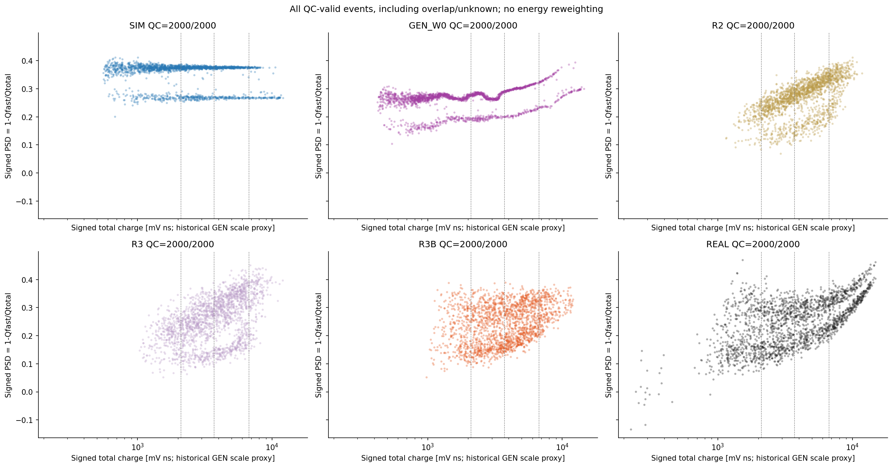
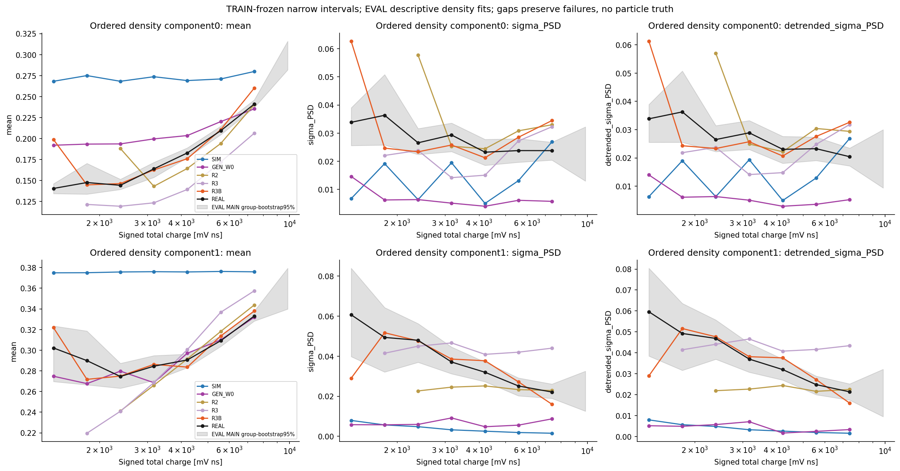
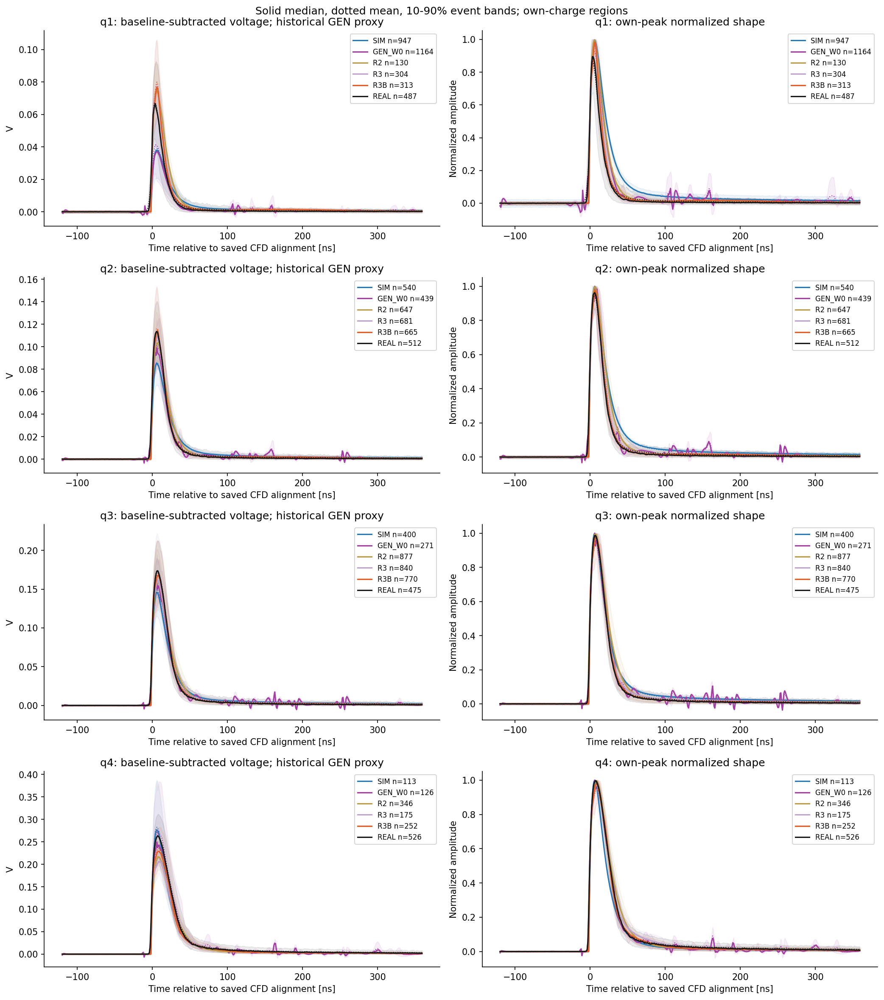
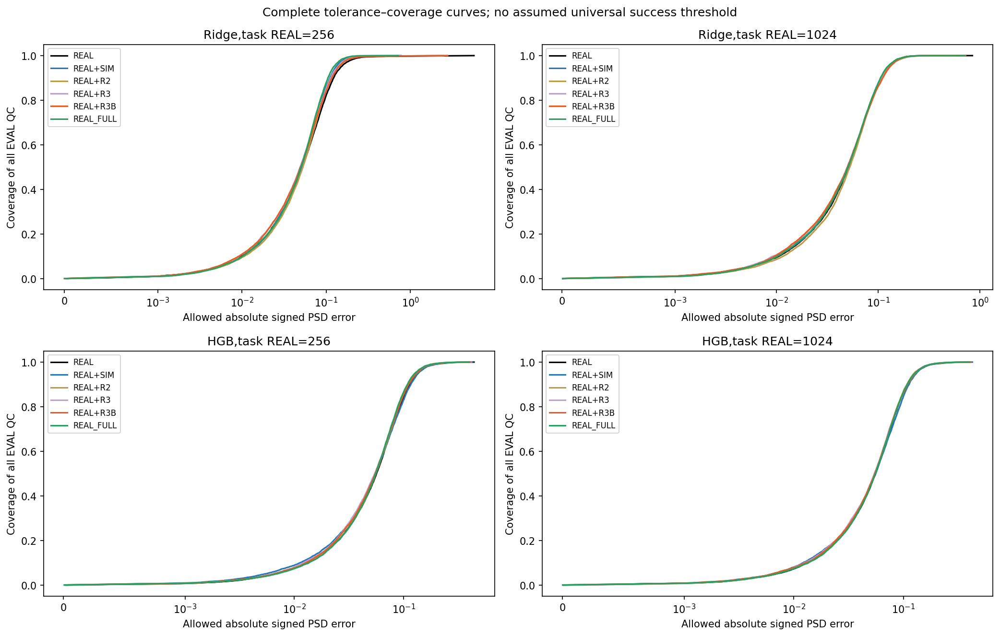
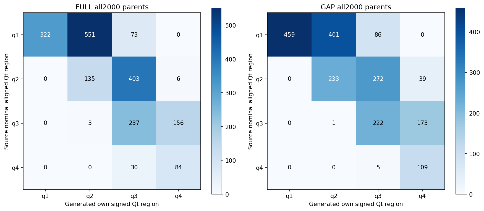
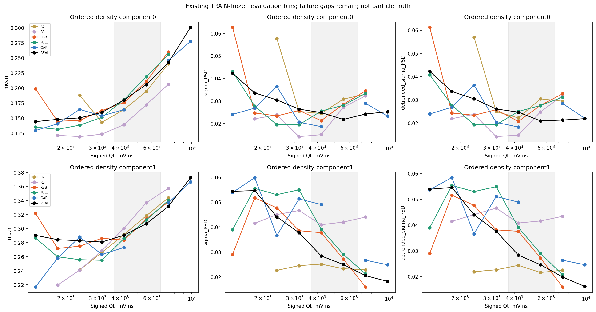

# G4 到 EJ-276D 实测响应：结果与交付

2026-10-08。本轮预定研究、保存模型重放和关键结果检查已完成。本文汇总当前单次 AmBe 采集内的响应变换、最终留出评价、合成数据效用和连续电荷区间排除实验；文件入口及证据对应关系见 [交付索引](DELIVERY_INDEX.json)。

已完成结果支持：学习变换明显改善若干分布，条件峰宽也有局部改善；完整响应尚未匹配实测。合成数据的下游收益依赖样本量、估计器与预测目标。这里的“完成研究”与“响应相似性成功”是不同结论；失败与未定义结果均保留，不据留出数据继续挑选配方。

## 方法、数据与共同定义

方法接收既有 G4 父事件的沉积分量、可见能量代理和分析响应电荷，学习条件脉冲形状、幅值及随机变化。R2 使用平滑衰减核混合与随机响应；R3 增加连续时间形状修正；R3B 在相同结构上加入电荷条件 PSD 的软窗口 CDF 与占比损失。噪声谱与噪声幅度统计来自允许的实测 TRAIN。每条生成波形保留原 G4 父事件身份，实测波形不是生成器的逐事件输入。

现有 G4 导出仅保留非零沉积/触发条件，本次没有新 G4 仿真，不能由这批输出推断全入射历史的探测效率。固定 2000 父事件的旧标签为 neutron 1683、gamma 桶 317；该 gamma 桶按原生产规则表示“非 2112”，不能改称全为 PDG 22。原标签、EE/hadron 沉积及身份映射均保留，不以实测伪标签重新赋予物理真值。

这是一种无配对分布拟合。G4 与实测没有一一对应的事件真值，不使用随机配对波形 MSE 来定义转换误差，也未识别出唯一的物理传递函数。电压幅度包含学得的响应标度，不能写成独立探测器标定；积分电荷、可见能量代理和入射中子能量必须区分。

所有对象使用相同保存接口与评价：1 ns 采样、480 点窗口、自身前 100 点基线，快积分 `100:150`，总积分 `100:400`，signed `PSD=1−Qfast/Qtotal`。共同 QC 后的 unknown/重叠事件进入完整分布评价；高置信 CCM 伪标签只作辅助参考。固定 CAL 的 q4 参考拟合失败继续记为 undefined，不补粒子标签。

| 角色 | 本次有效记录数与用途 |
| --- | --- |
| REAL TRAIN | 3191，其中 2592 拟合、599 组隔离内部验证；只在允许角色内估计尺度、噪声和训练目标 |
| REAL CAL | 1594，固定电荷分区与参考切点；不因后续结果重拟合 |
| REAL DEV | 2000，开发诊断；已经用于架构研究，不能重新称为盲测 |
| REAL EVAL | 预定 7600 条，7583 通过 QC；R4 主比较按身份哈希固定 2000 条，R5 用全部有效记录 |
| G4 TRAIN | 8192 个父事件，6593 拟合、1599 验证；与 G4 DEV 不交叠 |
| G4 DEV | 固定 2000 个父事件，各响应候选共用；用于最终响应比较时也不是新 G4 采集 |

实测来自同一次历史采集，50 条记录组成的人工组用于隔离和重采样，不是独立采集批次。历史逐事件暴露范围 unknown；当前训练隔离证明不能替代外部盲测。R4 解码 EVAL 之前已登记 [FROZEN_METHOD.json](FROZEN_METHOD.json)，固定 SIM、W0、R2、R3、R3B 及 R4/R5/R6 任务；EVAL 不用于新的响应方法选择。

## 留出实测的响应比较

R4 对各固定域分别用 2000 条，与固定 REAL 2000 条比较。二维距离是 TRAIN 尺度标准化后的 `(log Q, PSD)` 128 方向 sliced Wasserstein；单变量 W1 保留原量纲。

| 固定候选 | PSD W1 | 电荷 W1 / mV ns | 上升时间 W1 / ns | 二维 sliced W1 | 形状 C2ST 平衡准确率 |
| --- | ---: | ---: | ---: | ---: | ---: |
| 原 SIM | 0.104569 | 1978.08 | 1.75160 | 0.949681 | 0.998 |
| 历史 W0 | 0.045630 | 2299.43 | 0.70382 | 0.754878 | 0.998 |
| R2 | 0.023172 | 1072.89 | 0.73863 | 0.316658 | 0.992 |
| R3 | 0.008206 | 1089.28 | 0.33467 | 0.207795 | 0.996 |
| R3B | 0.013729 | 945.34 | 0.14620 | 0.199078 | 0.988 |
| REAL–REAL | 0.003135 | 99.88 | 0.07548 | 0.036285 | 0.504 |

REAL–REAL 的距离是 64 次互斥组、2000 对 2000 的中位数，C2ST 是固定一次分组的结果，二者不是同一种汇总量。其二维距离 5–95% 范围为 0.024972–0.058952；R3B 的 0.199078 仍明显更大。该范围仅表示当前采集内抽样差异，不是物理等效界或任务成功线。

独立 C2ST 每域 600 训练、250 留出，按 G4 父事件及实测组隔离，并有 REAL–REAL 阴性对照和预定扰动阳性对照。R3B 的形状/含幅值两视图 BA 均为 0.988，条件组 bootstrap 95% 区间均约 0.978–0.996；REAL–REAL 为 0.504/0.528，阳性对照为 0.996/0.996。评价器未与响应模型联合训练。这个结果清楚否定当前完整响应已经相似；也不能把某次 C2ST 接近随机反过来当作物理等效证明。

R3B 的 q1–q4 数量为 313/665/770/252，实测为 487/512/475/526。低端与高端覆盖不足、谱形与类别组成混合仍影响总体距离，不能只比较好看的条件切片。完整分区统计、FoM、峰位/宽度、原电压和峰归一化波形均见 [R4 报告](work/R4_FROZEN_HELDOUT_RESPONSE_001/REPORT.md) 与 [指标](work/R4_FROZEN_HELDOUT_RESPONSE_001/metrics.json)。

在相同全局固定切点下，R3B 低 PSD 侧占 51.5%，REAL 为 47.85%；高置信低/高/unknown 计数分别为 694/525/781 与 666/372/962。整体带比例和 unknown 占比没有同时匹配。这些是响应分布的操作性组成，不能与上述 G4 物理来源桶直接等同，也不足以证明中子/伽马逐事件标签正确。

## 峰宽随电荷的变化

用户指出的两峰随能量升高收窄，在本次实测的电荷代理上得到支持。诊断使用 TRAIN 冻结的 8 个窄 logQ 区间，按均值排序的两个密度成分拟合原宽度，并去除区间内峰位随 logQ 漂移后再评价宽度。两个密度成分不等同粒子真值；不合格或未收敛拟合保留缺口，不改门槛补点。

R3B 在开发集共同合格的第 2–7 区，将低/高成分原 sigma 的 MAE 从 R3 的 0.007507/0.013381 降为 0.005017/0.004390。该比较使用同一支持集合，是局部描述性改善。留出 EVAL 也保留总体收窄趋势，但 R3B 最低区低成分 sigma 为 0.062704，实测 0.033848；第 7 区低成分 sigma 为 0.034472，实测 0.023771，仍明显偏宽。最高第 8 窄区本次 REAL 和 R3B 的单次 EM 均未收敛，宽度 undefined。

因此，模型使用能量相关输入、输出与能量相关、以及正确学习条件峰宽，是三个不同层次。R3B 的可见能量代理与输出电荷 Spearman 相关为 0.92586，强子可见分量占比与 PSD 相关为 0.60880；这些关联说明输入未被完全丢弃，却不能证明每个区间的响应正确。固定随机变量的能量/组成条件对也已保存，全部父事件继续参与评价，不以反复生成挑选输出。

## 条件波形与噪声

R3B 的全局上升时间和尾部部分特征更接近实测，W0 的固定时间纹理已经消除；但分区前沿/峰后细节仍有偏差。R3B q1/q4 的上升时间 W1 分别为 1.64992/1.21732 ns，明显大于全局的 0.14620 ns，全局改善不能替代条件比较。

R3B 的基线 RMS W1 为 0.00001604 V，而 REAL–REAL 中位为 0.00000373 V；ACF1 W1 为 0.06194，对应实测参照中位为 0.00573。生成的 lag-1 相关中心仍偏正，实测偏负。已有 RMS、频谱、自相关和条件均值/中位/10–90% 范围图一起保留；幅度接近不能推出相关结构已经匹配。

## 合成数据对实测重建任务的价值

R5 只使用前 150 点构造输入：前 100 点基线及 RMS、随后 50 点前沿的前缀峰归一化值与峰幅。预测目标是完整 `100:400` 窗口的 PSD 和 logQ。原数据已经过全波形 CFD 对齐，所以这是固定离线前缀重建任务，不能直接声称因果触发或 FPGA 在线收益。

预先固定 256/1024 两个嵌套 REAL 子集、REAL-only 与 +SIM/+R2/+R3/+R3B 五臂、Ridge/HGB 两估计器、两目标，并加入全部 2592 REAL 的对照，共 44 次拟合。四合成臂使用同一 2000 个 G4 TRAIN 父事件；所有估计器及尺度保存后，才对 7583 条 EVAL 单次预测。

| 实测预算与估计器 | REAL-only PSD MAE | +SIM | +R2 | +R3 | +R3B | 全部 2592 REAL |
| --- | ---: | ---: | ---: | ---: | ---: | ---: |
| 256 / Ridge | 0.069210 | 0.057754 | 0.062633 | 0.059258 | 0.061745 | 0.055386 |
| 1024 / Ridge | 0.055960 | 0.055916 | 0.057528 | 0.055848 | 0.055947 | 0.055386 |
| 256 / HGB | 0.061196 | 0.061476 | 0.060334 | 0.059417 | 0.060035 | 0.059595 |
| 1024 / HGB | 0.059864 | 0.060619 | 0.059199 | 0.058869 | 0.059307 | 0.059595 |

256 条 Ridge 的 +R3B PSD MAE 差值为 −0.007464，条件组 95% 区间 [−0.009586,−0.005572]；原 SIM 的改善更大。1024 条 Ridge 的 +R3B 差值约 −0.000013，区间跨零，电荷 MAE 则从 327.496 升至 331.528 mV ns。1024 条 HGB 的 +R3B PSD MAE 小幅下降，但电荷 MAE 从 819.404 升至 853.398 mV ns。没有统一占优的增强方法，响应距离改善也不自动转化为全部任务收益。

误差 CDF、各分区、RMSE 与尾部误差一起保留：256 条 REAL-only Ridge 的电荷 RMSE 为 27890.08 mV ns，少数极端误差没有事后裁掉。原 SIM 这次生成有 248/2000 量化截幅，仍按原发生器和固定 QC 纳入；R2/R3/R3B 该批无截幅。切点翻侧约 31% 是相对完整积分参考的差异，并非粒子真值错误率。

任务容许误差以误差–覆盖曲线和距切点 margin 来表达，没有凭空规定统一 1% 或 FoM 成功线。若业务给出 PSD、电荷或切点误差预算，可以直接在固定结果中读出覆盖与风险；本次结果自身不能替业务设定接受标准。组 bootstrap 条件于这次训练好的估计器，不含重新拟合或跨采集不确定性，也未作多重比较校正。

256/1024 是下游任务拟合子集，不能写成总实测采集成本。响应开发还使用 TRAIN 3191、CAL 1594、DEV 2000；原 SIM 噪声标度/谱还继承了历史 79793 条实测先验。详见 [R5 报告](work/R5_PREFIX_RECONSTRUCTION_UTILITY_001/REPORT.md)。

## 连续电荷区间排除

R6 固定排除 q3=[3703.7782948464155,6711.804904974998) mV ns。FULL/GAP 从相同已保存可学习初始参数各完成 R2 1600→R3 2000→R3B 2000 更新，共 11200 更新；各阶段仅用本臂允许的 TRAIN 内部验证选点。没有加载历史全区间已训练权重。

GAP 从拟合/验证中剔除 REAL 698/146 条和 G4 968/220 个父事件，剩余 REAL 1894/453、G4 5625/1379，两侧区间保留。G4 排除依据为未学习的分析响应、共同对齐 `100:400` 名义电荷；REAL 使用自身积分电荷。两臂可学习参数的初始摘要相同，共同初值只用 GAP 允许的拟合数据取得，噪声谱等固定 buffer 则由本臂允许的拟合数据分别估计，FULL 的区间内统计没有复制给 GAP。尺度、CDF 和内部验证也遵守排除。

所有模型和主生成先保存，再使用 EVAL 评价。全部 7583 条有效 EVAL 中，q3 有 1955 条、覆盖 152 个人工组；两臂各 2000 个输出全部通过 QC，均无截幅或补边。按输出自身电荷落在 q3 的主比较为：

| q3 指标 | FULL | GAP |
| --- | ---: | ---: |
| 输出 q3 数量 / 2000 | 743 | 585 |
| PSD W1，相对 REAL q3 | 0.005036 | 0.008257 |
| 电荷 W1 / mV ns | 35.247 | 50.290 |
| 上升时间 W1 / ns | 0.93427 | 1.96544 |
| 尾电荷比例 W1 | 0.005350 | 0.013992 |
| 固定切点 FoM | 0.72444 | 0.71790 |
| 形状 / 含幅值 C2ST BA | 1.000 / 1.000 | 1.000 / 1.000 |

REAL q3 固定切点 FoM 为 0.84809。C2ST 每域 200 训练、100 留出；这里的 1.000 是有限留出样本上的结果，重采样区间退化为 [1,1] 不表示真实总体准确率已知为 100%。对应各生成数量都完成 64 次同样本量 REAL–REAL 比较：585 条时 PSD W1 中位 0.003428、5–95% 0.002060–0.006961；743 条时中位 0.003021、5–95% 0.001747–0.006285。两组完整响应均存在明显失配，当前结果不支持可靠的完整区间响应推广。

输出条件选择不能覆盖源条件迁移。固定源名义 q3 的 396 个父事件，其全部输出均保留：FULL 有 237 个落回 q3、156 个迁到 q4、3 个到 q2；GAP 对应为 222/173/1。对这全部 396 个输出与同一 REAL q3 比较，PSD W1 为 FULL 0.021660、GAP 0.017072，排序与上表相反。源名义电荷和实测电荷没有逐事件配对标定，这个补充比较显示条件定义及迁移会改变结论，不能把一张输出区间表写成所有方面均退化或成功。

q1/q2/q4 控制保留在指标与图中，变化并非单向：例如 GAP q4 电荷 W1 从 FULL 的 1583.20 降至 546.42 mV ns，但其上升时间 W1 从 1.53073 升至 3.33183 ns。窄区间峰宽同样没有全面匹配：GAP 第 6 区 EM 未收敛，FULL 第 8 区低密度成分有效数不足 20；失败继续 undefined。R6 的 REAL 窄区间图使用全部 7583 条 EVAL，因此最高区拟合支持与 R4 主比较的 2000 条不同，不回填 R4 的缺失值。

这是一次当前拟合排除连续电荷区间的配对回顾实验。CAL/历史标度先验以及全区间 DEV 的架构开发已经存在，不能称整个研究历史从未见过该区间，更不能称入射中子能量或跨真实工况推广。单种子、单区间结果限制了训练稳定性与更广区间的推断；不据本次 EVAL 增加训练或另挑区间。

完整执行与各冻结参照见 [R6 报告](work/R6_CHARGE_GAP_GENERALIZATION_001/REPORT.md) 及 [紧凑指标](work/R6_CHARGE_GAP_GENERALIZATION_001/METRICS_COMPACT.json)。完整逐事件排除清单与指标保留本地。

## 可复现产物与结论边界

源码、冻结定义、配置、各阶段报告、紧凑指标和图使用私有 [GitHub 仓库](https://github.com/Aggressivecyber/ej276d-sim2real) 管理。逐事件波形、模型、随机状态、原生回执及缓存位于 `E:/GAN/research/sim2real_two_papers_20261008_0305`；克隆 GitHub 不包含数据和模型载荷。

[REPRODUCTION.md](REPRODUCTION.md) 提供独立副本中的固定推理入口。R3/R3B 保存权重、固定输入及 RNG 的完整 2000×480 主生成已在独立进程逐位重放；R5 的 44 个保存估计器对 64 条前缀输入共 2816 个预测值逐位一致；R6 两臂各 2000×480、合计 1920000 个值也逐位一致。R2 原始构造前的 Torch 初始化未记录，不能声称其从头训练逐位可复现；保存权重的复载证据及后续固定输入依赖如实保留。重放通过说明实现及产物可追溯，不说明物理真实性通过。

本次工作未建立跨采集、跨真实工况、入射能量推广、独立粒子真值正确性或总采集成本节省的证据。主结果是可复现的条件响应原型、具体改善、明确残余失配，以及任务与区间适用范围的实验结论。后续若另立新研究问题，应针对这些失败证据重新登记验证，不能继续利用本次 EVAL 迭代并沿用“最终留出”称谓。
