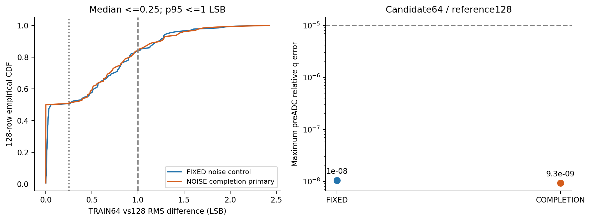

# R48 结果：数值前提失败，模型目标未完成

固定主候选 GUIDED_NOISE_COMPLETION 与等预算对照 GUIDED_FIXED_NOISE_CONTROL 均完成从零训练50000次更新。两臂未通过事先固定的64/128步积分一致性门，按协议在DEV之前关闭。第三个方法名额已经使用，本改进块停止新增科学作业。

| 固定末点 | RMS中位数（LSB，≤0.25） | RMS P95（LSB，≤1） | 最大相对电荷误差（≤1e-5） | 数值判定 |
|---|---:|---:|---:|---|
| 等预算对照 | 0.158880 | 1.332799 | 1.040213e-8 | 失败 |
| 主候选 | 0.116197 | 1.449824 | 9.337949e-9 | 失败 |

每臂检查同一组SOURCE/REAL TRAIN各64条，64步是候选，128步仅为参考。没有更高步数搜索，也没有选择中间checkpoint或对照赢家。上述是固定数值配方的负结果，尚不能判定噪声补全机制无效。

两臂共享初始化、全部七项训练索引/随机流、guide、REAL身份路径、谱核和各0.5的SOURCE/IDENTITY损失。唯一臂间差别为初态创新方差 tau² 与 max(tau²−v(input),0)。两臂的SOURCE首/末批MSE分别为1.488745→0.571175和1.488745→0.571149；IDENTITY分别为0.219879→0.000632975和0.000821378→0.000056315。IDENTITY速度目标不同，较低MSE不能证明输出稳定。首末批数值也不是完整人口的收敛保证。

校准及训练实际使用3752个unique SOURCE父事件和18739条unique REAL；加载容器6593/21047另行记录。每臂SOURCE、matched REAL及REAL身份路径各有160万行训练曝光，重复曝光不增加独立人口。真实逐事件跨域对应关系和物理噪声识别均未获得。

| 原验收项 | R48结果 |
|---|---|
| A 完整SOURCE和REAL响应 | 未评价；无DEV输出或HGB拟合 |
| B PSD、条件峰宽、噪声 | 未评价；无DEV输出或EM拟合 |
| C 源信息、边界、数值可信 | 数值前提失败；其余本轮未评价 |
| D 下游效用 | 未登记执行；没有A–C合格模型 |
| E FULL/GAP适用范围 | 未登记执行；没有A–C合格模型 |
| F 可复现交付 | 本轮负结果与两组末点已封存；私有Git与D复制以实际交付回执为准；尚无满足A–F的最终模型 |

R48新增DEV推理、HGB、EM和主输出独立重放均为0。已完成TRAIN求解器前向98304行，不能把它记作8000条主输出重放。EVAL读取与CAL波形解码均为0，原源组成/权重和旧失败结论不变。

本阶段6个计费作业均原生退出0（原生执行成功与科学判定通过分别记录）。科学总耗时3181.818013416秒，训练守护累计3103.261651秒。改进块累计6380.315270759/90000秒，训练3/6次，方法3/3项。阶段186文件、44,449,915 B。观察到的worker RSS峰值1,991,344,128 B，GPU allocated/reserved峰值681,300,992/746,586,112 B；两次RSS查询缺口原因仍为unknown，不能称连续监控无缺口。

四张TRAIN图已实际打开复核，噪声规则图统一0–0.60 mV坐标后重新打开，原图另名保留。未为缺失的DEV结果补画成功图。

[训练曲线](work/R48_GUIDED_NOISE_COMPLETION_FLOW_001/results/figures/training_source_identity.png) · [噪声算子](work/R48_GUIDED_NOISE_COMPLETION_FLOW_001/results/figures/TRAIN_noise_operator.png) · [初态噪声规则](work/R48_GUIDED_NOISE_COMPLETION_FLOW_001/results/figures/TRAIN_initial_noise_rule.png)

下一次科学执行须有另行明确的有限计划及资源范围；不能借尚余的科学时间/训练次数绕过已耗尽的方法上限。新证据首先需要说明如何同时满足数值可信和原完整响应要求，再决定是否另行开展实验。本轮没有预先授权新方法、重训或更大步数搜索。

可复核入口：[执行器报告](work/R48_GUIDED_NOISE_COMPLETION_FLOW_001/REPORT.md)、[数值结果](work/R48_GUIDED_NOISE_COMPLETION_FLOW_001/TRAIN_SOLVER_CHECK.json)、[训练摘要](work/R48_GUIDED_NOISE_COMPLETION_FLOW_001/TRAINING_COMPACT.json)、[资源回执](work/R48_GUIDED_NOISE_COMPLETION_FLOW_001/RESOURCE_RECEIPT.json)、[原生退出链](work/R48_GUIDED_NOISE_COMPLETION_FLOW_001/NATIVE_CHAIN.json)、[复现说明](work/R48_GUIDED_NOISE_COMPLETION_FLOW_001/REPRODUCTION.md)、[根复核](reviews/ROOT_R48_KEY_RESULT_REVIEW_001.json)、[原A–F](PROJECT_ACCEPTANCE.md)。config.json继承的new_response_training_runs=0仅为非生效历史元数据；真实两次训练以原生回执及TRAINING_COMPACT为准，冻结配置未为美化计数而改写。

所有本机新增数据/源码/日志/缓存/临时文件保留E/D；原始和封存资料未覆盖。科学产物在E及已用服务器新目录保存；原始输入为既有依赖，D增量不应宣称重新归档了所有外部原始数据。恢复入口并不代表执行过恢复测试。模型目标仍未完成。
