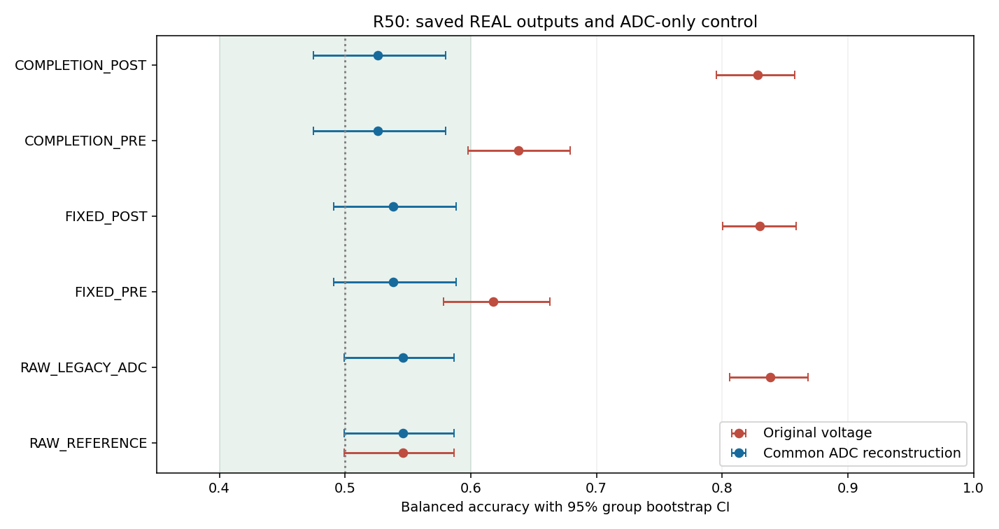
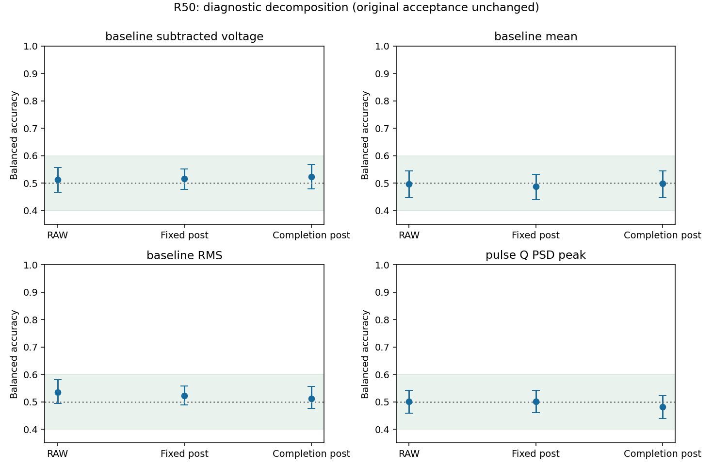
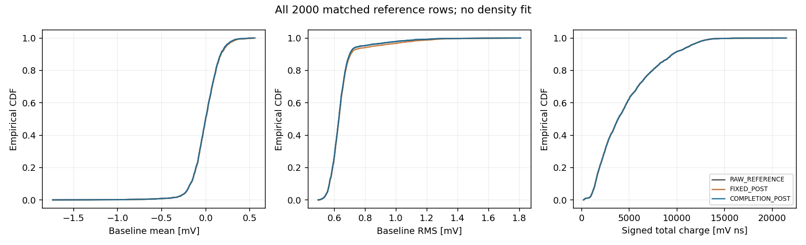

# R50：ADC 表示干扰已得到受控验证

24个预登记HGB比较已在服务器完成，新增响应训练、生成和密度拟合均为0。原始REAL参考只经过旧float32 ADC后，全部960000个样点的整数码保持不变，但BA从0.546升到0.838；平均波形RMS变化仅1.5624e-8 V。共同按整数码以float64重建后，BA恢复0.546，特征和预测与相同重建的RAW完全一致。这支持数字表示产生了强判别信号。

主候选REAL输出原电压BA=0.828，共同重建后0.526，95%区间[0.4745,0.5797]；配对变化为-0.302，95%区间[-0.3502,-0.2379]。固定噪声对照0.830降为0.538。基线均值、基线RMS、去基线电压及Q/PSD/峰值的固定诊断区间均落在原工程容差内；这不等于全部响应验收通过。

| 人口 | 原电压 BA [95% CI] | 共同 ADC 重建 BA [95% CI] |
|---|---|---|
| RAW_REFERENCE | 0.546 [0.4995, 0.5866] | 0.546 [0.4995, 0.5866] |
| RAW_LEGACY_ADC | 0.838 [0.8062, 0.8682] | 0.546 [0.4995, 0.5866] |
| FIXED_PRE | 0.618 [0.5781, 0.6629] | 0.538 [0.4907, 0.5882] |
| FIXED_POST | 0.830 [0.8003, 0.8586] | 0.538 [0.4907, 0.5882] |
| COMPLETION_PRE | 0.638 [0.5976, 0.6793] | 0.526 [0.4745, 0.5797] |
| COMPLETION_POST | 0.828 [0.7956, 0.8580] | 0.526 [0.4745, 0.5797] |

旧float32 ADC在模型量化前后还造成少量边界码差异：固定对照161/960000、主候选67/960000样点。因而不能笼统声称所有模型数组都只是无损换表示；RAW ADC-only对照的码变化确实为0。两臂原ADC重算与保存输出逐位一致。

原R49失败结论保持；R50是原因诊断，不是重新验收。SOURCE形状BA 0.780、PSD W1 0.02890、必需Q3宽度未定义及源条件约束失败仍需解决。未打开EVAL或新增CAL解码。分组区间条件于固定评价器与当前采集，24个固定比较属于探索性机制诊断，不宣称多重比较校正或独立采集泛化。

下一步将ADC整数码及共同浮点重建作为前瞻性处理定义写入新协议，保留旧原电压指标；再定位SOURCE条件PSD/宽度与噪声失配，按证据选择新响应机制。

服务器原生退出0；worker 10615 / supervisor 10614，科学作业树计时10.909501秒，RSS峰值294903808 B，观测缺口0。本轮固定科学终点完成，长期目标继续active。

[长期目标与结束条件](LONG_TERM_GOAL_20261010.md) · [预登记协议](tasks/R50_FROZEN_VOLTAGE_ATTRIBUTION_001.md) · [完整24项指标](work/R50_FROZEN_VOLTAGE_ATTRIBUTION_001/METRICS.json) · [归因描述](work/R50_FROZEN_VOLTAGE_ATTRIBUTION_001/DESCRIPTIVE_METRICS.json) · [原生回执](work/R50_FROZEN_VOLTAGE_ATTRIBUTION_001/numeric_worker.py.NATIVE_RECEIPT.json) · [后续方向](reviews/R50_ROOT_DIRECTION_001.json)

