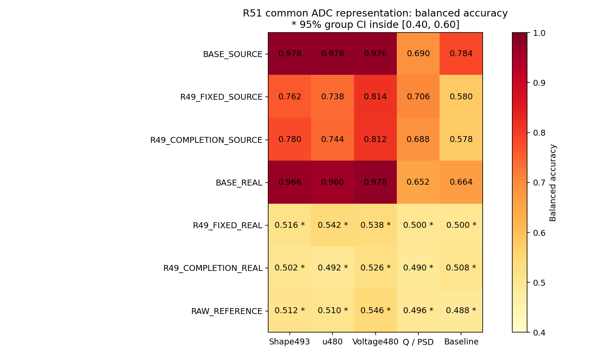
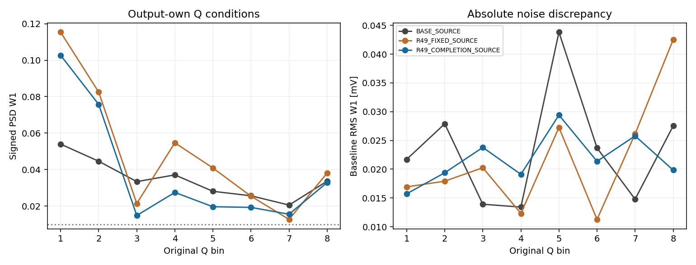
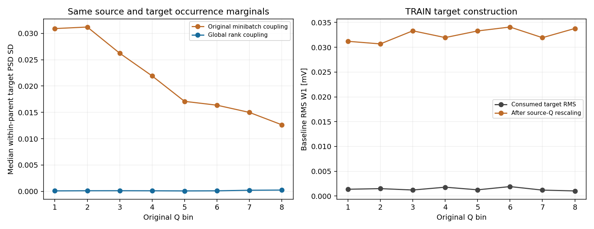

# R51：SOURCE 偏差与训练目标的两项冲突

32个新HGB及3个复用结果已完成。共同ADC整数码重建后，两臂同处理REAL的五视图95%区间全部落入[0.40,0.60]；SOURCE五视图仍全部未达到联合要求。原R49历史判定保留，本轮未重拟合条件峰宽、未验收新的响应模型。

| 人口 | Shape493 BA | u480 BA | V480 BA | Q/PSD BA | 基线 BA |
|---|---:|---:|---:|---:|---:|
| BASE_SOURCE | 0.978 | 0.978 | 0.976 | 0.690 | 0.784 |
| R49_FIXED_SOURCE | 0.762 | 0.738 | 0.814 | 0.706 | 0.580 |
| R49_COMPLETION_SOURCE | 0.780 | 0.744 | 0.812 | 0.688 | 0.578 |
| BASE_REAL | 0.966 | 0.960 | 0.978 | 0.652 | 0.664 |
| R49_FIXED_REAL | 0.516 * | 0.542 * | 0.538 * | 0.500 * | 0.500 * |
| R49_COMPLETION_REAL | 0.502 * | 0.492 * | 0.526 * | 0.490 * | 0.508 * |
| RAW_REFERENCE | 0.512 * | 0.510 * | 0.546 * | 0.496 * | 0.488 * |

星号表示整个95%分组区间位于容差带内。完整区间和配对差见链接指标。SOURCE主候选总体PSD W1=0.028896，固定Q1–Q7平均0.039321；原要求为0.01。Q3密度未收敛仍保留。源电荷人口差异、pure-had谷比例及所有八区均保留，没有重加权或删区。

原TRAIN载入6593个SOURCE与21047个REAL，其中实际94400次出现涉及3752个SOURCE与18739个REAL。按原Q区进行全局PSD同序配对，逐区及全局的目标出现次数完全保留。Q2–Q7的父事件内目标PSD标准差中位数均降至原来的0.39%–1.42%，满足预登记至少4区降低50%的机制判据。此关联是统计构造，不是物理逐事件真值，也不证明神经转换会改善。

| Q区 | 原父事件目标PSD SD中位数 | 全局排序SD中位数 | 原目标RMS W1 / mV | 电荷缩放后 / mV | 全局排序后再缩放 / mV |
|---|---:|---:|---:|---:|---:|
| 1 | 0.030903 | 0.000093 | 0.001372 | 0.031206 | 0.032323 |
| 2 | 0.031197 | 0.000120 | 0.001498 | 0.030683 | 0.032534 |
| 3 | 0.026223 | 0.000126 | 0.001219 | 0.033325 | 0.033007 |
| 4 | 0.021913 | 0.000113 | 0.001787 | 0.031958 | 0.031957 |
| 5 | 0.017088 | 0.000084 | 0.001259 | 0.033297 | 0.032567 |
| 6 | 0.016359 | 0.000105 | 0.001911 | 0.034084 | 0.034857 |
| 7 | 0.014992 | 0.000213 | 0.001199 | 0.031937 | 0.029946 |
| 8 | 0.012642 | 0.000248 | 0.001035 | 0.033793 | 0.033555 |

现有目标为 q_SOURCE × REAL/q_REAL。全部94400次出现中，缩放PSD变化最大6.66e-16，噪声RMS缩放恒等式误差1.30e-18 V。目标PSD对REAL TRAIN本区的W1为0.00037–0.00177，但目标噪声RMS距离由约0.001–0.002 mV增至0.031–0.034 mV；仅全局PSD排序仍保留这一偏差。噪声目标构造与父事件关联离散是两个不同问题。

下一步固定一种联合电荷与PSD的统计耦合，保持原出现次数、源人口和模型验收线，用TRAIN目标检查同时约束噪声缩放和父事件目标离散度，之后才决定响应训练。不会只换PSD排序就重复训练，也不会将模型目标标记完成。

原生退出0；worker 16465 / supervisor 16464。科学计时12.810745秒，worker自报峰值649129984 B，轮询作业树峰值537698304 B；两者采样方式不同，观测失败0。新增响应训练/生成/密度拟合、EVAL读取和CAL解码均为0。

这些结果条件于原固定开发人口及评价器，且未作多重比较校正；不能代表独立采集泛化。

[协议](tasks/R51_CANONICAL_SOURCE_TEACHER_DIAGNOSTIC_001.md) · [35项判别及配对差](work/R51_CANONICAL_SOURCE_TEACHER_DIAGNOSTIC_001/CANONICAL_C2ST.json) · [SOURCE八区指标](work/R51_CANONICAL_SOURCE_TEACHER_DIAGNOSTIC_001/SOURCE_METRICS.json) · [训练目标诊断](work/R51_CANONICAL_SOURCE_TEACHER_DIAGNOSTIC_001/TEACHER_DIAGNOSTIC.json) · [原生回执](work/R51_CANONICAL_SOURCE_TEACHER_DIAGNOSTIC_001/numeric_worker.py.NATIVE_RECEIPT.json) · [下一步](reviews/R51_ROOT_DIRECTION_001.json)

