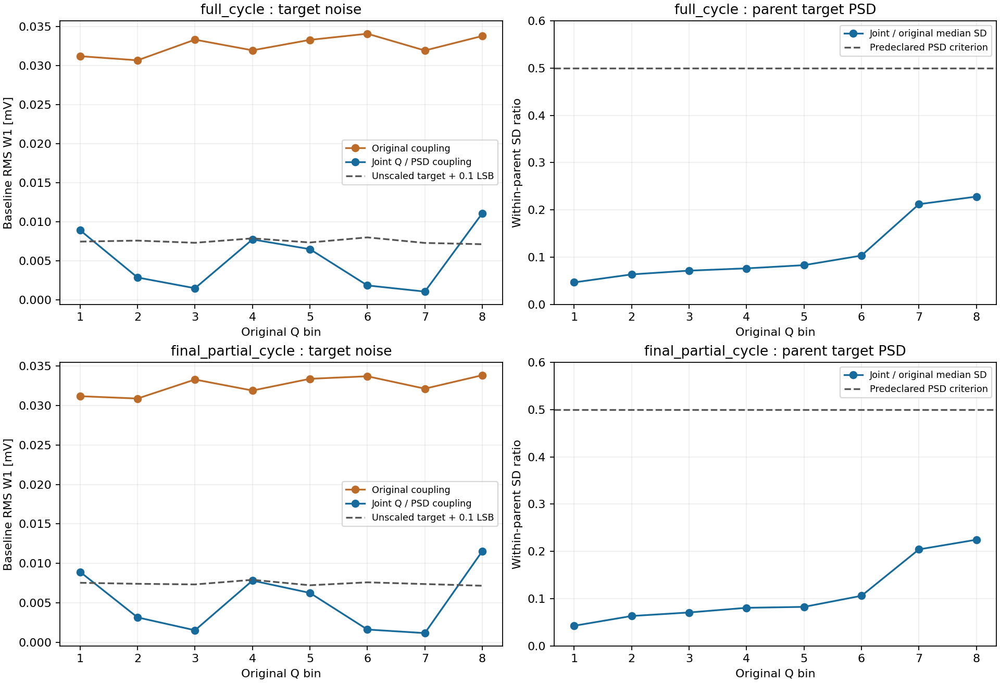

# R52：联合配对改善成立，但端点噪声要求仍失败

唯一的16电荷分位内PSD排序配方已完成。完整94400行与末89600行两块都保持SOURCE顺序及逐区REAL出现次数；Q2–Q7父事件目标PSD标准差全部满足至少降低50%的要求。但两块的Q1、Q8仍超过预登记目标噪声容差，本配方因此关闭，新增响应训练0。没有修改组数、删去失败区或降低容差。

| 块 | Q区 | 原缩放目标RMS W1 / mV | 联合配对后 / mV | 固定上限 / mV | 父事件SD比值 | 噪声通过 |
|---|---:|---:|---:|---:|---:|---|
| full_cycle | 1 | 0.031206 | 0.008934 | 0.007476 | 0.0467 | 否 |
| full_cycle | 2 | 0.030683 | 0.002881 | 0.007602 | 0.0636 | 是 |
| full_cycle | 3 | 0.033325 | 0.001506 | 0.007323 | 0.0716 | 是 |
| full_cycle | 4 | 0.031958 | 0.007753 | 0.007891 | 0.0764 | 是 |
| full_cycle | 5 | 0.033297 | 0.006507 | 0.007363 | 0.0832 | 是 |
| full_cycle | 6 | 0.034084 | 0.001864 | 0.008014 | 0.1035 | 是 |
| full_cycle | 7 | 0.031937 | 0.001076 | 0.007303 | 0.2122 | 是 |
| full_cycle | 8 | 0.033793 | 0.011104 | 0.007139 | 0.2281 | 否 |
| final_partial_cycle | 1 | 0.031184 | 0.008926 | 0.007542 | 0.0428 | 否 |
| final_partial_cycle | 2 | 0.030887 | 0.003157 | 0.007414 | 0.0634 | 是 |
| final_partial_cycle | 3 | 0.033294 | 0.001525 | 0.007335 | 0.0709 | 是 |
| final_partial_cycle | 4 | 0.031901 | 0.007820 | 0.007918 | 0.0808 | 是 |
| final_partial_cycle | 5 | 0.033387 | 0.006258 | 0.007229 | 0.0827 | 是 |
| final_partial_cycle | 6 | 0.033708 | 0.001619 | 0.007600 | 0.1061 | 是 |
| final_partial_cycle | 7 | 0.032138 | 0.001168 | 0.007382 | 0.2043 | 是 |
| final_partial_cycle | 8 | 0.033842 | 0.011552 | 0.007168 | 0.2248 | 否 |

Q1、Q8的完整周期中位电荷比例分别约0.9879与0.9826，局部电荷配对仍不能使整条波形的缩放完全消失。这个结果只关闭本次固定构造，不能证明所有统计耦合都无法满足噪声要求。旧R51全局PSD排序与本轮联合配对均作为负结果保留，不靠扫描分位组数继续。

下一步另行定义保持实测基线的加性脉冲修正：以固定平滑基函数承载所需电荷差，并保持目标signed PSD。这会改变训练端点，须在TRAIN中核对电荷/PSD恒等式、基线/尾段保留和波形扰动，再决定新响应训练。原A–F、原源码输出、完整源人口和Q边界保持。

服务器原生退出0，worker 20038 / supervisor 20037，科学2.317410秒。worker峰值318316544 B，轮询作业树峰值140189696 B；观测失败0。0响应训练、HGB、密度拟合、DEV/EVAL读取及CAL解码。长期模型目标active且未完成。

[协议](tasks/R52_JOINT_CHARGE_PSD_COUPLING_001.md) · [固定判定](work/R52_JOINT_CHARGE_PSD_COUPLING_001/JOINT_DECISION.json) · [完整周期指标](work/R52_JOINT_CHARGE_PSD_COUPLING_001/full_cycle_METRICS.json) · [末周期指标](work/R52_JOINT_CHARGE_PSD_COUPLING_001/final_partial_cycle_METRICS.json) · [原生回执](work/R52_JOINT_CHARGE_PSD_COUPLING_001/numeric_worker.py.NATIVE_RECEIPT.json) · [下一步](reviews/R52_ROOT_DIRECTION_001.json)

