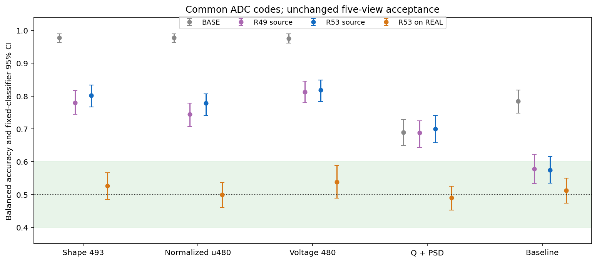
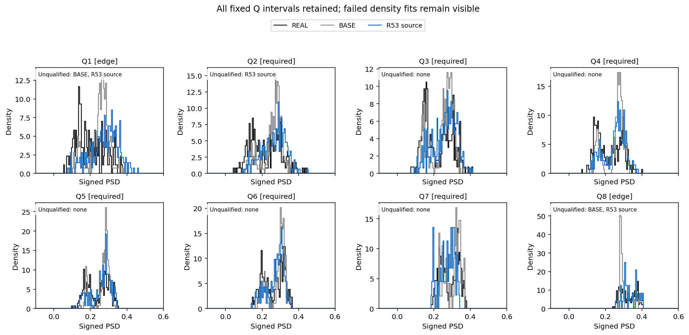
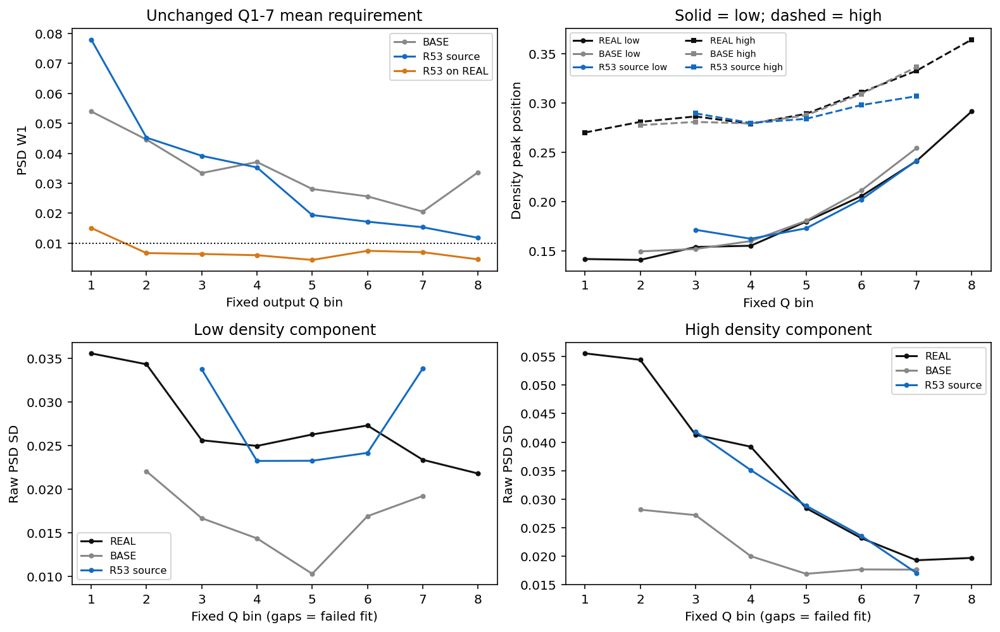
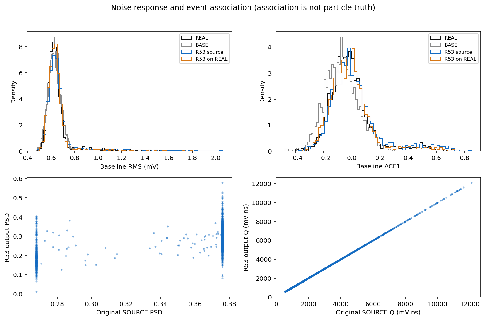
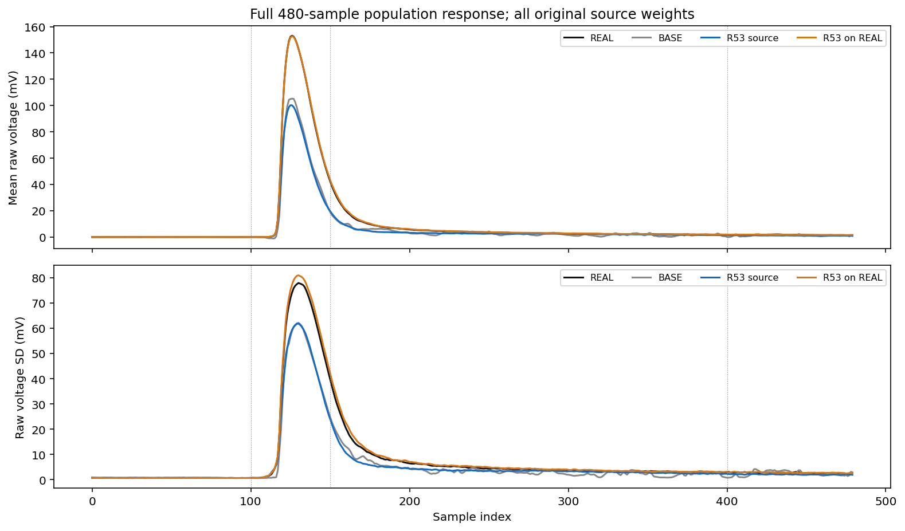
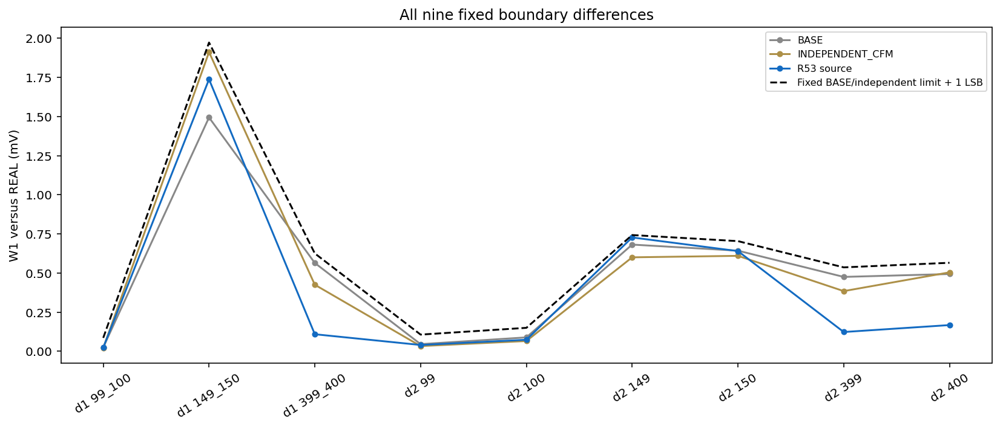
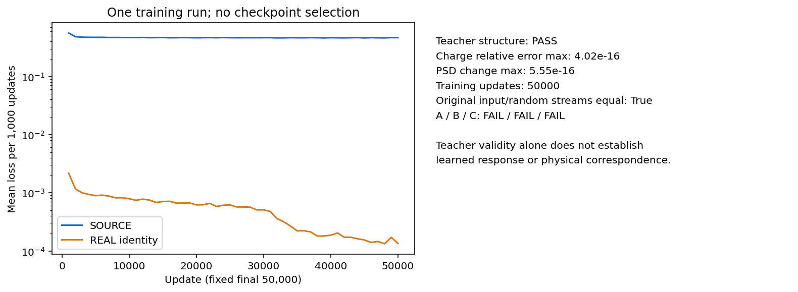

# R53：固定平滑脉冲教师与完整响应评估

本轮只训练一个固定 50000 步模型。教师端采用已登记的电荷/PSD 耦合，并以唯一的脉冲区平滑校正保留实测基线与尾段；训练的 SOURCE、REAL 身份支路和随机暴露流与 R48 对照一致。组合改动的结果不能分别归因给两个组件。

本轮 A/B/C：A 未通过 / B 未通过 / C 未通过。同一冻结方法尚未完成原 A–F，长期目标继续保持 active。

| 同一 ADC 表示下的视图 | SOURCE BA [95% CI] | 同处理 REAL BA [95% CI] |
|---|---:|---:|
| full_historical_shape | 0.802 [0.767, 0.834] | 0.526 [0.486, 0.566] |
| normalized_u480 | 0.778 [0.741, 0.807] | 0.500 [0.460, 0.537] |
| full_voltage | 0.818 [0.784, 0.849] | 0.538 [0.489, 0.589] |
| Q_PSD_2D | 0.700 [0.658, 0.741] | 0.490 [0.452, 0.526] |
| baseline_local | 0.574 [0.534, 0.616] | 0.512 [0.474, 0.550] |

判据仍为每个区间完整落在 [0.40, 0.60]。BASE、RAW REAL–REAL 与 R49 对照复用 R51 的固定判别器结果；新方法在服务器 GPU 生成，旧 R49 控制结果来自既有运行，不宣称新增跨平台位级验证。

总体 PSD W1=0.02563165；原固定 Q1–7 等权平均 W1=0.03565861，两项门槛均为 0.010。

| 分量 | 必需 Q2–7 峰位 MAE | raw SD 平均相对误差 | 失败必需区 |
|---|---:|---:|---|
| 低峰 | 未定义 | 未定义 | [2] |
| 高峰 | 未定义 | 未定义 | [2] |

全部八个 Q 区及所有失败拟合均保留；密度分量不是粒子真值。原始 SOURCE 分箱继续采用未量化输入，purehad Q3/Q4 分别保留 213/181 个事件。旧 postADC 参考分箱的 207/182 属于另一种描述，未用来替代主分母。

| 原六项阶段门 | 结果 |
|---|---|
| gate1_complete_response | 通过 |
| gate2_PSD_width_centers_noise | 未通过 |
| gate3_source_preservation | 未通过 |
| gate4_boundary_source | 通过 |
| gate5_same_treated_REAL_control | 通过 |
| gate6_numerical_replay | 通过 |

TRAIN 128/256 数值差异：median=0.040669 LSB，p95=0.323070 LSB，电荷相对误差最大值=1.178e-08。阈值仍为 0.25 / 1 LSB 和 1e-5。

独立 GPU 回放实际处理 4000 条，位级一致结果为 True；回放通过可移动推理入口加载包内权重与常量。主样本及探针合计 5984 条，新 HGB 10 次，密度描述 16 个分区。

训练、数值检查、生成、评估和回放均原生退出 0。汇总指标写出后的两次绘图分别因旧对照缺失直方图及分箱边界为空退出 1；只从已保存特征重绘后的展示作业退出 0，两次失败和原图均保留。累计科学/必要汇总耗时 1715.869627 秒，最高 worker RSS 2297831424 B。RSS 查询缺失共 6 次，逐次时间和未知原因保留在原生回执，未触发终止。本轮响应训练 1 次、50000 步；DEV 历史暴露继续披露，未读取 EVAL 或重新解码 CAL。

封存 R53 固定方案。下一轮预登记单一连续电荷条件消融：保持同一教师、数据、噪声、初始权重和 50000 次更新，只在神经场中显式加入由原 TRAIN 电荷边界定义的连续 logQ 坐标；不按 DEV 选尺度或检查点。训练后沿用原数值门与 A–F 联合验收；失败即关闭该固定方案。

[原协议](tasks/R53_PULSE_ONLY_TEACHER_FLOW_001.md) · [完整判据](work/R53_PULSE_ONLY_TEACHER_FLOW_001/ACCEPTANCE_A_C.json) · [指标](work/R53_PULSE_ONLY_TEACHER_FLOW_001/METRICS_COMPACT.json) · [推理与复现](work/R53_PULSE_ONLY_TEACHER_FLOW_001/REPRODUCTION.md) · [训练回执](work/R53_PULSE_ONLY_TEACHER_FLOW_001/JOINT_PULSE_RESPONSE/TRAINING_RECEIPT.json) · [独立回放](work/R53_PULSE_ONLY_TEACHER_FLOW_001/REPLAY_RECEIPT.json) · [资源回执](work/R53_PULSE_ONLY_TEACHER_FLOW_001/RESOURCE_RECEIPT.json)

