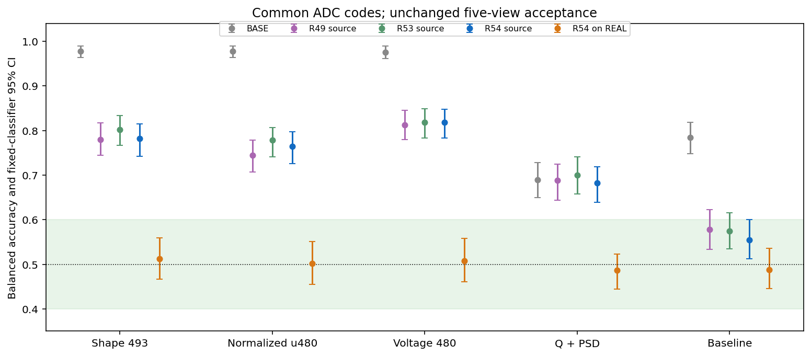
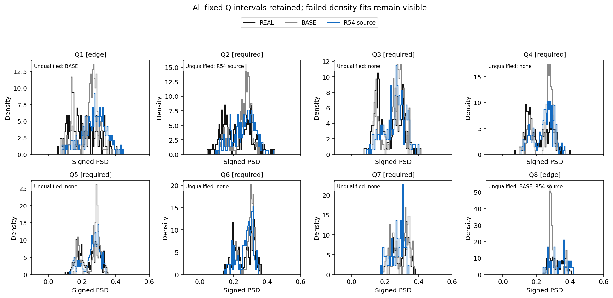
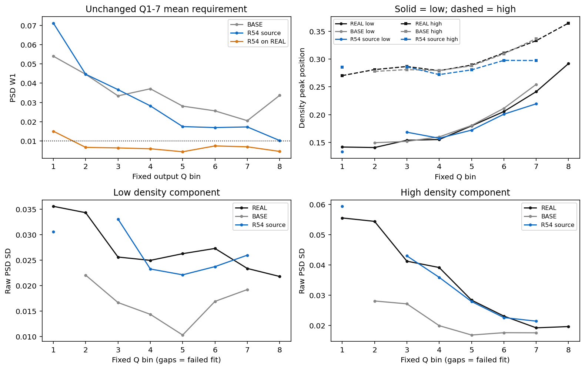
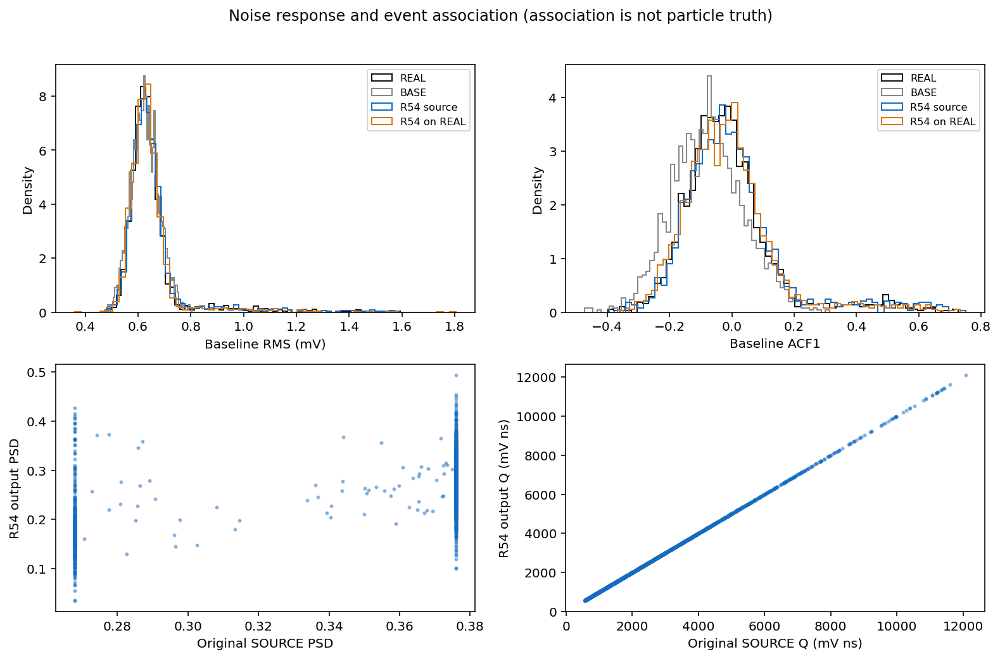
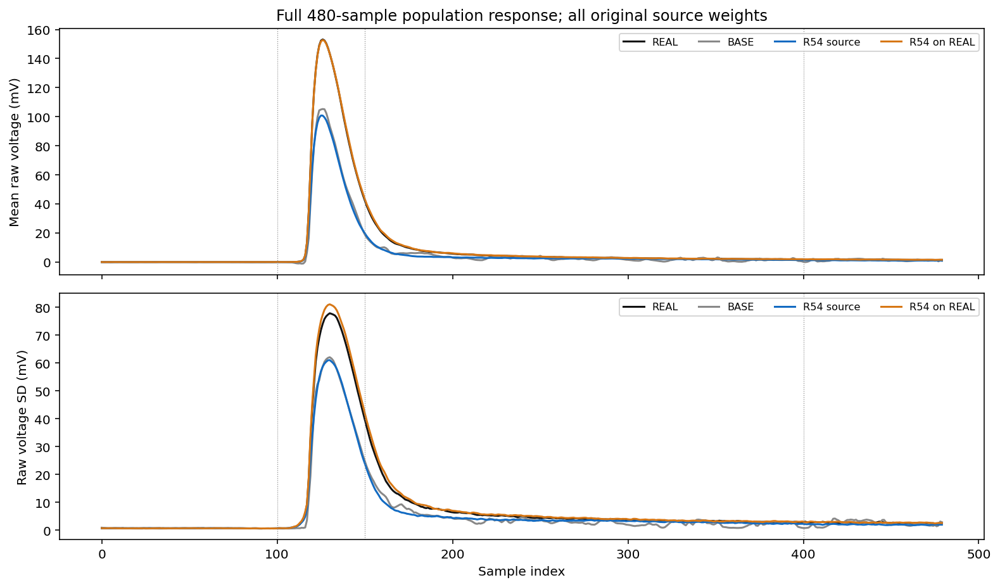
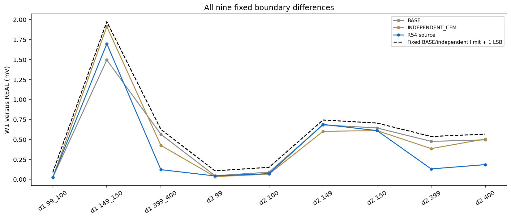
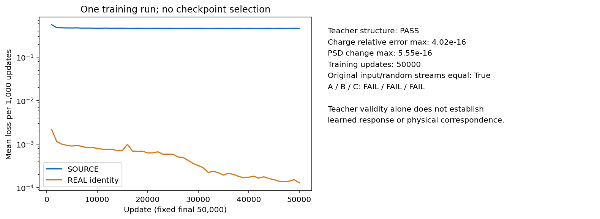

# R54：连续电荷条件的固定消融结果

同一初始权重、平滑脉冲教师、样本、噪声、随机流和 50000 次更新下，本轮只把原 embedding 的一个零输入替换为连续 logQ 坐标。分区、坐标公式和单一终点在训练前登记；未选择检查点或连续尺度。

原 A/B/C：A 未通过 / B 未通过 / C 未通过。同一冻结方法尚未完成原 A–F，长期目标仍为 active。

| 共同 ADC 表示下的视图 | SOURCE BA [95% CI] | 同处理 REAL BA [95% CI] |
|---|---:|---:|
| full_historical_shape | 0.782 [0.742638, 0.814407] | 0.512 [0.466639, 0.559568] |
| normalized_u480 | 0.764 [0.726215, 0.797324] | 0.502 [0.455251, 0.551397] |
| full_voltage | 0.818 [0.782819, 0.847817] | 0.508 [0.460347, 0.557569] |
| Q_PSD_2D | 0.682 [0.639542, 0.718823] | 0.486 [0.444345, 0.523214] |
| baseline_local | 0.554 [0.512193, 0.600092] | 0.488 [0.445280, 0.535915] |

A 要求每个区间完整位于 [0.40, 0.60]，按未舍入值判定。SOURCE baseline 的区间上界为 0.600091818，仍记未通过。RAW REAL–REAL、BASE 和旧 R49 对照复用已冻结的共同 ADC 结果；R53 对照复用原 GPU 结果。没有新增对照拟合。

| 相对 R53 的配对 BA 差 | SOURCE ΔBA [95% CI] | 同处理 REAL ΔBA [95% CI] |
|---|---:|---:|
| full_historical_shape | -0.020 [-0.046, +0.006] | -0.014 [-0.050, +0.027] |
| normalized_u480 | -0.014 [-0.042, +0.012] | +0.002 [-0.043, +0.052] |
| full_voltage | +0.000 [-0.021, +0.022] | -0.030 [-0.063, +0.004] |
| Q_PSD_2D | -0.018 [-0.045, +0.012] | -0.004 [-0.030, +0.024] |
| baseline_local | -0.020 [-0.067, +0.022] | -0.024 [-0.068, +0.019] |

差异使用完全相同的固定留出身份、组和 500 次配对 bootstrap；区间条件于这一对已拟合分类器和一次响应训练，不包含跨采集或重复训练不确定性。

总体 PSD W1=0.01809836；原共同 Q1–7 区等权平均 W1=0.03320543。两个原门槛均为 0.010。

| 成分 | 必需 Q2–7 峰位 MAE | raw SD 平均相对误差 | 必需区失败 |
|---|---:|---:|---|
| 低峰 | 未定义 | 未定义 | [2] |
| 高峰 | 未定义 | 未定义 | [2] |

全部八个区间及失败密度拟合均保留；密度成分没有粒子真值标签。原始 SOURCE purehad Q3/Q4 为 213/181 条，继续使用未量化输入电荷定义；旧 postADC 参考 207/182 单列保存，不能互换分母。

| 原阶段门 | 结果 |
|---|---|
| gate1_complete_response | 通过 |
| gate2_PSD_width_centers_noise | 未通过 |
| gate3_source_preservation | 未通过 |
| gate4_boundary_source | 通过 |
| gate5_same_treated_REAL_control | 通过 |
| gate6_numerical_replay | 通过 |

| 原始 SOURCE purehad 区间 | N | 输出谷比例 | BASE 谷比例 | 增量上限 | 结果 |
|---|---:|---:|---:|---:|---|
| bin3 | 213 | 0.126761 | 0.056338 | 0.020000 | 未通过 |
| bin4 | 181 | 0.154696 | 0.005525 | 0.020000 | 未通过 |

| 噪声量 | 候选 W1 | BASE W1 | 相对变化 |
|---|---:|---:|---:|
| baseline_RMS_V_overall_W1 | 1.07266051e-05 | 1.93582993e-05 | -44.589% |
| ACF1_overall_W1 | 0.0144759023 | 0.0642349344 | -77.464% |

TRAIN 128/256 数值差：median=0.038664 LSB、p95=0.327502 LSB；preADC 相对电荷最大误差=9.099e-09。原门槛为 0.25 / 1 LSB 和 1e-5。

全部原 R48 随机流及 R53 教师匹配流一致性在训练进程内通过；连续电荷权重收到非零梯度的更新数为 49999。该实现记录不能证明响应正确。

独立 GPU 进程通过可移动推理入口实际重放 4000 条，位级一致结果为 True。全部生成及探针合计 5984 条；新 HGB 拟合 10 次、密度槽 16 个。

六个原生作业均退出 0，累计科学及必要汇总耗时 1717.385646 秒；最大 worker RSS 2258427904 B，RSS 查询缺失 4 次。缺失查询的具体原因若无日志证据则保持未知。新响应训练 1 次、50000 更新；DEV 已有多轮历史暴露，本轮未打开最终 EVAL 或新解码 CAL。

封存 R54 固定方案。下一轮先登记总体/条件 PSD 与原始源谷比例的必要条件兼容性诊断：保持固定 SOURCE 电荷、身份和权重，允许原数值容差及 ADC 引起的分箱迁移，求一个明确放宽的分布距离下界；不训练或选新模型，不改变原 A–F。只有经核验的下界越过原阈值才可报告目标冲突；否则该诊断仅说明尚不能排除可行性，随后据 TRAIN 端点与学习误差证据决定新机制。

[原协议](tasks/R54_CONTINUOUS_CHARGE_FLOW_001.md) · [原始判据](work/R54_CONTINUOUS_CHARGE_FLOW_001/ACCEPTANCE_A_C.json) · [指标](work/R54_CONTINUOUS_CHARGE_FLOW_001/METRICS_COMPACT.json) · [R53 配对比较](work/R54_CONTINUOUS_CHARGE_FLOW_001/PAIRED_R54_MINUS_R53.json) · [推理与复现](work/R54_CONTINUOUS_CHARGE_FLOW_001/REPRODUCTION.md) · [训练回执](work/R54_CONTINUOUS_CHARGE_FLOW_001/CONTINUOUS_Q_RESPONSE/TRAINING_RECEIPT.json) · [独立重放](work/R54_CONTINUOUS_CHARGE_FLOW_001/REPLAY_RECEIPT.json) · [资源回执](work/R54_CONTINUOUS_CHARGE_FLOW_001/RESOURCE_RECEIPT.json)

