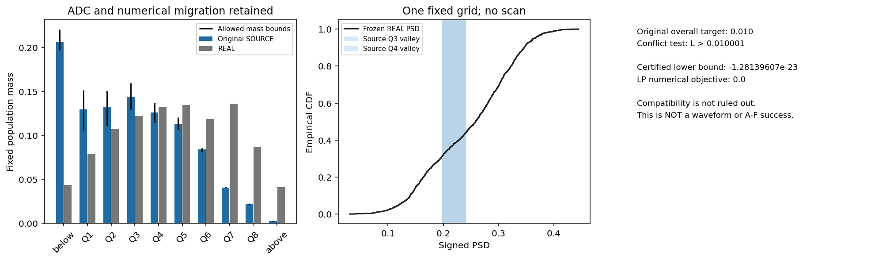

# R55：固定源人口的必要条件兼容性结果

R55 未证明验收目标冲突：一次固定 LP 的数值最优值为 0，精确对偶下界为 −1.2813960740059585e−23，未超过 0.010001。结合距离非负性只能得到平凡下界 0。这个放宽结果既不能排除原要求的可行性，也不能证明存在合格的完整波形或神经方法。

这是关于同一固定经验人口的保守分布下界诊断。它没有训练响应模型、生成新候选或修改原 A–F；R54 的失败结论保持。

| 项目 | 实际结果 |
|---|---|
| 原 SOURCE / REAL | 2000 / 2000 |
| 原 purehad Q3 / Q4 | 213 / 181 |
| 可能跨输出分箱的源事件 | 184 |
| 变量 / 约束 / 非零系数 | 102189 / 246397 / 939485 |
| 固定 PSD 网格点 | 2004 |
| LP 求解次数 | 1 |
| 求解器状态 | 0：Optimization terminated successfully. (HiGHS Status 7: Optimal) |
| 数值 primal objective（不能单独证明下界） | 0.0 |
| 精确证书下界的向下浮点表示 | -1.28139607401e-23 |
| 诊断冲突门槛 | 严格大于 0.010001 |

原总体 W1 验收仍为 0.010；额外 1e-6 只用于让本诊断更保守。共同 Q1–7 的等权条件均值和原始源谷比例也采用向宽松方向的微小余量。LP 中的分数质量变量是数学放宽，未用于重加权原 SOURCE、删源事件或输出新候选。

| 原始源区间 | 事件数 | 放宽后的输出区质量范围 |
|---|---:|---:|
| 下方支持外 | 412 | 0.197000–0.220500 |
| Q1 | 259 | 0.105500–0.151500 |
| Q2 | 265 | 0.111000–0.150500 |
| Q3 | 288 | 0.129500–0.159500 |
| Q4 | 252 | 0.114500–0.137000 |
| Q5 | 226 | 0.106500–0.120500 |
| Q6 | 168 | 0.081000–0.085500 |
| Q7 | 81 | 0.040500–0.041500 |
| Q8 | 44 | 0.020500–0.022500 |
| 上方支持外 | 5 | 0.002000–0.003000 |

每个采样点预留一整 ADC LSB，再加入原 preADC 相对电荷容差及浮点余量。常数电荷半径为 0.0366243290606 V ns；实际输入最大绝对幅值为 0.422367364168 V，保存特征与运行时 q 定义差为 0 V ns。支持外事件全部保留。

区间平均 CDF 的 Jensen 下界、分箱质量乘积的 McCormick 放宽、源谷概率的下界以及网格外积分的省略，都只会降低所求下界。矩阵向 float64 转换时各行向外放宽；最大右端项余量为 1.106e-16。实际保存的矩阵与对偶随后用于精确有理数证书。

证书计算 `yᵀb + Σ min(0,c−Aᵀy)`，包含 0 个负残差列的保守修正。分子、分母和全部矩阵/对偶保存在回执及私有 NPZ 中；求解器 success 标记本身不承担不可能性证明。

本轮没有为完整波形、固定 HGB、密度峰位/峰宽、源秩、噪声、REAL 控制或 D/E 建立可行性证书；这些仍须由同一冻结方法实际通过。历史 DEV 暴露保持披露，没有读取最终 EVAL 或新解码 CAL。

原生科学进程退出 0，耗时 110.736253 秒，worker 峰值 RSS 765902848 B，作业树采样峰值 765759488 B。缺失 RSS 查询 0 次，保留原回执，不补造原因。

封存 R55 必要条件诊断，不因其低下界放宽原 A–F，也不继续扫描下界设置。下一轮登记仅用 TRAIN 的教师端点与冻结 R54 学习误差诊断：先追溯固定匹配流的目标人口和原始源覆盖，再比较教师本身与全量合法 REAL TRAIN 的 PSD/完整响应描述及冻结模型对同一端点的误差；没有获得明确端点或学习瓶颈证据前，不启动新的响应训练。

[协议](tasks/R55_PSD_SOURCE_COMPATIBILITY_001.md) · [结果](work/R55_PSD_SOURCE_COMPATIBILITY_001/RESULT.json) · [构造说明](work/R55_PSD_SOURCE_COMPATIBILITY_001/LP_CONSTRUCTION.json) · [求解回执](work/R55_PSD_SOURCE_COMPATIBILITY_001/LP_SOLVER_RECEIPT.json) · [证书](work/R55_PSD_SOURCE_COMPATIBILITY_001/LOWER_BOUND_CERTIFICATE.json) · [复现](work/R55_PSD_SOURCE_COMPATIBILITY_001/REPRODUCTION.md)

