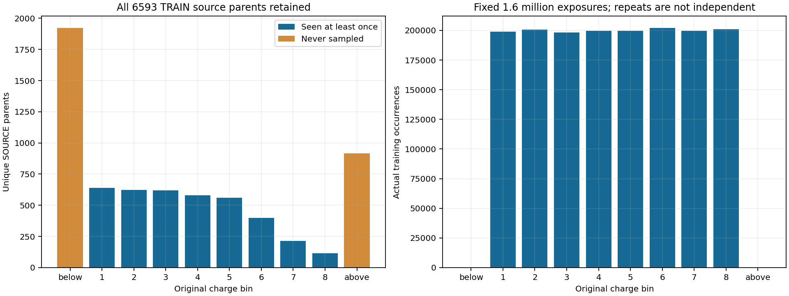
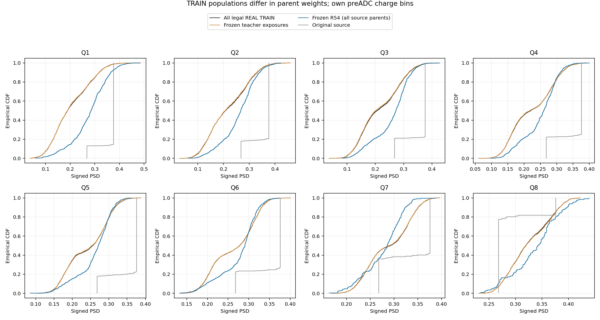
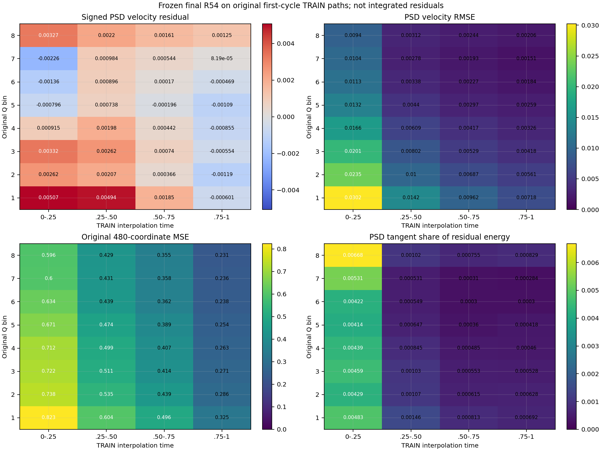
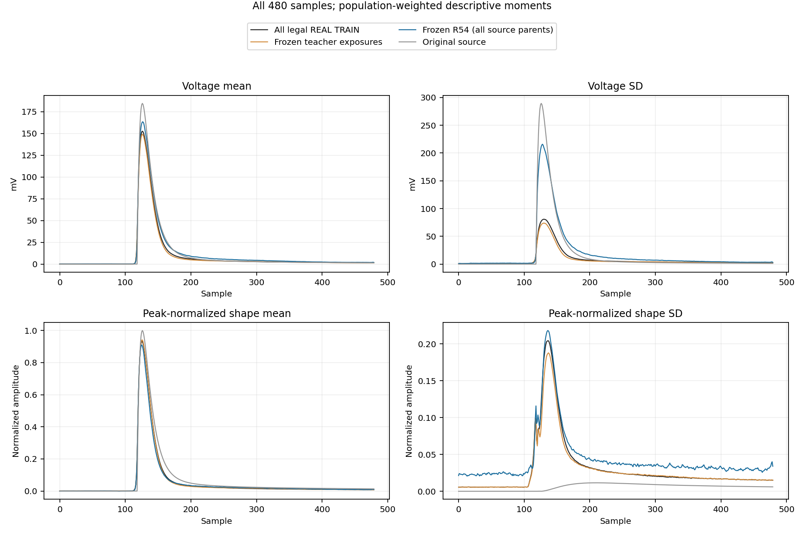
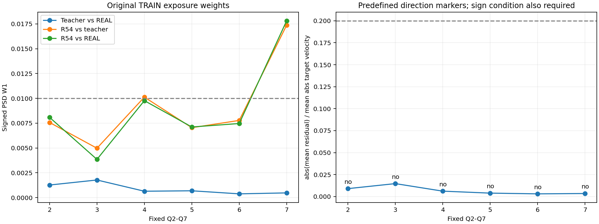

# R56：TRAIN 教师、覆盖与冻结 R54 学习误差

R56的预登记学习残差标记为0/6，教师偏差标记也是0/6，不能据此启动显式PSD切向机制。教师Q2–Q7的PSD W1为0.000374–0.001770；按旧训练曝光统计，冻结R54在Q2–Q6的W1为0.00385–0.00976。相同源端点按原父事件等权统计后，Q2–Q6为0.01665–0.04285，显示原训练采样测度与等权源人口之间的明显差异。2840个支持外TRAIN源从未参加训练，且本轮其中647个preADC输出越过ADC电压范围。模型目标仍未完成。

本轮未训练或选择新模型；唯一 R54 权重保持，原 A–F 不变。没有读取 DEV/EVAL、重新解码 CAL，TRAIN 包的 source_val/target_val 字段也未解码。以下是训练人口的诊断，不能充当最终响应验收。

| 项目 | SOURCE | REAL |
|---|---:|---:|
| 全量合法 TRAIN | 6593 | 21047 |
| 实际见过的唯一父事件 | 3752 | 18739 |
| 原训练曝光次数 | 1600000 | 1600000 |

旧 R23 采样器按八区间等概率取样，区间内 SOURCE 使用既有 exp(lambda*h)，REAL 均匀抽样。后续排序/训练沿用曝光流。2840 个源事件位于原电荷支持外，全部未被训练采样；支持内3753个中仅1个未见。原字段与本轮电荷重算的分箱完全一致。全量源没有在本轮被删除或重加权；h 只作为已有沉积组成代理，不解释为独立粒子真值。

| 原区间 | 源父事件 | 已见源 | REAL父事件 | 已见REAL |
|---|---:|---:|---:|---:|
| 下方支持外 | 1922 | 0 | 1120 | 0 |
| Q1 | 639 | 638 | 1670 | 1667 |
| Q2 | 622 | 622 | 2286 | 2271 |
| Q3 | 621 | 621 | 2533 | 2508 |
| Q4 | 581 | 581 | 2604 | 2571 |
| Q5 | 561 | 561 | 2689 | 2661 |
| Q6 | 399 | 399 | 2624 | 2602 |
| Q7 | 214 | 214 | 2526 | 2500 |
| Q8 | 116 | 116 | 1963 | 1959 |
| 上方支持外 | 918 | 0 | 1032 | 0 |

全周期94400和末周期89600条脉冲教师均保留原目标PSD与基线/尾部，且未增加新的目标人口。下表采用原全周期曝光：R54每个源父事件只生成一次，重复曝光共享同一噪声实现，因此这些重复不是独立样本，也没有逐事件物理配对真值。教师与REAL的W1来自同一原电荷区间，模型比较与路径误差仍是不同对象。

| 区间 | 教师→REAL W1 | R54→教师 W1 | R54→REAL W1 | B | G | abs(B)/D | 标记 |
|---|---:|---:|---:|---:|---:|---:|---|
| Q2 | 0.001263 | 0.007569 | 0.008083 | 0.000951 | 0.004241 | 0.009003 | 未命中 |
| Q3 | 0.001770 | 0.004971 | 0.003846 | 0.001553 | 0.004237 | 0.014714 | 未命中 |
| Q4 | 0.000638 | 0.010120 | 0.009765 | 0.000624 | 0.001189 | 0.006135 | 未命中 |
| Q5 | 0.000682 | 0.007041 | 0.007110 | -0.000342 | -0.005891 | 0.003889 | 未命中 |
| Q6 | 0.000374 | 0.007773 | 0.007460 | -0.000204 | -0.004829 | 0.003067 | 未命中 |
| Q7 | 0.000470 | 0.017370 | 0.017811 | -0.000145 | -0.017337 | 0.003440 | 未命中 |

同一组固定输出按原源父事件等权统计，与旧训练曝光统计的结果如下。此处只是报告两种既有测度，没有改变验收源权重。

| 区间 | 原源父事件数 | 父事件等权 PSD W1 | 旧曝光 PSD W1 |
|---|---:|---:|---:|
| Q2 | 622 | 0.04285282 | 0.00808328 |
| Q3 | 621 | 0.04081015 | 0.00384643 |
| Q4 | 581 | 0.02736063 | 0.00976487 |
| Q5 | 561 | 0.01985190 | 0.00711011 |
| Q6 | 399 | 0.01664507 | 0.00745997 |
| Q7 | 214 | 0.01550365 | 0.01781148 |

预登记学习标记命中 0/6；教师偏差标记 0/6。学习规则同时要求教师W1≤0.01、模型对教师和REAL的W1都>0.01、|B|/D≥0.20、B与G同号；至少4/6命中才支持预登记的显式PSD切向机制方向。不会把某一子条件改称规则通过。

| 冻结路径 | PSD速度RMSE | 带符号残差均值 | 原480维MSE | PSD方向残差能量占比 |
|---|---:|---:|---:|---:|
| SOURCE | 0.01032249 | 0.00090858 | 0.46024102 | 0.22139% |
| REAL identity | 0.00047994 | -0.00007305 | 0.00012790 | 1.62123% |

PSD速度是相同单位电荷坐标中的线性泛函；能量占比按原480维MSE的欧氏切向几何定义。最终场在原首周期训练路径上的残差不能等同于实际积分轨迹误差，更不能由占比小推断PSD不重要。

| 全部源父事件分组 | 父事件数 | preADC越ADC范围数 | preADC无效数 | 对全量REAL总体PSD W1 |
|---|---:|---:|---:|---:|
| all | 6593 | 647 | 0 | 0.03026599 |
| seen | 3752 | 0 | 0 | 0.02530094 |
| unseen | 2841 | 647 | 0 | 0.04747722 |
| inside | 3753 | 0 | 0 | 0.02530134 |
| outside | 2840 | 647 | 0 | 0.04749587 |

这些分组各自的电荷人口不同，不能把总体W1差异解释成单独的泛化因果效应。范围外从未有训练教师，其误差只能报告冻结场外推和与全量REAL的描述；不能虚构范围外教师。按原源分箱、实际输出分箱以及规范ADC后输出分箱的完整统计均在RESULT.json，未删除失败或越界事件。

本轮固定 Heun128 共生成6593个TRAIN源端点，最大float32相对电荷误差 1.71890216e-08；这不是新候选的数值门或DEV成功声明。原权重在前后哈希绑定相同。

科学原生退出0，136.052468秒；188800次路径行前向、6593次源ODE、1876608次总场行前向、184000条教师描述。worker峰RSS 2063818752 B，作业树采样峰值 2051162112 B，RSS缺测 1 次。无训练更新、HGB或密度拟合。

封存R56，不把0/6学习标记解释为通过，也不延长R54或直接加强PSD损失。下一轮只用合法TRAIN，预登记原TRAIN父事件等权的教师/耦合预检，去除旧exp(lambda*h)训练采样倾斜，并明确支持内外覆盖、源电荷/PSD关联、谷比例、完整波形与ADC/噪声约束。原验收2000个SOURCE的身份、顺序、组成和权重全部保持；训练采样政策的改变必须单列。先完成教师科学终点，有可用端点证据后再另行登记神经训练；不读取DEV/EVAL选参。

[协议](tasks/R56_TRAIN_ENDPOINT_LEARNING_DIAGNOSTIC_001.md) · [结果](work/R56_TRAIN_ENDPOINT_LEARNING_DIAGNOSTIC_001/RESULT.json) · [覆盖](work/R56_TRAIN_ENDPOINT_LEARNING_DIAGNOSTIC_001/COVERAGE.json) · [路径残差](work/R56_TRAIN_ENDPOINT_LEARNING_DIAGNOSTIC_001/PATH_SUMMARY.json) · [教师人口](work/R56_TRAIN_ENDPOINT_LEARNING_DIAGNOSTIC_001/TEACHER_POPULATIONS.json) · [复现](work/R56_TRAIN_ENDPOINT_LEARNING_DIAGNOSTIC_001/REPRODUCTION.md)

