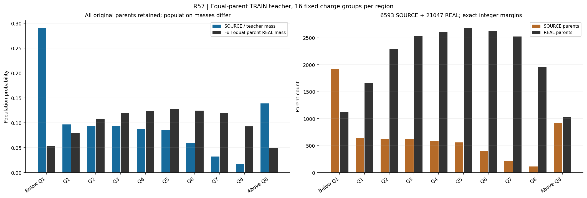
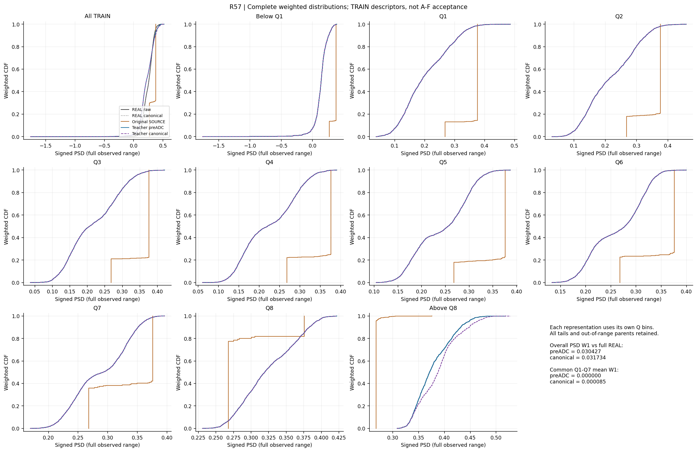
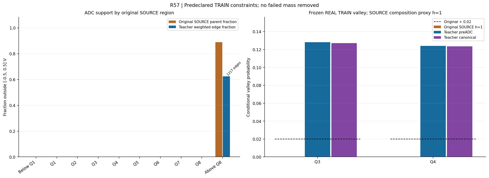
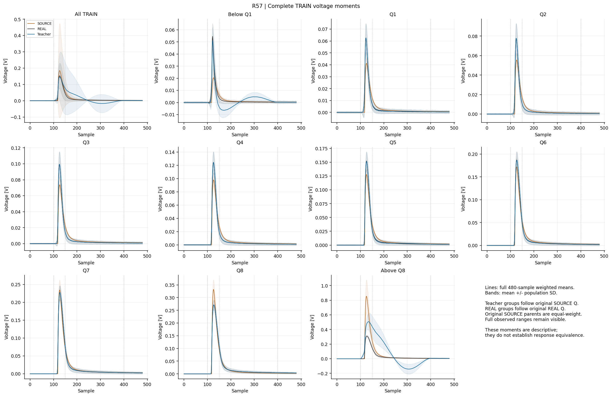
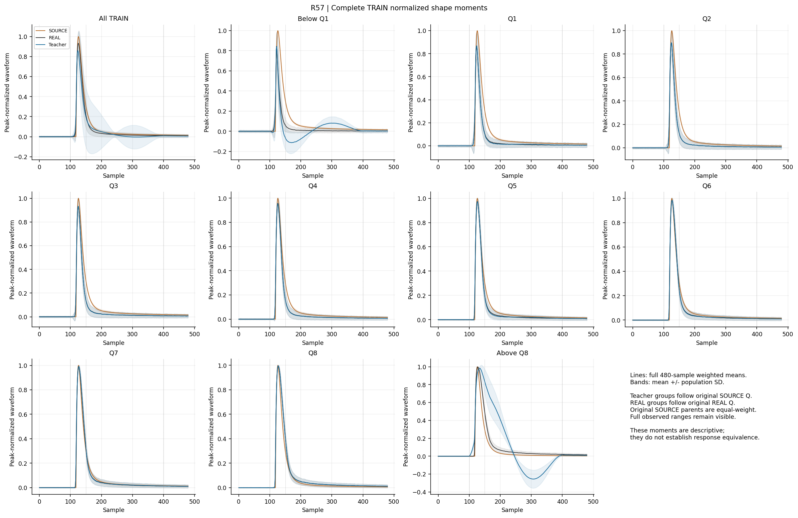
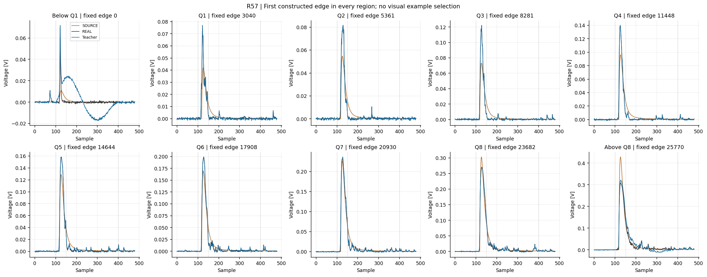

# R57：原 TRAIN 父事件等权教师预检

R57全6593源等权、21047 REAL条件等权的整数耦合通过，但固定教师未通过。共同Q1–7 preADC/规范ADC PSD W1均值为4.97e-15/0.0000851；总体为0.0304266/0.0317340。Q3/Q4 h==1 TRAIN谷概率由0增加到12.82%/12.41%，高于2个百分点的预检线。1217条教师边越界，关联575个高端支持外源，占总源测度8.69%；原输入本身有816个高端源越界，不能把全部教师越界称为新增裁剪。关闭此固定教师，0神经训练，原模型目标未完成。

本轮是一次固定TRAIN统计教师诊断，不是已训练的神经变换或A–F评价。原2000个验收SOURCE的身份、组成、顺序和权重保持；没有读取DEV/EVAL/CAL或TRAIN包的source_val/target_val。

每个原电荷区域按实际Q划为16个等质量组，再按signed PSD单调耦合。每个区域的整数总质量为Ns×Nr，每个源父事件有Nr单位，每个REAL父事件有Ns单位；换算到全体源后，每个源精确为1/6593。REAL仅在区间内等权，其总体区间质量随SOURCE。分数边是条件教师概率，不是物理逐事件真值，也不改变原源权重。

| 原区域 | SOURCE父事件 | REAL父事件 | 耦合边 | 源/教师总体质量 | 原REAL总体质量 |
|---|---:|---:|---:|---:|---:|
| 下方支持外 | 1922 | 1120 | 3040 | 0.29152131 | 0.05321423 |
| Q1 | 639 | 1670 | 2321 | 0.09692098 | 0.07934623 |
| Q2 | 622 | 2286 | 2920 | 0.09434248 | 0.10861405 |
| Q3 | 621 | 2533 | 3167 | 0.09419081 | 0.12034969 |
| Q4 | 581 | 2604 | 3196 | 0.08812377 | 0.12372310 |
| Q5 | 561 | 2689 | 3264 | 0.08509025 | 0.12776168 |
| Q6 | 399 | 2624 | 3022 | 0.06051873 | 0.12467335 |
| Q7 | 214 | 2526 | 2752 | 0.03245867 | 0.12001710 |
| Q8 | 116 | 1963 | 2088 | 0.01759442 | 0.09326745 |
| 上方支持外 | 918 | 1032 | 1954 | 0.13923859 | 0.04903312 |

十区整数边缘全部严格成立；浮点源边缘最大误差5.4210109e-20。旧训练exp(lambda*h)曝光倾斜已从本轮教师测度去除；这属于训练采样政策改变，不能改变最终评价人口。

| 预登记教师条件 | 结果 |
|---|---|
| exact_full_equal_source_marginal | 通过 |
| charge_PSD_baseline_structure | 通过 |
| no_teacher_ADC_range_excess | 未通过 |
| preADC_overall_PSD | 未通过 |
| preADC_common_Q1_Q7_PSD | 通过 |
| canonical_overall_PSD | 未通过 |
| canonical_common_Q1_Q7_PSD | 通过 |
| baseline_RMS_ACF1_all8 | 通过 |
| source_h_one_Q3_Q4_valleys | 未通过 |

总体PSD W1：preADC 0.030426636，共同规范ADC 0.031733995，均超过0.01。共同Q1–7等权平均分别为4.96775924e-15和8.51121846e-05。

| 原区域 | preADC PSD W1（源分箱） | ADC PSD W1（输出自身分箱） |
|---|---:|---:|
| 总体 | 0.0304266361 | 0.0317339953 |
| 下方支持外 | 1.32370281e-15 | 0.00024048342 |
| Q1 | 4.9372642e-15 | 0.000206707707 |
| Q2 | 7.66155248e-15 | 0.000119994275 |
| Q3 | 2.81019514e-15 | 8.6572861e-05 |
| Q4 | 5.02545223e-15 | 5.96243178e-05 |
| Q5 | 2.28721231e-15 | 5.15311386e-05 |
| Q6 | 5.92319731e-15 | 4.88790118e-05 |
| Q7 | 6.12944104e-15 | 2.24759815e-05 |
| Q8 | 3.36951789e-15 | 1.67412215e-05 |
| 上方支持外 | 3.5057687e-16 | 0.00929982808 |

教师与实际匹配REAL的总体PSD W1为1.53179938e-16；实际匹配REAL与全量REAL的W1为0.030426636，与教师preADC总体差一致到舍入精度。此构造的总体差来自保留的区间人口比例；精确条件匹配本身不消除这个差。

| h==1源组 | 父事件数 | 原源谷概率 | 教师preADC | 教师规范ADC | 允许增量 |
|---|---:|---:|---:|---:|---:|
| Q3 | 482 | 0.00000000 | 0.12817694 | 0.12717359 | 0.02 |
| Q4 | 435 | 0.00000000 | 0.12412557 | 0.12345463 | 0.02 |

谷区来自冻结R3B REAL TRAIN双峰定义，h==1是原源沉积组成代理。该TRAIN预检以原源为参照，比部分原DEV对BASE的规则更严格；失败只否定本构造，不能证明原A–F不可能，也不能将密度峰当粒子真值。

| 原区域 | 原源越界父事件 | 教师越界边 | 有越界教师的源父事件 | 教师越界总质量 |
|---|---:|---:|---:|---:|
| 下方支持外 | 0 | 0 | 0 | 0.00000000 |
| Q1 | 0 | 0 | 0 | 0.00000000 |
| Q2 | 0 | 0 | 0 | 0.00000000 |
| Q3 | 0 | 0 | 0 | 0.00000000 |
| Q4 | 0 | 0 | 0 | 0.00000000 |
| Q5 | 0 | 0 | 0 | 0.00000000 |
| Q6 | 0 | 0 | 0 | 0.00000000 |
| Q7 | 0 | 0 | 0 | 0.00000000 |
| Q8 | 0 | 0 | 0 | 0.00000000 |
| 上方支持外 | 816 | 1217 | 575 | 0.08690727 |

ADC范围为[-0.5,0.5] V。全部1217条越界边来自高端支持外，关联575个源父事件；加权总质量为0.0869073，该区域内占0.6241608。原高端源已有816个输入越界，所以这些计数不能解释成1217个新裁剪事件；每条边和原父事件的分母不同。所有越界与支持外质量保留，preADC及规范ADC没有无效事件。

冻结脉冲基底的最大相对Q误差1.54047901e-15，PSD保持误差4.88498131e-15；0:100基线和400:480尾部与所匹配REAL逐元素相同。八区baseline RMS/ACF1 W1均在1e-12以内。

| 区域 | 源Q→教师Q加权秩相关 | 源PSD→教师PSD加权秩相关 | ADC后PSD秩相关 |
|---|---:|---:|---:|
| 总体 | 1.00000000 | 0.18635918 | 0.18209102 |
| 下方支持外 | 0.99999998 | 0.74607600 | 0.74638597 |
| Q1 | 0.99999940 | 0.97663486 | 0.97662917 |
| Q2 | 0.99999921 | 0.97324574 | 0.97325034 |
| Q3 | 0.99999933 | 0.97302460 | 0.97301915 |
| Q4 | 0.99999907 | 0.97872474 | 0.97873991 |
| Q5 | 0.99999929 | 0.95297575 | 0.95294598 |
| Q6 | 0.99999801 | 0.92879829 | 0.92879724 |
| Q7 | 0.99999311 | 0.82304141 | 0.82303519 |
| Q8 | 0.99997839 | 0.57405253 | 0.57409886 |
| 上方支持外 | 0.99999975 | 0.69537566 | 0.61479693 |

这些秩相关是有限耦合分布的加权midrank描述，重复边不是独立源事件。总体PSD关联明显弱于多数区内关联，不能将区内排序当作原C源保真验收。完整480点电压/峰值归一化形状mean与SD、峰值、logQ、基线、九个固定边界及逐边特征均已保存；支持外图中可见宽的正负修正波瓣，条件PSD相等并不建立完整波形等效。

一次CPU科学作业原生退出0，耗时5.766703秒；worker峰RSS 614916096 B，作业树采样峰值510865408 B。RSS缺测1次，原因保留unknown；无资源终止。0响应训练/ODE/HGB/密度拟合，6张最终PNG已实际打开核验。

封存R57等权16分位教师，不调整组数、删除支持外事件或启动该教师的神经训练。下一轮仅用合法TRAIN预登记联合约束教师的可行性问题：保留原源父事件等权边缘，同时处理总体/条件PSD、源谷区概率及PSD秩关联；把ADC有界脉冲可行性单列，先区分原源电荷的硬界与当前脉冲基底的不足。不能把更严格的全TRAIN预检失败外推为原DEV A–F不可能；也不能通过改验收人口、谷定义或读取DEV/EVAL选参解决。只有获得完整端点证据后才另行登记神经训练。

[协议](tasks/R57_EQUAL_PARENT_TEACHER_DIAGNOSTIC_001.md) · [结果](work/R57_EQUAL_PARENT_TEACHER_DIAGNOSTIC_001/RESULT.json) · [整数边缘](work/R57_EQUAL_PARENT_TEACHER_DIAGNOSTIC_001/COUPLING_RECEIPT.json) · [复现](work/R57_EQUAL_PARENT_TEACHER_DIAGNOSTIC_001/REPRODUCTION.md) · [科学回执](work/R57_EQUAL_PARENT_TEACHER_DIAGNOSTIC_001/FINAL_RECEIPT.json)

