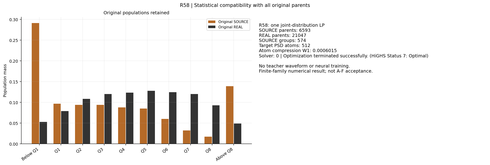
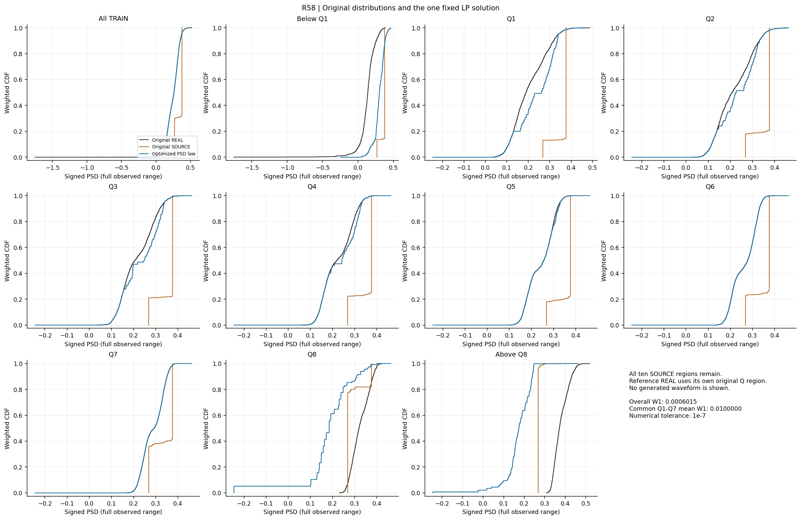
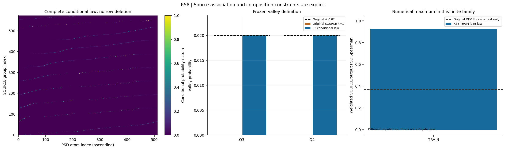
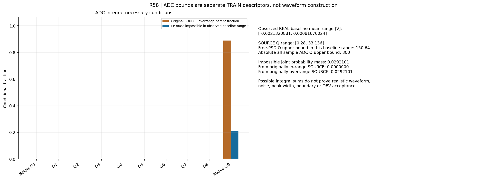

# R58：联合分布约束检查

R58一次固定LP及保存解核验通过：原6593源等权边缘与全部21047 REAL贡献保留，总体PSD W1为0.0006015000，共同Q1–7均值为0.0100000000000698，后者处于预登记数值容差内的边界。Q3/Q4 h==1谷增量均约2个百分点，TRAIN加权源PSD秩关联为0.924042；这只支持本有限统计族的可行性，不是原A–F通过。联合律有2.9210%质量在已观测REAL基线范围下不满足ADC积分必要条件，均来自原输入已越界的高端支持外源；自由PSD总电荷硬界未排除任何源事件。0教师波形、0神经训练，完整模型目标未完成。

此前“教师”指流匹配路线中人工构造的目标波形，用于定义从仿真波形到实测域端点的训练方向；它不是另一已训练网络，也不是仿真事件的真实逐事件实测答案。无配对转换并不必须使用这种教师。本轮去掉固定目标波形假设，仅检查联合统计约束，不生成教师波形，不据分数组合进行逐事件真值监督。

R57全TRAIN零越界预检严于原冻结DEV的零裁剪检查。本轮保留该负结果，同时将ADC积分可行性单列。原A–F、原2000个验收SOURCE的身份/顺序/组成/权重及数据用途全部不变；没有新DEV/EVAL/CAL或TRAIN验证字段解码。

全部6593源保持原等权边缘，按十个原电荷区域、h==1标志与64个全局PSD midrank分段得到574组。全部21047 REAL以精确整数质量参与512个等质量分位段，段均值形成512个PSD原子。压缩原子对原始完整REAL的总体W1为0.000601500013；未删除尾部或原事件。

变量x[g,k]采用源父事件计数单位，源组行和及固定REAL原子列和共同约束。每个组的条件概率律均匀归还该组原父事件，各父事件权重仍为1/6593；h与身份始终保留，REAL未被附加粒子标签。唯一目标最大化源/输出PSD的midrank协方差；边缘固定后它与Spearman成正比。这个数值最优仅针对已登记有限族，不能充当所有映射的上界。

一次HiGHS dual-simplex：317973个变量、4663个等式、41019个不等式，86773次迭代。求解器状态0：Optimization terminated successfully. (HiGHS Status 7: Optimal)。求解耗时439.302091秒。原选项及警告保存在LP_SOLVER_RECEIPT.json；没有第二次求解、组数/原子数/约束扫描。

| 从保存解独立核验 | 值 |
|---|---:|
| equality_residual_max | 3.58046925e-13 |
| inequality_violation_max | 2.26553901e-10 |
| lower_bound_violation_max | 0 |
| CDF_slack_upper_bound_violation_max | 0 |
| group_row_error_max | 1.8562929e-13 |
| target_column_error_max | 3.28626015e-13 |
| per_parent_probability_sum_error_max | 6.19504448e-14 |
| SOURCE_global_weight_error_max | 9.40545385e-18 |

概率非负：True；原登记1e-7数值容差内可行：True。负值不会被截零修复；此处没有严格有理数可行性证书。

| 原区域 | 源父事件 | REAL父事件 | 精确PSD W1 |
|---|---:|---:|---:|
| 总体 | 6593 | 21047 | 0.000601500013 |
| 下方支持外 | 1922 | 1120 | 0.169872609 |
| Q1 | 639 | 1670 | 0.0321557271 |
| Q2 | 622 | 2286 | 0.0147827392 |
| Q3 | 621 | 2533 | 0.0145885117 |
| Q4 | 581 | 2604 | 0.00705558798 |
| Q5 | 561 | 2689 | 0.00112035303 |
| Q6 | 399 | 2624 | 0.000147447996 |
| Q7 | 214 | 2526 | 0.000149632973 |
| Q8 | 116 | 1963 | 0.144340175 |
| 上方支持外 | 918 | 1032 | 0.206986449 |

总体W1为0.000601500013；原共同Q1–Q7等权平均为0.0100000000001。模型中使用原子与全部原REAL PSD值的并集积分，核验用SciPy原始样本精确W1；没有以直方图或几个CDF点代替。处于阈值附近的值按原登记数值容差报告，不能据舍入声称严格小于阈值。

| h==1源组 | 父事件数 | 原源谷概率 | 联合律谷概率 | 增量 |
|---|---:|---:|---:|---:|
| Q3 | 482 | 0 | 0.02 | 0.02 |
| Q4 | 435 | 0 | 0.02 | 0.02 |

本有限族的数值最优加权SOURCE PSD关联为0.924042044。冻结原BASE DEV参考为0.418989839，允许下降0.05后的值为0.368989839；这里的TRAIN人口不同，比较仅作上下文，不能把它称为原C门通过。组内共享概率律是本有限族的限制，不能凭该最优值排除更细或不同的映射。

REAL TRAIN基线均值范围为[-0.00213208813, 0.000816700235] V；原源Q范围[0.27999652, 33.1364375]。在该已观测基线范围内，自由PSD的最大可容纳Q为150.639626；只受全窗ADC电压范围约束时绝对上界为300。

对给定(q,p)，短/长脉冲段电压和分别为q(1−p)+50b与qp+250b。它们必须分别落在[−25,25]与[−125,125]内。没有共同可用b只证明在已观测基线范围下积分不可实现；有共同b也不能证明真实形状、噪声、峰宽、边界或神经变换成立。

| 原区域 | 源父事件 | 原输入越界父事件 | 有不可实现概率的父事件 | 不可实现总质量 | 原输入未越界部分质量 |
|---|---:|---:|---:|---:|---:|
| 总体 | 6593 | 816 | 202 | 0.0292101081 | 0 |
| 下方支持外 | 1922 | 0 | 0 | 0 | 0 |
| Q1 | 639 | 0 | 0 | 0 | 0 |
| Q2 | 622 | 0 | 0 | 0 | 0 |
| Q3 | 621 | 0 | 0 | 0 | 0 |
| Q4 | 581 | 0 | 0 | 0 | 0 |
| Q5 | 561 | 0 | 0 | 0 | 0 |
| Q6 | 399 | 0 | 0 | 0 | 0 |
| Q7 | 214 | 0 | 0 | 0 | 0 |
| Q8 | 116 | 0 | 0 | 0 | 0 |
| 上方支持外 | 918 | 816 | 202 | 0.0292101081 | 0 |

原输入越界父事件计数与联合律不可实现概率的分母不同；所有原源均保留。TRAIN原始电荷和范围不同于冻结DEV，因此这些数值不能当DEV失败率或放宽其零裁剪门的许可。

一次CPU科学作业原生退出0，总耗时442.561727秒；worker峰RSS 1034833920 B，作业树采样峰值1025875968 B，RSS缺测0次。0教师波形、响应训练、ODE、HGB或密度拟合。四张最终PNG均已实际打开。

封存R58有限统计族结果，以此作为联合PSD与源关联并非已被排除的证据。下一轮预登记直接无配对的全窗神经分布训练：保留全部原TRAIN源父事件等权，联合考虑总体/条件PSD、真实全窗条件分布、源秩/谷概率、精确电荷、ADC范围和同处理REAL控制；不把R58有限原子或分数组合充当逐事件真实目标波形。先仅用合法TRAIN固定网络、损失和一个科学终点，再执行冻结候选的原数值检查、完整A–C及独立重放；通过后继续原D/E。R58的2.92% TRAIN不可实现质量不授权修改原DEV人口、阈值或删除支持外源。

[协议](tasks/R58_JOINT_DISTRIBUTION_FEASIBILITY_001.md) · [结果](work/R58_JOINT_DISTRIBUTION_FEASIBILITY_001/RESULT.json) · [LP状态](work/R58_JOINT_DISTRIBUTION_FEASIBILITY_001/LP_SOLVER_RECEIPT.json) · [复现](work/R58_JOINT_DISTRIBUTION_FEASIBILITY_001/REPRODUCTION.md) · [科学回执](work/R58_JOINT_DISTRIBUTION_FEASIBILITY_001/FINAL_RECEIPT.json)

