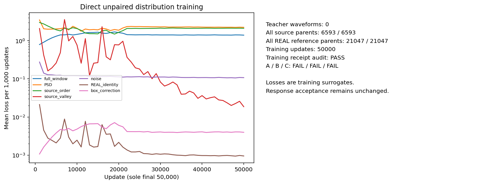
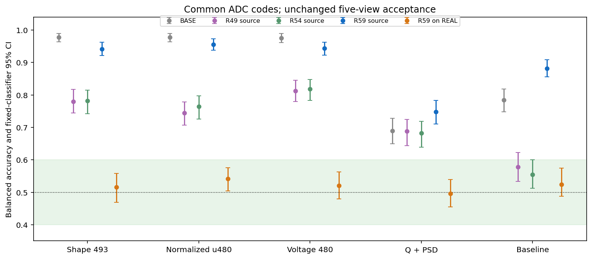
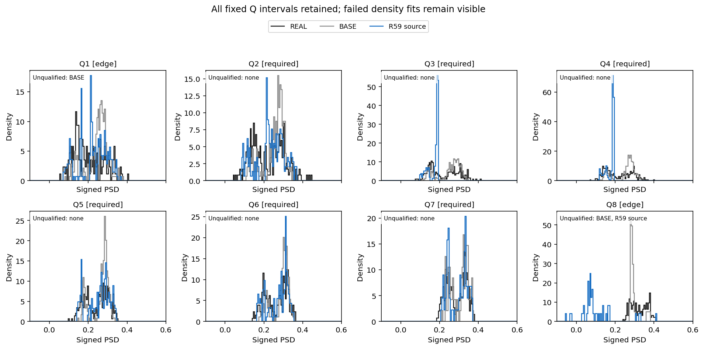
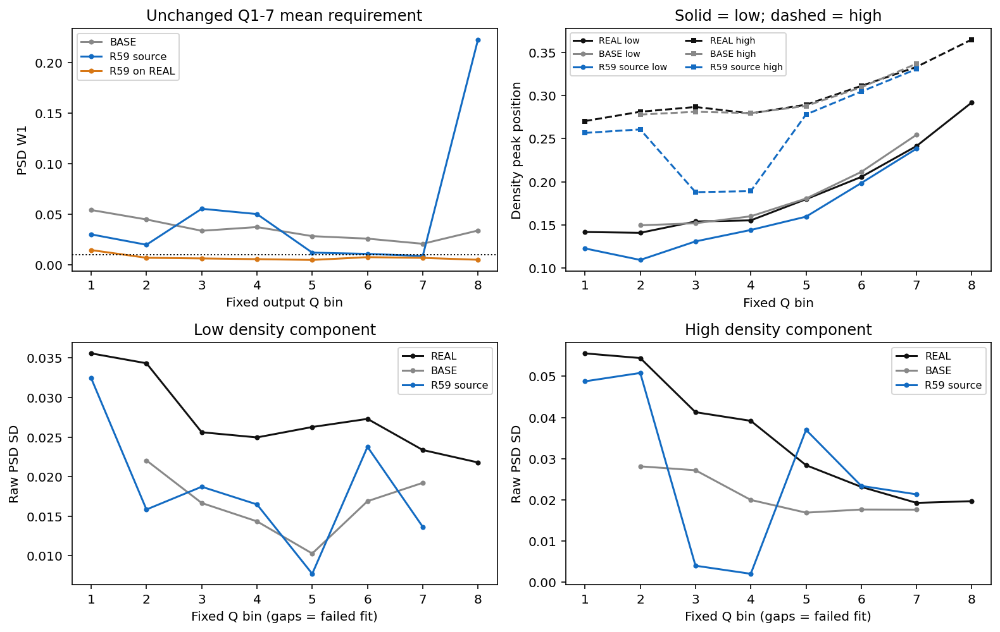
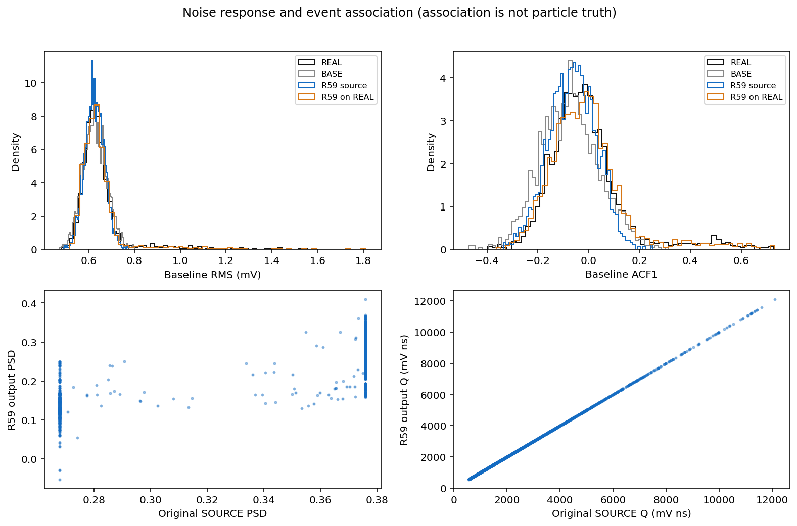
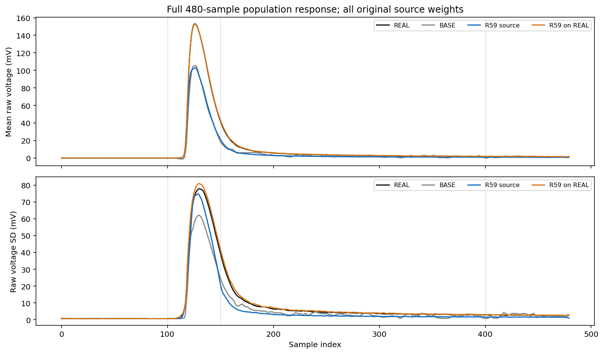
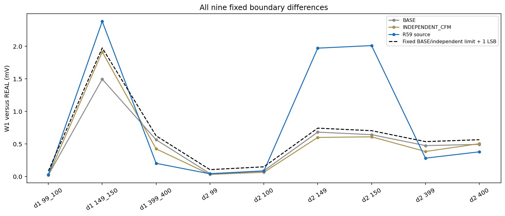
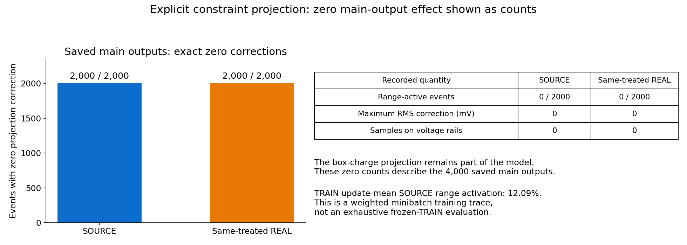

# R59：直接无配对全窗分布训练

原 A/B/C：A 未通过 / B 未通过 / C 未通过。本轮固定末点已经完成训练、数值检查、评价和独立重放；完整模型目标仍需同一方法满足原 A–F。

本轮不构造教师波形，使用全部 6593 个源父事件和 21047 个实测父事件。每步分区抽样并显式恢复原区域质量的全局权重，训练一个全 480 点条件 U-Net；只使用预登记的第 50000 次更新。源 h 只用于谷约束，不输入网络，也不为实测添加粒子标签。

| 共同 ADC 表示下的视图 | SOURCE BA [95% CI] | 同处理 REAL BA [95% CI] |
|---|---:|---:|
| full_historical_shape | 0.942 [0.922135, 0.962645] | 0.516 [0.469011, 0.558597] |
| normalized_u480 | 0.956 [0.937547, 0.973677] | 0.542 [0.504603, 0.575821] |
| full_voltage | 0.944 [0.923001, 0.962462] | 0.520 [0.479476, 0.562358] |
| Q_PSD_2D | 0.748 [0.710634, 0.783703] | 0.496 [0.454922, 0.539681] |
| baseline_local | 0.882 [0.855416, 0.908298] | 0.524 [0.487447, 0.574271] |

A 要求全部十个区间完整位于 [0.40,0.60]，使用未舍入数值判定。RAW REAL–REAL、BASE、R49 和 R54 比较复用已冻结结果；本轮没有重新拟合历史对照。

| 相对冻结 R54 的配对 BA 差 | SOURCE ΔBA [95% CI] | 同处理 REAL ΔBA [95% CI] |
|---|---:|---:|
| full_historical_shape | +0.160 [+0.123208, +0.202285] | +0.004 [-0.042056, +0.045394] |
| normalized_u480 | +0.192 [+0.160612, +0.232748] | +0.040 [-0.002925, +0.080417] |
| full_voltage | +0.126 [+0.094571, +0.162720] | +0.012 [-0.026923, +0.050675] |
| Q_PSD_2D | +0.066 [+0.030252, +0.103951] | +0.010 [-0.017980, +0.039463] |
| baseline_local | +0.328 [+0.275845, +0.381807] | +0.036 [+0.003836, +0.073554] |

配对区间使用相同留出身份、组和 500 次 bootstrap，条件于这两个已拟合分类器。R59 同时改变训练目标、抽样及初始化等因素，不能把差异归因于单一结构或推广为重复训练、独立采集收益。

总体 PSD W1=0.014454697；固定共同 Q1–7 等权平均 W1=0.026478402。两个原阈值均为 0.010。

| 成分 | 必需 Q2–7 峰位 MAE | raw SD 平均相对误差 | 必需区密度拟合失败 |
|---|---:|---:|---|
| 低峰 | 0.015990272 | 39.949% | [] |
| 高峰 | 0.038233463 | 38.973% | [] |

全部八区及失败密度拟合保留。原始源 purehad Q3/Q4 分母为 213/181；旧 postADC 定义的 207/182 另列，不混用。密度成分不是粒子真值。

| 原阶段门 | 结果 |
|---|---|
| gate1_complete_response | 未通过 |
| gate2_PSD_width_centers_noise | 未通过 |
| gate3_source_preservation | 通过 |
| gate4_boundary_source | 未通过 |
| gate5_same_treated_REAL_control | 通过 |
| gate6_numerical_replay | 通过 |

| 原始源 purehad 区 | N | 输出谷比例 | BASE 谷比例 | 增量 | 结果 |
|---|---:|---:|---:|---:|---|
| bin3 | 213 | 0 | 0.056338028 | -0.056338028 | 通过 |
| bin4 | 181 | 0 | 0.0055248619 | -0.0055248619 | 通过 |

| 全人口源关联 | 输出 Spearman | BASE Spearman | 结果 |
|---|---:|---:|---|
| source_Q_to_output_Q | 0.99999939 | 0.99972601 | 通过 |
| source_PSD_to_output_PSD | 0.49727037 | 0.41898984 | 通过 |

| 噪声量 | 候选 W1 | BASE W1 | 相对变化 |
|---|---:|---:|---:|
| baseline_RMS_V_overall_W1 | 2.1162292e-05 | 1.9358299e-05 | +9.319% |
| ACF1_overall_W1 | 0.05242071 | 0.064234934 | -18.392% |

模型内包含预登记的电压范围与原电荷联合欧氏投影。下表明确报告其影响；后续 ADC 的零裁剪不能说明内部没有修改波形。

| 人口 | 触发范围投影事件 / N | 投影修正 RMS 均值 (V) | 最大单点修正 (V) | 电压上下限采样点总数 |
|---|---:|---:|---:|---:|
| SOURCE | 0 / 2000 | 0 | 0 | 0 |
| 同处理 REAL | 0 / 2000 | 0 | 0 | 0 |

支持内外及原电荷区域的投影统计见 `CONSTRAINT_PROJECTION_SUMMARY.json`。TRAIN 的逐更新记录是按原区域质量加权的小批量估计；不是冻结模型对全 TRAIN 的再次推理。固定 TRAIN 数值探针也保留每事件投影记录。

网络位移只依赖当前输入、噪声和电荷条件，作为时间/状态常数场执行原 Heun128；缓存一次神经预测不代表省略数值检查。TRAIN 128/256 差 median=0 LSB，p95=0 LSB；preADC 最大相对电荷误差=8.994793e-09，原阈值仍为 0.25 / 1 LSB 和 1e-5。

主输出和探针合计 5984 条；实际网络行数 5984，数学场求值行数 1531904。新 HGB 10 次、密度描述槽 16 个，4000 条独立进程重放通过可移动入口逐位一致。

训练回执核验：通过；源/REAL参考/REAL保持实际唯一父事件 [6593, 21047, 21047]，消费行数分别为 16000000 / 16000000 / 3200000。它们是重复曝光，不能当作独立新事件。六条随机流、逐更新损失及父事件曝光次数完整保存。

六个原生作业均退出 0，含必要汇总的实际耗时 4850.557215 秒；worker 峰值 RSS 2863276032 B。模型训练 GPU allocated / reserved 峰 2956646912 / 3466592256 B。无计算时间配额；机器安全限制保留。

本轮训练没有解码验证波形，训练结束后按预登记方案读取历史 DEV；最终 EVAL 和新 CAL 波形未解码。单次历史采集与固定评价器的通过不等于独立采集或物理逐事件对应关系得到证明。

封存R59固定末点，不续训或选择其他检查点。下一轮先登记仅用合法TRAIN的冻结R59损失与梯度诊断：按原父事件权重完成一次全TRAIN固定前向，并在预先固定的小批量上分解七项损失及全窗四个视图的参数梯度，区分条件分布不足、源顺序/谷约束竞争、支持外投影和数值实现问题。保留全部源父事件及同处理REAL，据TRAIN证据决定下一项直接无配对机制；原A–F、最终源人口和阈值不变，不因本轮负结果启动D/E或宣称目标不可能。

[协议](tasks/R59_DIRECT_DISTRIBUTION_RESPONSE_001.md) · [验收](work/R59_DIRECT_DISTRIBUTION_RESPONSE_001/ACCEPTANCE_A_C.json) · [指标](work/R59_DIRECT_DISTRIBUTION_RESPONSE_001/METRICS_COMPACT.json) · [R54 比较](work/R59_DIRECT_DISTRIBUTION_RESPONSE_001/PAIRED_R59_MINUS_R54.json) · [复现](work/R59_DIRECT_DISTRIBUTION_RESPONSE_001/REPRODUCTION.md) · [数值](work/R59_DIRECT_DISTRIBUTION_RESPONSE_001/TRAIN_SOLVER_CHECK.json) · [投影](work/R59_DIRECT_DISTRIBUTION_RESPONSE_001/CONSTRAINT_PROJECTION_SUMMARY.json) · [重放](work/R59_DIRECT_DISTRIBUTION_RESPONSE_001/REPLAY_RECEIPT.json)

