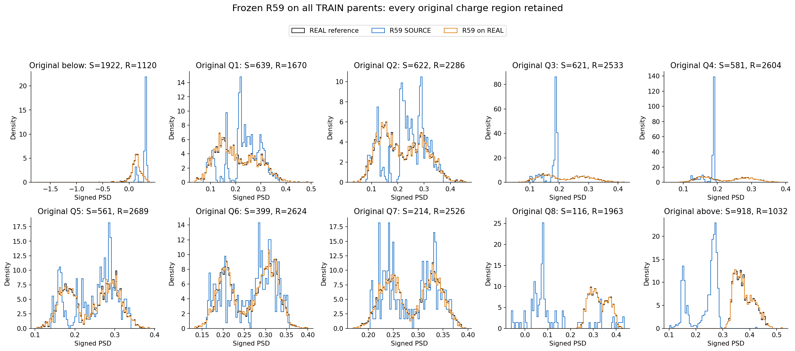
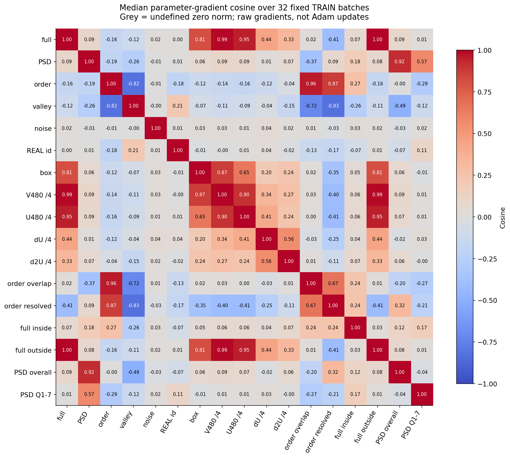
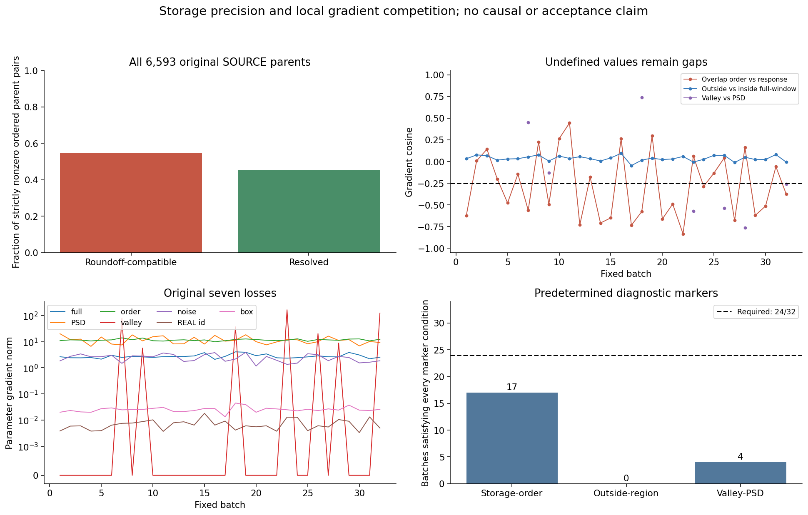
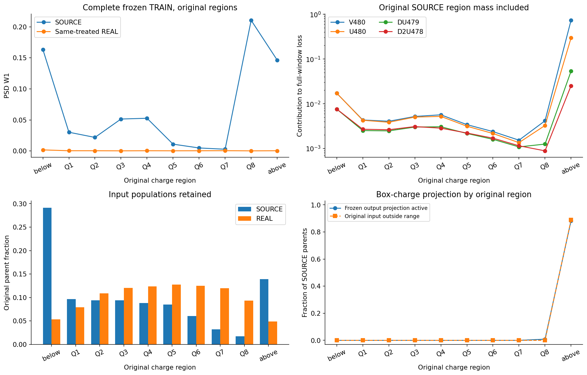
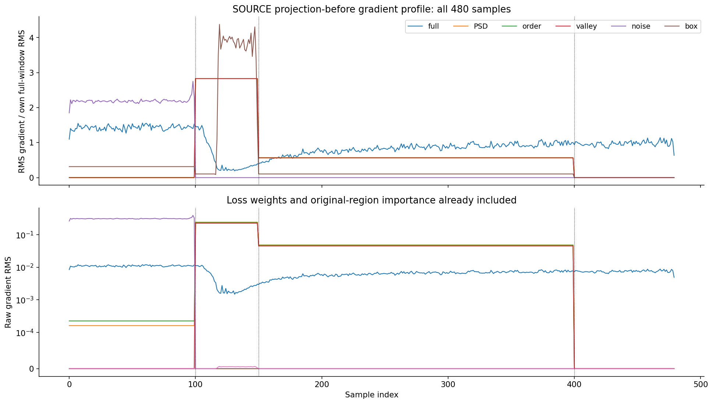
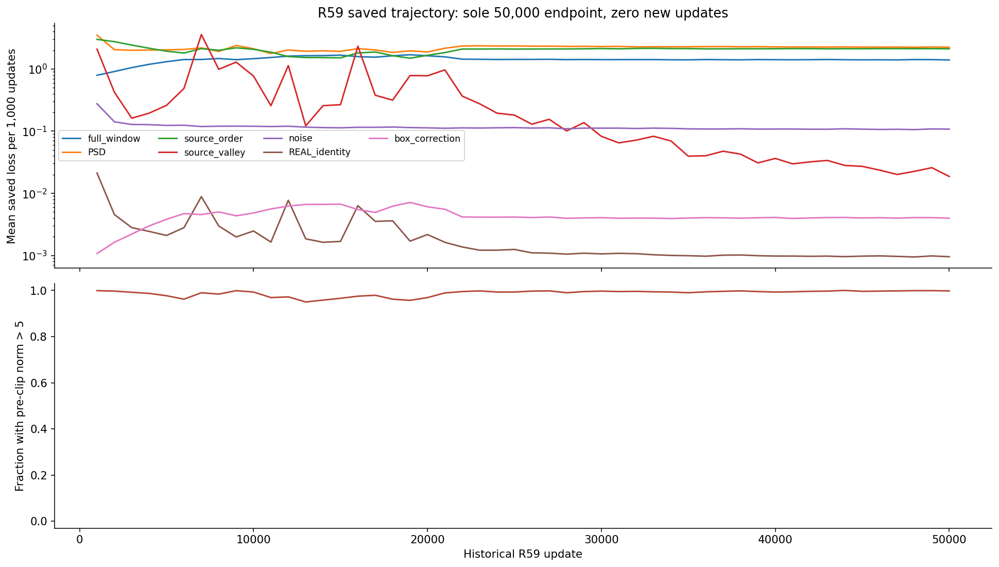
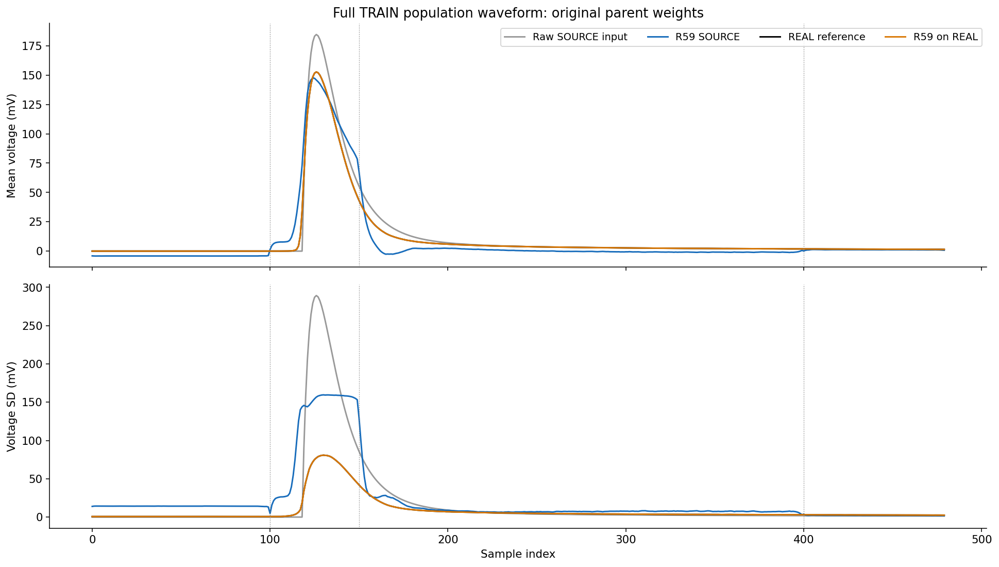

# R60：冻结 TRAIN 分布与梯度诊断

固定诊断已完成，三个预设冲突标记均未触发：存储排序 17/32、支持外全窗 0/32、谷区与 PSD 4/32，均低于预定的 24/32。保留这些否定结果，不将候选解释写成已确认机制。R59 原 A/B/C 失败保持；本轮没有新模型，长期目标仍需同一冻结方法满足原 A–F。

对全部 6593 SOURCE 和 21047 REAL 原 TRAIN 父事件，各用一个固定噪声执行原 Heun128。另完成固定 32 批、17 项梯度分解；合计 39928 行实际神经前向、465 次网络调用、544 次求导。0 训练更新、教师、HGB 或密度拟合；0 DEV/EVAL/CAL 波形读取。所有原区域、支持外事件与源父权重保留。

| 冻结 TRAIN 描述 | 数值 |
|---|---:|
| SOURCE 总体 PSD W1 | 0.0093706302 |
| SOURCE 共同 Q1–7 PSD W1 等区均值 | 0.024965918 |
| 同处理 REAL 总体 PSD W1 | 0.00027974615 |
| 原输入/输出 SOURCE PSD Spearman | 0.48395923 |
| 原输入/输出 SOURCE Q Spearman | 0.99999978 |

总体距离较小并未解决条件响应。Q3/Q4 中 SOURCE 中位 PSD 约为 0.18862/0.18905，95% 分位约为 0.19189/0.19141，仍聚集在窄峰；同处理 REAL 对应中位数为 0.20599/0.21991、95% 分位为 0.33882/0.33130。以下是 TRAIN 描述，不替代原 DEV 验收，也未重新做密度拟合。

| 原电荷区域 | SOURCE N | REAL N | SOURCE PSD W1 | 同处理 REAL PSD W1 | SOURCE 范围投影比例 |
|---|---:|---:|---:|---:|---:|
| below | 1922 | 1120 | 0.16344589 | 0.0017377664 | 0.0000% |
| Q1 | 639 | 1670 | 0.030174998 | 0.00036707041 | 0.0000% |
| Q2 | 622 | 2286 | 0.021834947 | 0.00033510674 | 0.0000% |
| Q3 | 621 | 2533 | 0.051463165 | 0.00020673323 | 0.0000% |
| Q4 | 581 | 2604 | 0.052689783 | 0.00034620529 | 0.0000% |
| Q5 | 561 | 2689 | 0.010968953 | 0.00025604265 | 0.0000% |
| Q6 | 399 | 2624 | 0.0048424818 | 0.00032858607 | 0.0000% |
| Q7 | 214 | 2526 | 0.0027870968 | 0.00043706761 | 0.0000% |
| Q8 | 116 | 1963 | 0.21048039 | 0.00018260668 | 0.8621% |
| above | 918 | 1032 | 0.14645229 | 0.00033565022 | 88.2353% |

Q3/Q4 中 h==1 的源父事件分别为 482/435，固定硬谷区输出比例均为 0，平滑谷概率分别为 0.01810694/0.01663660。原谷定义和来源标签边界保持；低谷比例与真实响应匹配必须一起判断。

| 全 TRAIN 原非零有序父对 | 对数 | 占比 | 对原排序损失的贡献 |
|---|---:|---:|---:|
| float32 PSD 区间重叠 | 23734116 | 54.6101% | 1.7415288 |
| 存储区间可分辨 | 19726882 | 45.3899% | 0.37358446 |

完整有序父对共 43467649；严格非零对 43460998，精确相等对 6651（其中 6593 为同父对角线）。区间重叠者贡献原排序罚的 82.3374%。PSD 舍入区间宽度约 9.60e−8 至 1.36e−7；这是 float32 存储包络，不是仪器误差，也不证明真实输入完全等 PSD。

存储排序标记中，“质量至少一半”和“梯度范数占比至少一半”均在 32/32 批满足，但与全窗+PSD+噪声梯度的余弦低于 −0.25 仅有 17/32。支持外梯度范数占比条件也为 32/32，但内外余弦冲突为 0/32。谷梯度仅 7 批达到 PSD 梯度范数的一半，其中 4 批满足余弦条件；另外 25 批谷梯度为零，余弦保留未定义。没有修改判据或将单个子条件替代整个标记。

全部分解值和参数梯度重组通过预登记数值容差，冻结参数逐张量 SHA 前后一致。保存的 Gram 矩阵、父索引、全部区域 W1、源关联和历史损失轨迹已由本机独立核算；本机复核没有执行新的模型前向。欧氏梯度不是实际 Adam 更新方向，局部反向也不是因果结论。

全 TRAIN 有 811/6593 个 SOURCE 触发内部范围投影，其中 810 个位于高端支持外，1 个位于 Q8；同处理 REAL 为 0/21047。高端支持外原输入本身已有 816/918 越界。SOURCE 投影修正 RMS 均值 0.012637273 V、最大事件 RMS 0.22903403 V，落在电压端点的采样数为 24479。源/REAL 最大 preADC 相对电荷误差为 2.1621145e-08 / 4.2139939e-08。这些全 TRAIN 结果与 R59 主 DEV 中投影为零的范围不同。

R59 既有 50000 步记录中，98.80% 的裁剪前梯度范数超过 5；范数中位数为 21.557738。这描述保存的训练轨迹，没有据此挑选另一个检查点。

原生作业退出 0，科学执行（监督器计时）53.273543 秒；worker 峰值 RSS 2756640768 B。GPU allocated/reserved 峰为 3201523712 / 3596615680 B。有 1 次实际 PID 的 RSS 查询失败，回执原因保留 unknown；未把失败补成成功采样。真实 PID 随后的 /proc 查询确认不存在。所有七张图实际打开核对通过。

封存R60，保留三个预设冲突标记均未触发的结论。下一轮预登记独立的单因素存储精度排序消融：相对R59只取消float32 PSD区间重叠父对的顺序罚，保留原非零父对分母、全部源父事件及其他六项损失；原网络、初始化、随机流、常数和唯一50000步终点保持。依据是直接核验的存储顺序不可分辨性，而非宣称17/32达到24/32。先检查新损失语义和复现绑定，再从零训练；同一冻结末点沿用原数值门与完整A–C，失败关闭，通过才继续D/E。原A–F、最终SOURCE人口和阈值不变。

下一轮是另行登记的假设检验，不是 R60 标记触发后的机制确认；当前尚未登记或开始下一轮训练。

[协议](tasks/R60_FROZEN_TRAIN_GRADIENT_DIAGNOSTIC_001.md) · [结果](work/R60_FROZEN_TRAIN_GRADIENT_DIAGNOSTIC_001/RESULT.json) · [逐批记录](work/R60_FROZEN_TRAIN_GRADIENT_DIAGNOSTIC_001/GRADIENT_BATCH_RECORDS.json) · [产物复核](work/R60_FROZEN_TRAIN_GRADIENT_DIAGNOSTIC_001/FROZEN_ARTIFACT_REVIEW.json) · [复现](work/R60_FROZEN_TRAIN_GRADIENT_DIAGNOSTIC_001/REPRODUCTION.md) · [后续判断](reviews/R60_ROOT_DIRECTION_001.json)

