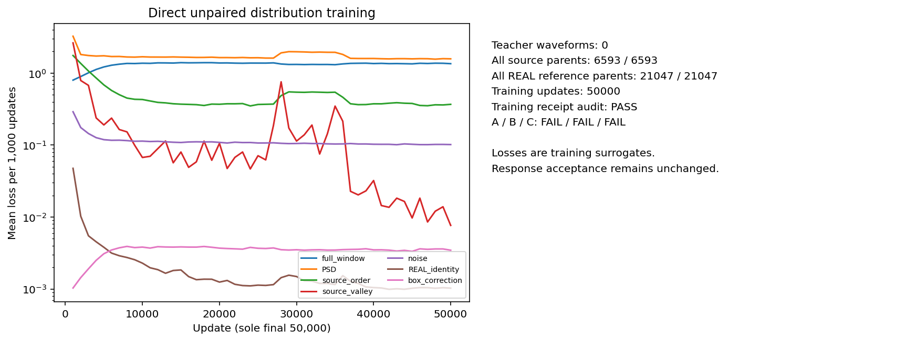
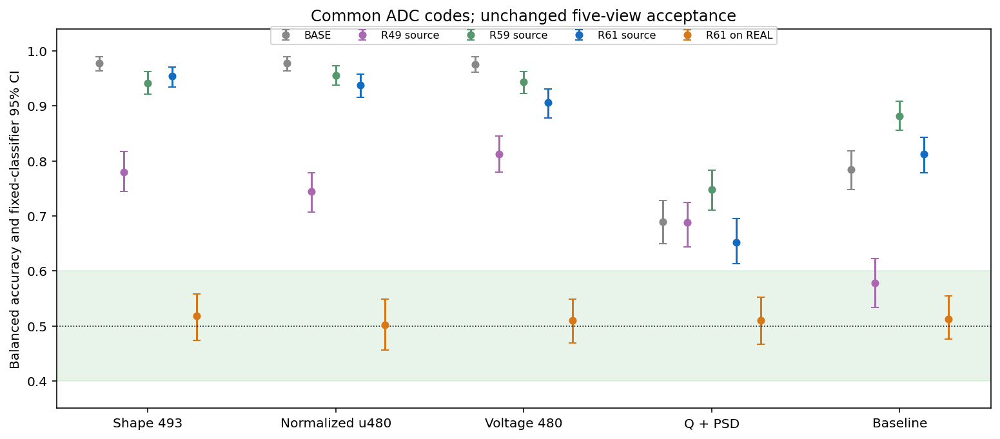
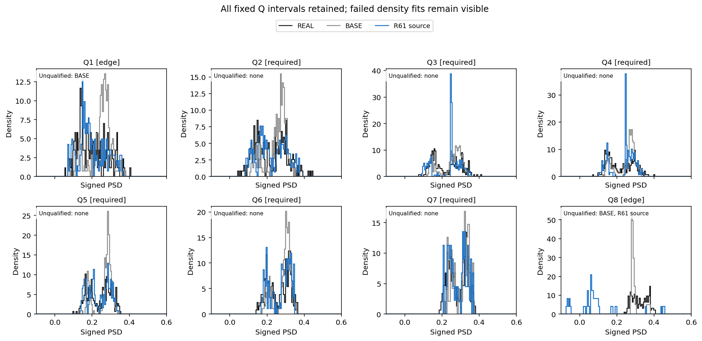
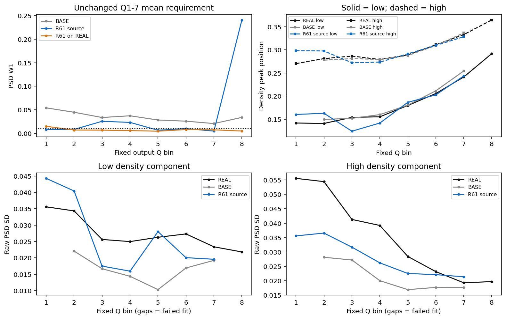
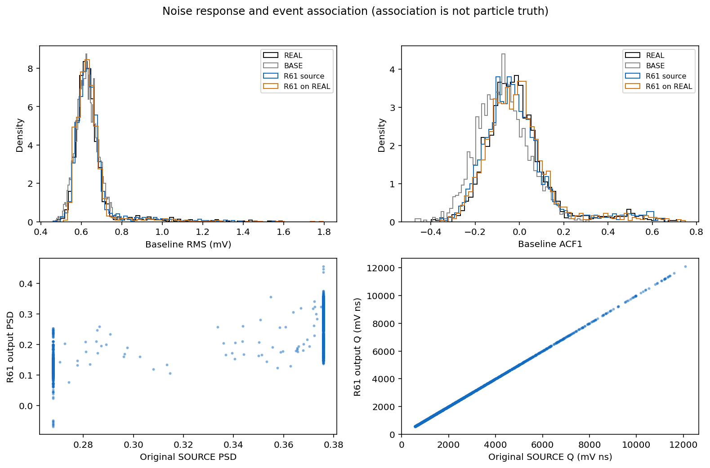
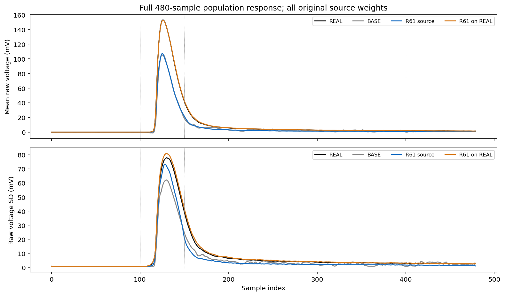
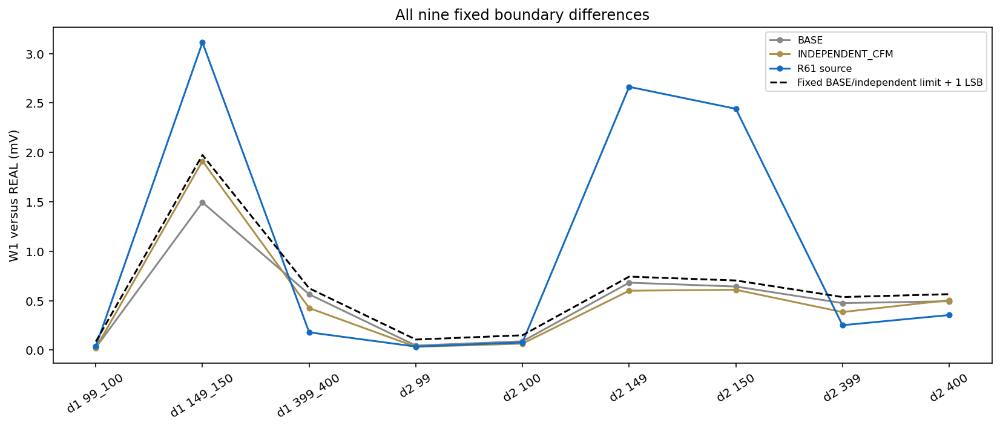
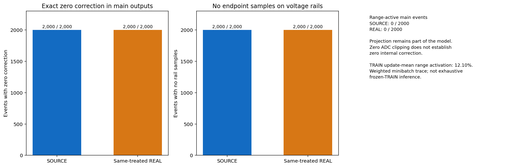
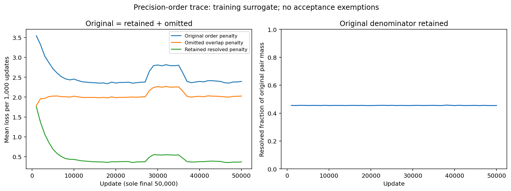

# R61：存储精度排序单因素消融

原 A/B/C：A 未通过 / B 未通过 / C 未通过。本轮固定末点已经完成训练、数值检查、评价和独立重放；完整模型目标仍需同一方法满足原 A–F。

本轮只取消 float32 PSD 保守区间重叠父对的顺序罚，保留原非零父对分母。全部 6593 源和 21047 REAL 父事件、初始化、六条实际随机流、曝光次数、冻结常数、其他六项损失及唯一 50000 更新终点与 R59 匹配。该区间是存储精度包络，不是粒子标签或实测不确定性。

| 共同 ADC 表示下的视图 | SOURCE BA [95% CI] | 同处理 REAL BA [95% CI] |
|---|---:|---:|
| full_historical_shape | 0.954 [0.934748, 0.971234] | 0.518 [0.473698, 0.558496] |
| normalized_u480 | 0.938 [0.915668, 0.958497] | 0.502 [0.455648, 0.548316] |
| full_voltage | 0.906 [0.878649, 0.931185] | 0.510 [0.468681, 0.548181] |
| Q_PSD_2D | 0.652 [0.612732, 0.694965] | 0.510 [0.466386, 0.552387] |
| baseline_local | 0.812 [0.778532, 0.842611] | 0.512 [0.475709, 0.554568] |

A 要求全部十个区间完整位于 [0.40,0.60]，使用未舍入数值判定。RAW REAL–REAL、BASE、R49 和 R59 比较复用已冻结结果；本轮没有重新拟合历史对照。

| 相对冻结 R59 的配对 BA 差 | SOURCE ΔBA [95% CI] | 同处理 REAL ΔBA [95% CI] |
|---|---:|---:|
| full_historical_shape | +0.012 [-0.010809, +0.036170] | +0.002 [-0.046469, +0.050380] |
| normalized_u480 | -0.018 [-0.041654, +0.005198] | -0.040 [-0.078385, -0.006009] |
| full_voltage | -0.038 [-0.061714, -0.015325] | -0.010 [-0.047592, +0.023886] |
| Q_PSD_2D | -0.096 [-0.140349, -0.052245] | +0.014 [-0.016786, +0.043678] |
| baseline_local | -0.070 [-0.103423, -0.035775] | -0.012 [-0.057954, +0.032100] |

配对区间使用相同留出身份、组和 500 次 bootstrap，条件于两个冻结分类器。一致性审计支持本固定运行的单因素比较；一个训练种子不能估计重复训练波动，历史单次采集也不能证明独立采集收益。

总体 PSD W1=0.010148559；固定共同 Q1–7 等权平均 W1=0.012159815。两个原阈值均为 0.010。

| 成分 | 必需 Q2–7 峰位 MAE | raw SD 平均相对误差 | 必需区密度拟合失败 |
|---|---:|---:|---|
| 低峰 | 0.012904346 | 22.527% | [] |
| 高峰 | 0.007459295 | 20.939% | [] |

全部八区及失败密度拟合保留。原始源 purehad Q3/Q4 分母为 213/181；旧 postADC 定义的 207/182 另列，不混用。密度成分不是粒子真值。

| 原阶段门 | 结果 |
|---|---|
| gate1_complete_response | 未通过 |
| gate2_PSD_width_centers_noise | 未通过 |
| gate3_source_preservation | 通过 |
| gate4_boundary_source | 未通过 |
| gate5_same_treated_REAL_control | 通过 |
| gate6_numerical_replay | 通过 |

| 原始源 purehad 区 | N | 输出谷比例 | BASE 谷比例 | 增量 | 结果 |
|---|---:|---:|---:|---:|---|
| bin3 | 213 | 0 | 0.056338028 | -0.056338028 | 通过 |
| bin4 | 181 | 0 | 0.0055248619 | -0.0055248619 | 通过 |

| 全人口源关联 | 输出 Spearman | BASE Spearman | 结果 |
|---|---:|---:|---|
| source_Q_to_output_Q | 0.99999939 | 0.99972601 | 通过 |
| source_PSD_to_output_PSD | 0.50073568 | 0.41898984 | 通过 |

| 噪声量 | 候选 W1 | BASE W1 | 相对变化 |
|---|---:|---:|---:|
| baseline_RMS_V_overall_W1 | 5.4749052e-06 | 1.9358299e-05 | -71.718% |
| ACF1_overall_W1 | 0.010283334 | 0.064234934 | -83.991% |

模型内包含预登记的电压范围与原电荷联合欧氏投影。下表明确报告其影响；后续 ADC 的零裁剪不能说明内部没有修改波形。

| 人口 | 触发范围投影事件 / N | 投影修正 RMS 均值 (V) | 最大单点修正 (V) | 电压上下限采样点总数 |
|---|---:|---:|---:|---:|
| SOURCE | 0 / 2000 | 0 | 0 | 0 |
| 同处理 REAL | 0 / 2000 | 0 | 0 | 0 |

支持内外及原电荷区域的投影统计见 `CONSTRAINT_PROJECTION_SUMMARY.json`。TRAIN 的逐更新记录是按原区域质量加权的小批量估计；不是冻结模型对全 TRAIN 的再次推理。固定 TRAIN 数值探针也保留每事件投影记录。

| 单因素核验 | 结果 |
|---|---|
| R59_initial_state_equal | 通过 |
| R59_all_six_consumed_streams_equal | 通过 |
| R59_parent_arrays_and_exposures_equal | 通过 |
| R59_final_PCG64_states_equal | 通过 |
| R59_frozen_distribution_statistics_byte_identical | 通过 |
| single_factor_receipt_assertions_match | 通过 |
| precision_trace_complete_finite_nonnegative | 通过 |
| original_order_equals_resolved_plus_omitted | 通过 |
| original_pair_mass_and_resolved_fraction_valid | 通过 |
| precision_intervals_cover_original_source | 通过 |
| precision_rule_frozen_original_denominator | 通过 |

原排序罚 = 保留可分辨罚 + 省略重叠罚，全部50000步分解最大绝对残差 1.7763568e-15。下表为逐更新小批量记录均值，不是冻结模型全TRAIN评价。

| 排序训练记录 | 逐更新均值 |
|---|---:|
| original_order_loss | 2.5300466 |
| omitted_order_loss | 2.0415605 |
| original_nonzero_pair_mass | 0.99511528 |
| resolved_pair_fraction | 0.4549019 |

R60 的三个预设冲突标记均未触发的结论保持；R61 是另行预登记的存储精度假设，不把本轮结果倒填为 R60 已定位原因。

首次数值检查在保存训练审计 JSON 时因 NumPy 布尔值类型退出 1，尚未执行神经前向或读取 DEV。修复只对一个审计字段加原生 bool 转换；实际保存 TRAIN 的全部28项审计通过，修复前后值完全一致，权重及训练条件未变。原代码、失败日志、一次未启动科学 worker 的旧提交标记拦截和恢复回执均保留在 `repairs/AUDIT_JSON_001/`。失败作业耗时 3.085775 秒已纳入下述总耗时。

网络位移只依赖当前输入、噪声和电荷条件，作为时间/状态常数场执行原 Heun128；缓存一次神经预测不代表省略数值检查。TRAIN 128/256 差 median=0 LSB，p95=0 LSB；preADC 最大相对电荷误差=9.4526025e-09，原阈值仍为 0.25 / 1 LSB 和 1e-5。

主输出和探针合计 5984 条；实际网络行数 5984，数学场求值行数 1531904。新 HGB 10 次、密度描述槽 16 个，4000 条独立进程重放通过可移动入口逐位一致。

训练回执核验：通过；源/REAL参考/REAL保持实际唯一父事件 [6593, 21047, 21047]，消费行数分别为 16000000 / 16000000 / 3200000。它们是重复曝光，不能当作独立新事件。六条随机流、逐更新损失及父事件曝光次数完整保存。

六个成功阶段均原生退出 0；加上已保留的失败尝试，七个科学 worker 的实际耗时合计 4827.466007 秒；worker 峰值 RSS 2710945792 B。模型训练 GPU allocated / reserved 峰 2955867648 / 3477078016 B。无计算时间配额；机器安全限制保留。

本轮训练没有解码验证波形，训练结束后按预登记方案读取历史 DEV；最终 EVAL 和新 CAL 波形未解码。单次历史采集与固定评价器的通过不等于独立采集或物理逐事件对应关系得到证明。

封存R61唯一末点，保留单因素消融带来部分PSD和电压指标改善、但原A–C仍失败的结论。下一轮先预登记仅用合法TRAIN的冻结R61完整波形残差诊断：一次覆盖全部原父事件的前向，分开记录输入、神经位移、约束投影及规范ADC，在固定电荷区间核对全窗电压/归一化形状的一阶二阶差分、基线联合噪声与原PSD谷区，检查现有分布损失的覆盖及随机小批量误差；同处理REAL与全部支持外源同时保留。依据TRAIN证据选择下一项全响应机制；不续训R61、不选择中间检查点或改变原A–F及最终SOURCE人口，也不将R60未触发的标记改判。

[协议](tasks/R61_PRECISION_RESOLVED_SOURCE_ORDER_001.md) · [验收](work/R61_PRECISION_RESOLVED_SOURCE_ORDER_001/ACCEPTANCE_A_C.json) · [指标](work/R61_PRECISION_RESOLVED_SOURCE_ORDER_001/METRICS_COMPACT.json) · [R59 比较](work/R61_PRECISION_RESOLVED_SOURCE_ORDER_001/PAIRED_R61_MINUS_R59.json) · [复现](work/R61_PRECISION_RESOLVED_SOURCE_ORDER_001/REPRODUCTION.md) · [数值](work/R61_PRECISION_RESOLVED_SOURCE_ORDER_001/TRAIN_SOLVER_CHECK.json) · [投影](work/R61_PRECISION_RESOLVED_SOURCE_ORDER_001/CONSTRAINT_PROJECTION_SUMMARY.json) · [重放](work/R61_PRECISION_RESOLVED_SOURCE_ORDER_001/REPLAY_RECEIPT.json)

