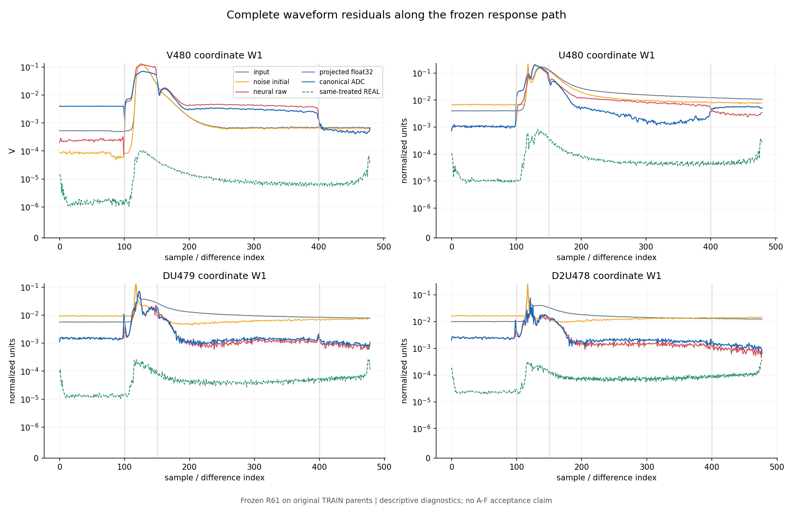
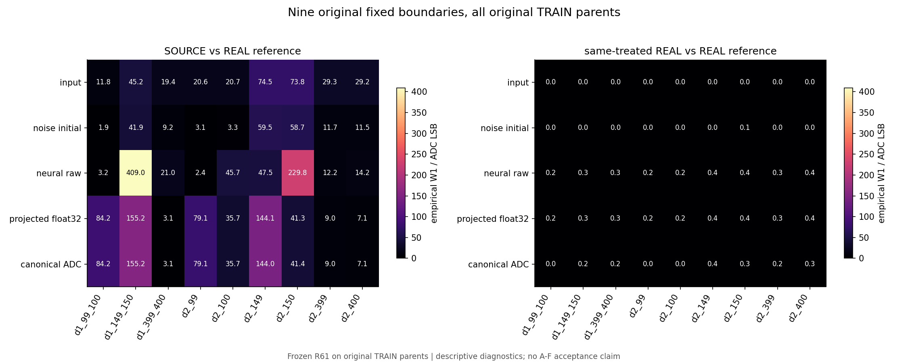
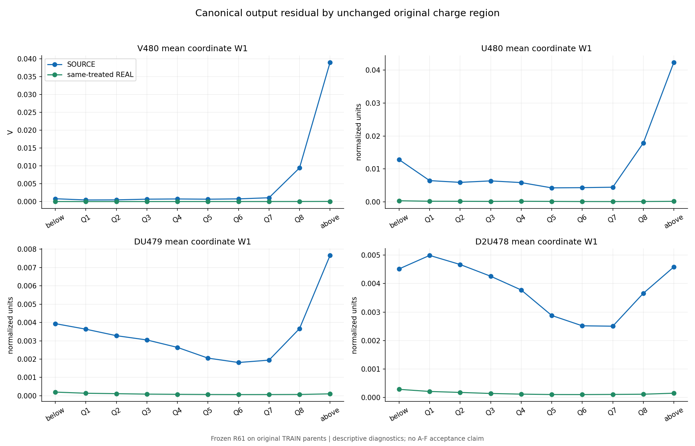
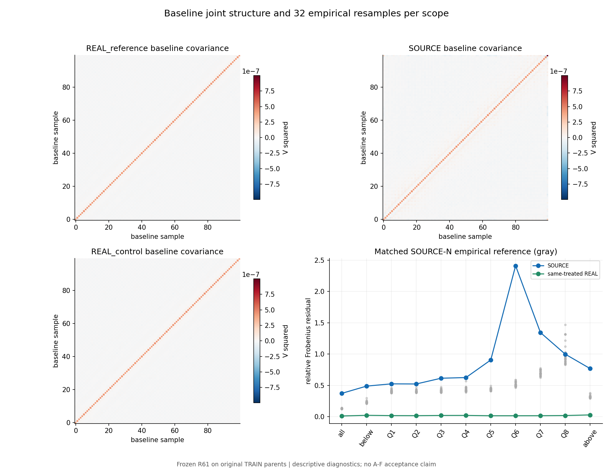
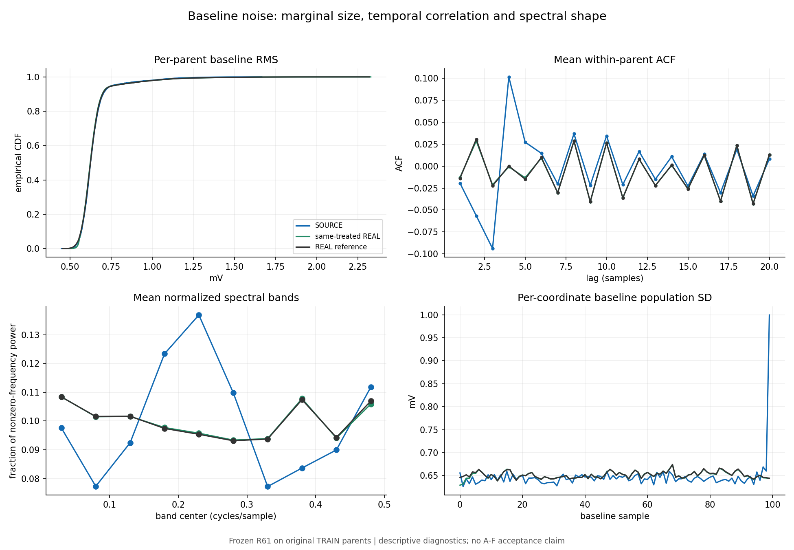
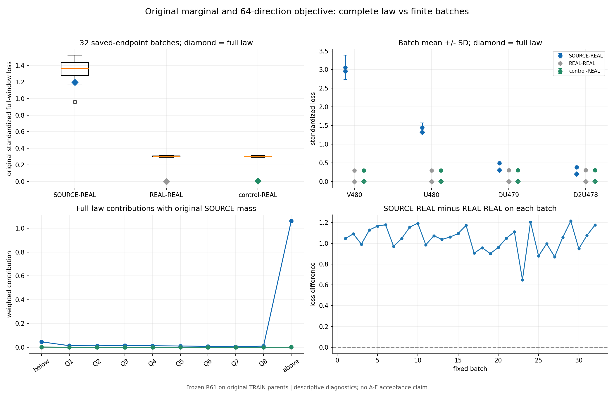
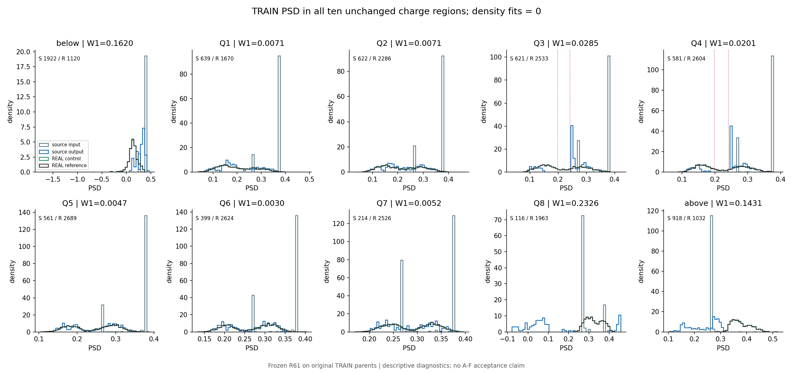
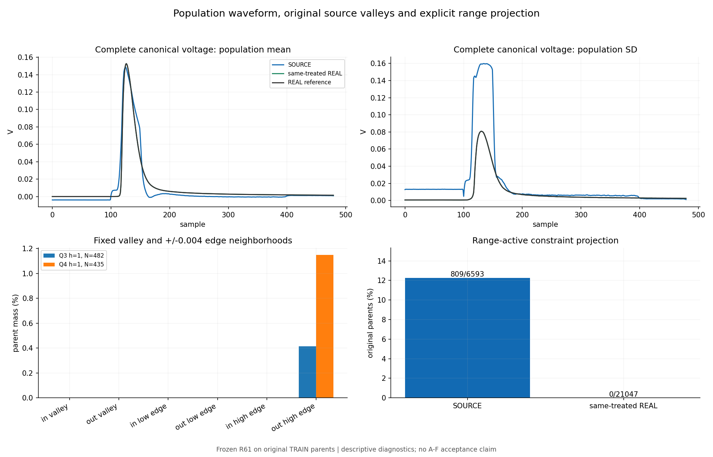

# R62：冻结完整 TRAIN 波形残差诊断

固定诊断完成。两个预设描述标记均触发：神经映射后150点附近有2/3项边界W1增量超过1 LSB；支持内7/8区的SOURCE基线协方差残差超过同处理REAL及全部32次经验参照。这些是TRAIN描述，不是因果检验或新模型验收。R61原A/B/C失败保持，长期目标仍需同一冻结方法满足原A–F。

冻结R61唯一50000步权重、五个执行模块及八个输入文件。全6593 SOURCE与21047 REAL保持原父顺序、等父权重和十个原始电荷区域，各执行一次固定噪声Heun128；共27640条实际神经前向、433次网络调用、7075840个数学场求值行。另完成32批已保存端点的重采样，无新增神经前向。0训练、求导、教师、HGB或密度拟合，0 DEV/EVAL/CAL解码。

逐父保留原输入、加噪初态、投影前神经端点、原约束投影后float32与共同ADC五个阶段。完整波形仅用于本次内存统计；保存全480坐标和差分、固定边界、均值/标准差、逐父紧凑量及实际输出SHA。中间非量化状态只用于路径描述，不替代原验收表示。

| 全TRAIN SOURCE固定边界 | 加噪初态W1 / LSB | 神经投影前W1 / LSB | 增量 / LSB | 最终共同ADC W1 / LSB |
|---|---:|---:|---:|---:|
| d1_99_100 | 1.8583347 | 3.150191 | 1.2918563 | 84.209814 |
| d1_149_150 | 41.912464 | 409.03599 | 367.12352 | 155.22116 |
| d1_399_400 | 9.2329925 | 21.012988 | 11.779995 | 3.0948936 |
| d2_99 | 3.0742571 | 2.3958604 | -0.67839666 | 79.067104 |
| d2_100 | 3.3317579 | 45.679476 | 42.347718 | 35.670218 |
| d2_149 | 59.523256 | 47.488501 | -12.034754 | 144.03987 |
| d2_150 | 58.739162 | 229.82996 | 171.0908 | 41.361949 |
| d2_399 | 11.729298 | 12.166148 | 0.43685062 | 8.9909569 |
| d2_400 | 11.531988 | 14.222014 | 2.690026 | 7.0654208 |

预定判定只使用d1_149_150、d2_149、d2_150三项，结果依次为是/否/是。全部九项和所有时间坐标照列。全TRAIN含支持外与范围投影事件，不能把此表数值直接替代R61固定DEV的边界门。

| 原范围 | SOURCE N | REAL N | SOURCE协方差相对Frobenius误差 | 同处理REAL误差 | 32次经验参照[min,max] | 超出全部参照及REAL控制 |
|---|---:|---:|---:|---:|---:|---|
| all | 6593 | 21047 | 0.373103 | 0.012193025 | [0.12485117, 0.14405853] | 是 |
| below | 1922 | 1120 | 0.48896087 | 0.022824401 | [0.21008085, 0.29963569] | 是 |
| Q1 | 639 | 1670 | 0.52487243 | 0.018101687 | [0.37997347, 0.45676764] | 是 |
| Q2 | 622 | 2286 | 0.52308613 | 0.017337873 | [0.38432124, 0.47118617] | 是 |
| Q3 | 621 | 2533 | 0.61481709 | 0.020405302 | [0.38544687, 0.47579929] | 是 |
| Q4 | 581 | 2604 | 0.62517471 | 0.021238847 | [0.3904826, 0.56785256] | 是 |
| Q5 | 561 | 2689 | 0.90569156 | 0.015939489 | [0.41097642, 0.49399063] | 是 |
| Q6 | 399 | 2624 | 2.4097373 | 0.016089679 | [0.46298698, 0.59082705] | 是 |
| Q7 | 214 | 2526 | 1.343718 | 0.016614713 | [0.62599304, 0.77327067] | 是 |
| Q8 | 116 | 1963 | 0.99829569 | 0.0194667 | [0.8320937, 1.4694849] | 否 |
| above | 918 | 1032 | 0.76878181 | 0.029219051 | [0.29141778, 0.37869641] | 是 |

基线协方差由每父前100点先去自身均值后计算。经验参照从本TRAIN原REAL有放回抽取，样本数与相应SOURCE一致；它不是总体95%置信区间、独立采集或粒子真值。Q8未超过全部32次参照，保留该否定结果。

基线RMS的总体经验CDF接近，但完整ACF1–20与频谱仍显示差异：SOURCE在短滞后处和中间频带偏离REAL，同处理REAL较接近。已保存100×100协方差、全部31个逐父描述量和十个含正确Nyquist权重的频带。频率只以cycles/sample报告。不能从图中的周期外观直接宣称某个网络层是唯一原因。

| 原标准化全窗目标 | 完整经验分布损失 | 32批均值 | 32批SD |
|---|---:|---:|---:|
| SOURCE–REAL | 1.1964174 | 1.3462647 | 0.12068125 |
| REAL–REAL | 0 | 0.3044509 | 0.0061316149 |
| 同处理REAL–REAL | 0.0074446101 | 0.30318077 | 0.0060024271 |

各批十个原区域分别抽32父事件，使用固定64方向和原SOURCE区域质量；完整分布使用精确不等样本经验W1。完整REAL–REAL为0，而有限批均值为0.3044509，显示明显抽样底噪。SOURCE的损失仍明显高于此描述性参照，不能把当前残差都解释成小批量误差。此处没有重新估计置信区间或训练收敛判据。

高端支持外区贡献完整SOURCE目标的88.73%。该标量贡献不证明内外梯度冲突；R60三个预定冲突标记未触发的结论保持。全部原父事件、区域质量及支持外区继续保留。

完整TRAIN SOURCE总体PSD W1=0.0036046785，共同Q1–7等区均值=0.010809827；同处理REAL总体W1=0.00036446004。这不覆盖原DEV验收。

| 原电荷区域 | SOURCE N | REAL N | SOURCE PSD W1 | 同处理REAL PSD W1 |
|---|---:|---:|---:|---:|
| below | 1922 | 1120 | 0.16198983 | 0.0028353481 |
| Q1 | 639 | 1670 | 0.007115401 | 0.00058985176 |
| Q2 | 622 | 2286 | 0.0070683703 | 0.0011637541 |
| Q3 | 621 | 2533 | 0.028470763 | 0.00048716701 |
| Q4 | 581 | 2604 | 0.020103315 | 0.00070206778 |
| Q5 | 561 | 2689 | 0.0047060177 | 0.00054374152 |
| Q6 | 399 | 2624 | 0.0030236953 | 0.00049930143 |
| Q7 | 214 | 2526 | 0.0051812293 | 0.00031655579 |
| Q8 | 116 | 1963 | 0.23257368 | 0.00027116007 |
| above | 918 | 1032 | 0.14313915 | 0.00030624224 |

源PSD与Q的Spearman分别为0.45989121 / 0.99999976。Q3/Q4 h==1分母为482/435，两区硬谷比例仍为0；谷高边界±0.004邻域的输出质量为0.4149% / 1.1494%。全十区和完整直方图范围保留，本轮未拟合峰位或峰宽。

| 全TRAIN投影 | 范围活跃事件/N | 电压端点采样总数 | 每事件修正RMS均值/V | 最大修正RMS/V | 最大preADC相对Q误差 |
|---|---:|---:|---:|---:|---:|
| SOURCE | 809/6593 | 24189 | 0.012010832 | 0.20909317 | 2.2190547e-08 |
| REAL_control | 0/21047 | 0 | 0 | 0 | 4.0914771e-08 |

CPU/CUDA人工测试核验观测版与原solve的float32输出逐位一致。首个服务器尝试在解码TRAIN前因跨NumPy/CUDA的float64 ADC电压逐位断言退出1；实际整数ADC码完全一致，最大电压差为1.1102230246251565e−16 V。只将该人工跨后端断言改为整数码严格一致且电压差不超过float64机器epsilon；模型、原求解器逐位要求、物理精度门和A–F均未改。原代码、日志和原生失败回执保存在repairs/ADC_CHECK_001。成功重试之后才首次读取TRAIN。

三条完整人口随机流与R60实际消费SHA一致。本机从保存索引和原种子重建全部八条随机流、末状态与链式SHA，并独立重算坐标归约、协方差残差、逐父描述W1、损失权重、PSD/谷区和投影汇总。该复核没有新的模型前向或原TRAIN波形读取；它是保存产物审计，不冒充额外完整模型重放。权重张量SHA前后均为`23fb626bb16032eb8b5d319992e6444044e71f611c4cef567eceb9d4574fdd5c`。

成功及失败两个科学worker累计96.904082秒；成功worker峰值RSS 4005302272 B，GPU allocated/reserved峰 83334144 / 106954752 B。RSS查询失败3次，原因保持原回执；GPU查询失败0次。实际PID已不存在，无活跃科学作业。CPU12/RSS48GiB/GPU10GiB安全限制及无计算配额政策保持。

八张原图已全部打开核对。第一张W1图自动坐标扩展到了无意义的负值区域，新增独立显示版本仅把y轴下限设为0；原图、原脚本、统计与科学RESULT不变。显示版本再次打开确认，无裁切或标签重叠。

封存R62固定诊断。下一轮预登记全窗训练目标的覆盖扩展：保留R61神经网络、全部原TRAIN父事件和区域权重、输入噪声与精确电荷/ADC构造，从同一初始化重新训练；在原七项损失基础上，显式约束基线多滞后/频带的联合分布，并提高全窗各坐标及一阶二阶差分局部残差的可见性。固定所有TRAIN标准化、损失公式及唯一训练末点后再运行，使用原数值门、完整A–C和独立重放判断；通过后才继续D/E。当前尚未登记或开始下一轮训练，不续训R61，不修改原A–F、源人口或R60否定标记，也不重开R37固定高斯校准或R39固定MMD配方。

[协议](tasks/R62_FROZEN_FULL_WAVEFORM_RESIDUAL_001.md) · [完整结果](work/R62_FROZEN_FULL_WAVEFORM_RESIDUAL_001/RESULT.json) · [路径统计](work/R62_FROZEN_FULL_WAVEFORM_RESIDUAL_001/PATH_SUMMARY.json) · [基线联合结构](work/R62_FROZEN_FULL_WAVEFORM_RESIDUAL_001/BASELINE_JOINT_SUMMARY.json) · [目标覆盖](work/R62_FROZEN_FULL_WAVEFORM_RESIDUAL_001/LOSS_COVERAGE_SUMMARY.json) · [复核](work/R62_FROZEN_FULL_WAVEFORM_RESIDUAL_001/FROZEN_ARTIFACT_REVIEW.json) · [复现](work/R62_FROZEN_FULL_WAVEFORM_RESIDUAL_001/REPRODUCTION.md) · [后续判断](reviews/R62_ROOT_DIRECTION_001.json)

