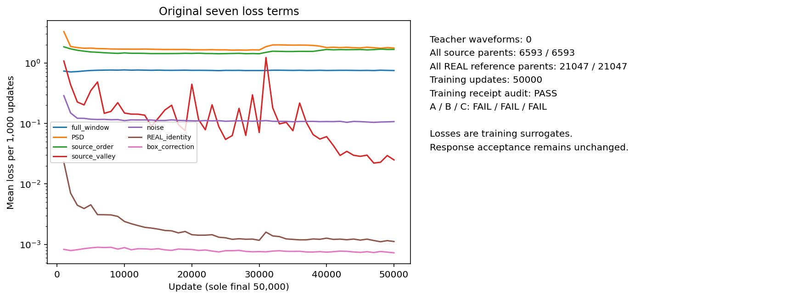
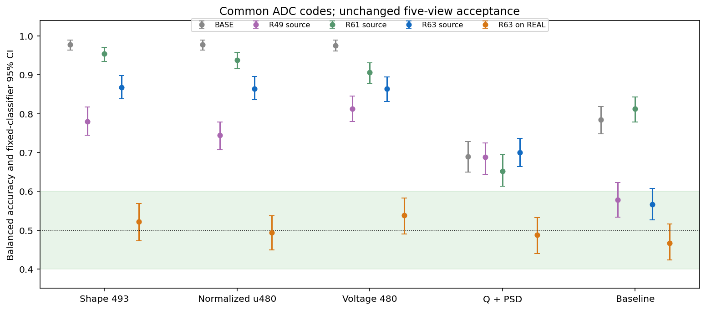
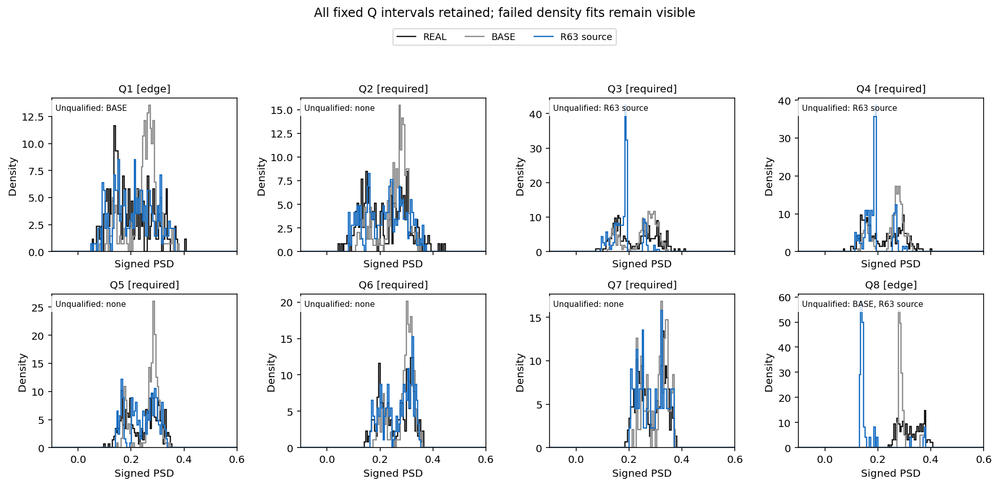
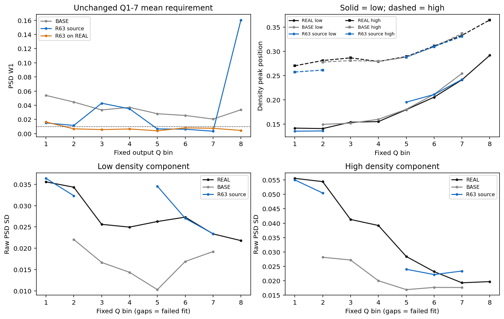
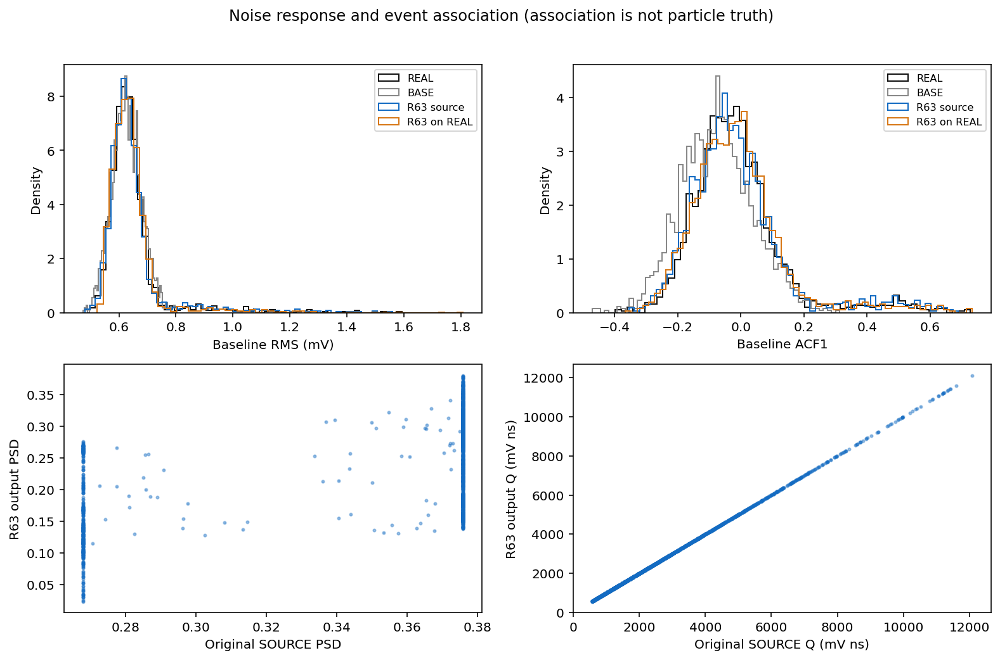
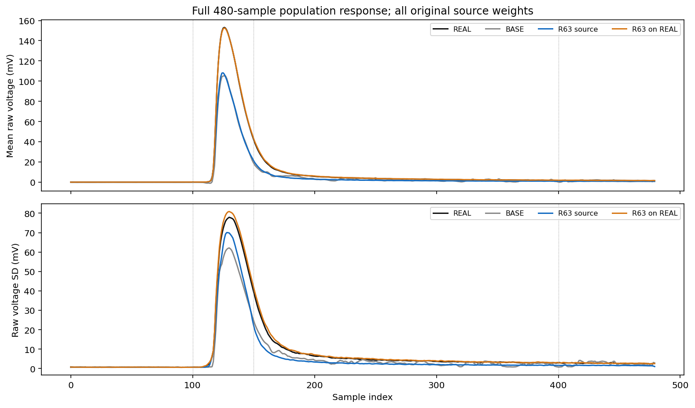
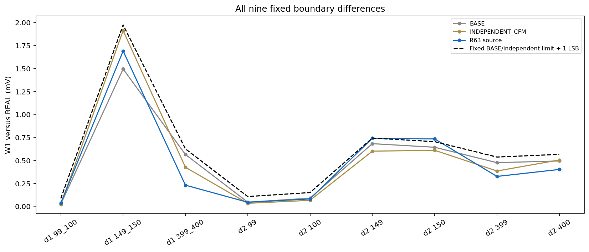
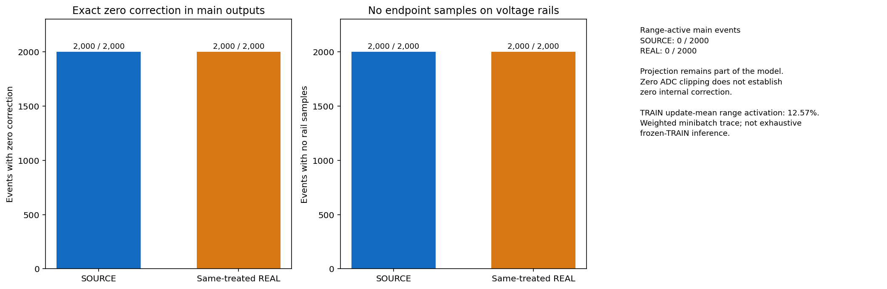
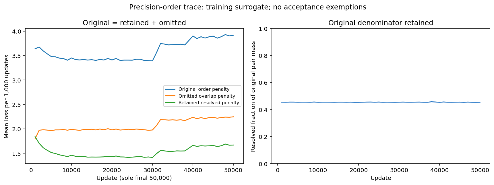
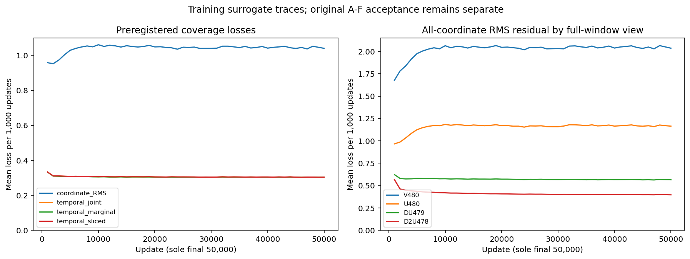

# R63：全窗坐标与基线时序联合分布覆盖

原 A/B/C：A 未通过 / B 未通过 / C 未通过。本轮固定末点已经完成训练、数值检查、评价和独立重放；完整模型目标仍需同一方法满足原 A–F。

本轮在冻结 R61 七项损失之上增加全坐标经验 W1 的 RMS 池化，以及31维基线RMS/lag1–20相关性/10频带的边缘与切片联合分布损失，两项系数均1。全部6593源和21047 REAL父事件、网络、初始化、六条原随机流、曝光次数、原标准化、噪声及电荷/ADC构造保持。新增TRAIN时序常数在首个更新前按原REAL区域固定；投影方向使用独立第七条随机流。唯一50000步末点，不按评价选参。

| 共同 ADC 表示下的视图 | SOURCE BA [95% CI] | 同处理 REAL BA [95% CI] |
|---|---:|---:|
| full_historical_shape | 0.868 [0.837987, 0.897838] | 0.522 [0.472884, 0.568207] |
| normalized_u480 | 0.864 [0.836236, 0.895806] | 0.494 [0.449109, 0.536612] |
| full_voltage | 0.864 [0.831015, 0.894372] | 0.538 [0.489492, 0.583034] |
| Q_PSD_2D | 0.700 [0.663404, 0.736061] | 0.488 [0.439634, 0.532282] |
| baseline_local | 0.566 [0.526975, 0.607781] | 0.466 [0.422887, 0.516020] |

A 要求全部十个区间完整位于 [0.40,0.60]，使用未舍入数值判定。RAW REAL–REAL、BASE、R49 和 R61 比较复用已冻结结果；本轮没有重新拟合历史对照。

| 相对冻结 R61 的配对 BA 差 | SOURCE ΔBA [95% CI] | 同处理 REAL ΔBA [95% CI] |
|---|---:|---:|
| full_historical_shape | -0.086 [-0.117660, -0.054723] | +0.004 [-0.042015, +0.048977] |
| normalized_u480 | -0.074 [-0.104969, -0.041108] | -0.008 [-0.059606, +0.036364] |
| full_voltage | -0.042 [-0.076609, -0.008283] | +0.028 [-0.013020, +0.069446] |
| Q_PSD_2D | +0.048 [+0.003796, +0.091211] | -0.022 [-0.057241, +0.013256] |
| baseline_local | -0.246 [-0.299117, -0.193832] | -0.046 [-0.089881, -0.000430] |

配对区间使用相同留出身份、组和 500 次 bootstrap，条件于两个冻结分类器。一致性审计支持同一网络和原随机流下的固定目标扩展比较，不能区分两个新增项各自的因果贡献；一个训练种子不能估计重复训练波动，历史单次采集也不能证明独立采集收益。

总体 PSD W1=0.017431165；固定共同 Q1–7 等权平均 W1=0.017282995。两个原阈值均为 0.010。

| 成分 | 必需 Q2–7 峰位 MAE | raw SD 平均相对误差 | 必需区密度拟合失败 |
|---|---:|---:|---|
| 低峰 | 未定义 | 未定义 | [3, 4] |
| 高峰 | 未定义 | 未定义 | [3, 4] |

全部八区及失败密度拟合保留。原始源 purehad Q3/Q4 分母为 213/181；旧 postADC 定义的 207/182 另列，不混用。密度成分不是粒子真值。

| 原阶段门 | 结果 |
|---|---|
| gate1_complete_response | 通过 |
| gate2_PSD_width_centers_noise | 未通过 |
| gate3_source_preservation | 通过 |
| gate4_boundary_source | 未通过 |
| gate5_same_treated_REAL_control | 通过 |
| gate6_numerical_replay | 通过 |

| 原始源 purehad 区 | N | 输出谷比例 | BASE 谷比例 | 增量 | 结果 |
|---|---:|---:|---:|---:|---|
| bin3 | 213 | 0 | 0.056338028 | -0.056338028 | 通过 |
| bin4 | 181 | 0 | 0.0055248619 | -0.0055248619 | 通过 |

| 全人口源关联 | 输出 Spearman | BASE Spearman | 结果 |
|---|---:|---:|---|
| source_Q_to_output_Q | 0.99999941 | 0.99972601 | 通过 |
| source_PSD_to_output_PSD | 0.37452202 | 0.41898984 | 通过 |

| 噪声量 | 候选 W1 | BASE W1 | 相对变化 |
|---|---:|---:|---:|
| baseline_RMS_V_overall_W1 | 6.111354e-06 | 1.9358299e-05 | -68.430% |
| ACF1_overall_W1 | 0.0082199619 | 0.064234934 | -87.203% |

模型内包含预登记的电压范围与原电荷联合欧氏投影。下表明确报告其影响；后续 ADC 的零裁剪不能说明内部没有修改波形。

| 人口 | 触发范围投影事件 / N | 投影修正 RMS 均值 (V) | 最大单点修正 (V) | 电压上下限采样点总数 |
|---|---:|---:|---:|---:|
| SOURCE | 0 / 2000 | 0 | 0 | 0 |
| 同处理 REAL | 0 / 2000 | 0 | 0 | 0 |

支持内外及原电荷区域的投影统计见 `CONSTRAINT_PROJECTION_SUMMARY.json`。TRAIN 的逐更新记录是按原区域质量加权的小批量估计；不是冻结模型对全 TRAIN 的再次推理。固定 TRAIN 数值探针也保留每事件投影记录。

| 冻结设计一致性核验 | 结果 |
|---|---|
| R61_initial_state_equal | 通过 |
| R61_original_six_consumed_streams_equal | 通过 |
| R61_parent_arrays_and_exposures_equal | 通过 |
| R61_original_six_final_PCG64_states_equal | 通过 |
| R61_frozen_distribution_statistics_byte_identical | 通过 |
| extension_receipt_assertions_match | 通过 |
| precision_trace_complete_finite_nonnegative | 通过 |
| original_order_equals_resolved_plus_omitted | 通过 |
| original_pair_mass_and_resolved_fraction_valid | 通过 |
| precision_intervals_cover_original_source_and_match_R61 | 通过 |
| precision_rule_frozen_original_denominator | 通过 |
| coverage_trace_complete_finite_nonnegative | 通过 |
| original_seven_trace_decomposition | 通过 |
| new_terms_trace_match | 通过 |
| temporal_half_sum | 通过 |
| coordinate_four_view_mean | 通过 |
| nine_terms_sum | 通过 |
| temporal_constants_shape_finite_floors | 通过 |
| temporal_constants_saved_metadata_equal | 通过 |
| temporal_constants_hash_and_preupdate_record | 通过 |
| independent_seventh_stream_consumption_reconstructed | 通过 |
| all_nine_outer_weights_one | 通过 |

原排序罚 = 保留可分辨罚 + 省略重叠罚，全部50000步分解最大绝对残差 1.7763568e-15。下表为逐更新小批量记录均值，不是冻结模型全TRAIN评价。

| 排序训练记录 | 逐更新均值 |
|---|---:|
| original_order_loss | 3.5932515 |
| omitted_order_loss | 2.0678124 |
| original_nonzero_pair_mass | 0.99511528 |
| resolved_pair_fraction | 0.4549019 |

R60 三个预设冲突标记均未触发的结论保持；R62 两个描述标记为另行预登记的覆盖扩展提供依据，不能据此声称识别唯一原因。

| 新增覆盖训练记录 | 逐更新均值 |
|---|---:|
| original_seven_total | 4.3513127 |
| coordinate_RMS | 1.0410591 |
| temporal_joint | 0.30599986 |
| temporal_marginal | 0.30559461 |
| temporal_sliced | 0.30640512 |
| V480_coordinate_RMS | 2.0231798 |
| U480_coordinate_RMS | 1.1566446 |
| DU479_coordinate_RMS | 0.57176847 |
| D2U478_coordinate_RMS | 0.41264346 |

首个本机人工检查因 sqrt(1e-20) 与 Python 常量相差 1.29247e-26 V 而触发精确相等断言；修正为 float64 epsilon 范围比较后，CPU/CUDA 全部人工检查通过。损失、系数、数据、原A–F未变；原失败和源文件已保存。科学 worker 失败尝试数量：0，全部纳入资源回执。

网络位移只依赖当前输入、噪声和电荷条件，作为时间/状态常数场执行原 Heun128；缓存一次神经预测不代表省略数值检查。TRAIN 128/256 差 median=0 LSB，p95=0 LSB；preADC 最大相对电荷误差=1.4915942e-08，原阈值仍为 0.25 / 1 LSB 和 1e-5。

主输出和探针合计 5984 条；实际网络行数 5984，数学场求值行数 1531904。新 HGB 10 次、密度描述槽 16 个，4000 条独立进程重放通过可移动入口逐位一致。

训练回执核验：通过；源/REAL参考/REAL保持实际唯一父事件 [6593, 21047, 21047]，消费行数分别为 16000000 / 16000000 / 3200000。它们是重复曝光，不能当作独立新事件。原六条随机流与R61完全匹配；独立重构第七条流的全部消费字节和末状态。22列损失、9列新增覆盖分解、精度排序分解和父事件曝光次数完整保存。

六个成功阶段均原生退出 0；计入已保留失败尝试，共 6 个科学 worker 的实际耗时合计 5181.726837 秒；worker 峰值 RSS 2925600768 B。模型训练 GPU allocated / reserved 峰 2970884096 / 3477078016 B。无计算时间配额；机器安全限制保留。

本轮训练没有解码验证波形，训练结束后按预登记方案读取历史 DEV；最终 EVAL 和新 CAL 波形未解码。单次历史采集与固定评价器的通过不等于独立采集或物理逐事件对应关系得到证明。

封存R63固定覆盖扩展末点，保留基线和部分全窗区分度改善、但PSD与必需密度拟合退化且原A–C仍失败的结论。下一轮先预登记仅用合法TRAIN的冻结R63端点、条件参照几何及小批量梯度诊断：保持全部原父事件和区域质量、旧及新增TRAIN常数，共用固定端点检查31维基线与全窗统计残差、同量REAL抽样底噪和电荷均值约束，再以明确的有限经验参照核对4×32与128的分布梯度。每父固定噪声与原每次出现独立噪声的区别必须单列；先完成人工值/梯度/重复父/两遍VJP检查再运行。据TRAIN证据决定后续机制，不续训或择取R63检查点，不自动添加特征或增大训练批量，不改变原A–F、源人口及R60阴性结论；本候选不启动D/E。

[协议](tasks/R63_FULL_WAVEFORM_COVERAGE_RESPONSE_001.md) · [验收](work/R63_FULL_WAVEFORM_COVERAGE_RESPONSE_001/ACCEPTANCE_A_C.json) · [指标](work/R63_FULL_WAVEFORM_COVERAGE_RESPONSE_001/METRICS_COMPACT.json) · [R61 比较](work/R63_FULL_WAVEFORM_COVERAGE_RESPONSE_001/PAIRED_R63_MINUS_R61.json) · [复现](work/R63_FULL_WAVEFORM_COVERAGE_RESPONSE_001/REPRODUCTION.md) · [数值](work/R63_FULL_WAVEFORM_COVERAGE_RESPONSE_001/TRAIN_SOLVER_CHECK.json) · [投影](work/R63_FULL_WAVEFORM_COVERAGE_RESPONSE_001/CONSTRAINT_PROJECTION_SUMMARY.json) · [重放](work/R63_FULL_WAVEFORM_COVERAGE_RESPONSE_001/REPLAY_RECEIPT.json)

