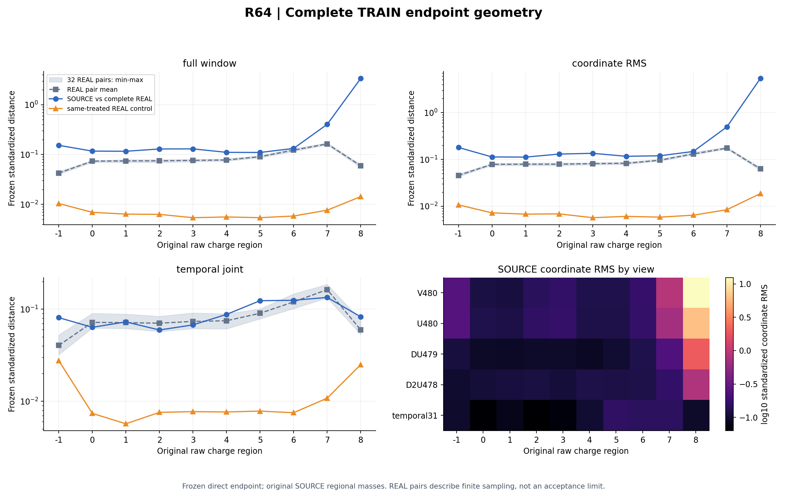
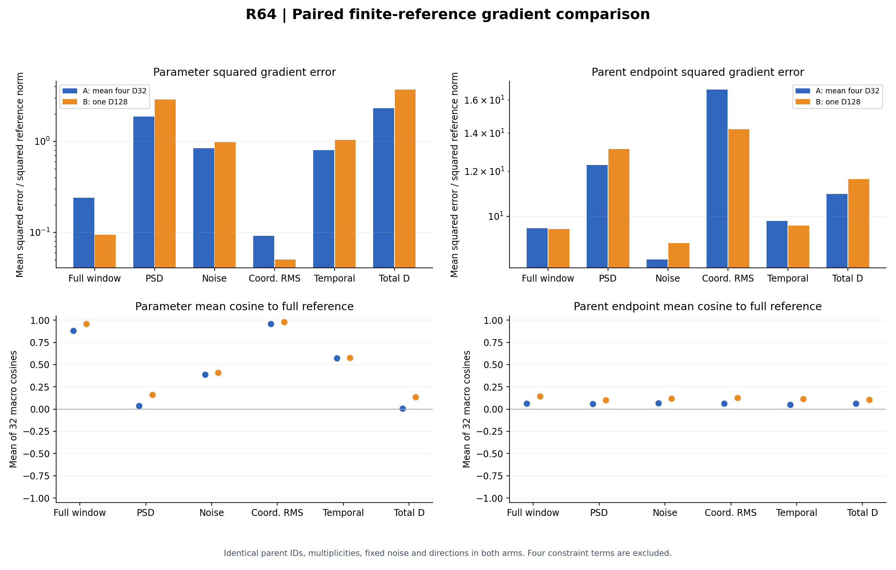
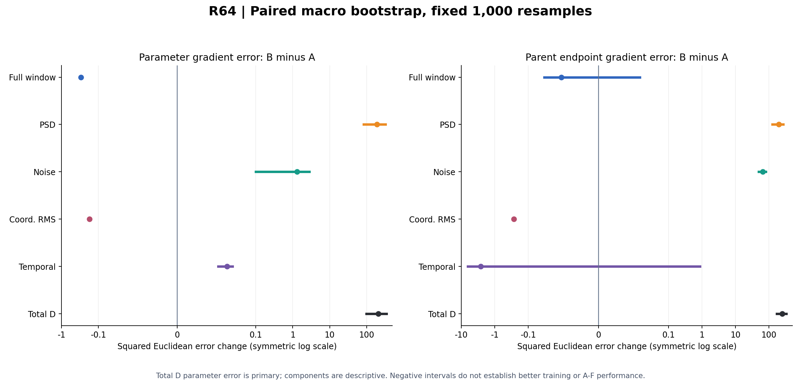
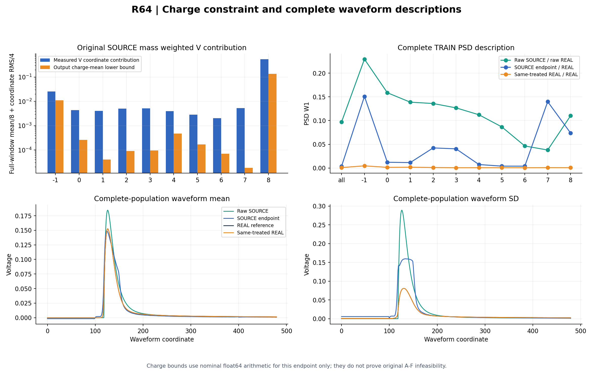

# R64：冻结 TRAIN 完整参照与分布梯度诊断

封存R64固定诊断：联合128的参数total_D均方误差比四个32批的平均增加206.362353，原95%配对区间[99.051001,343.486026]。两空间全部分量的32宏均值更接近参照，但总经验离散度增加更多；本次不支持采用B128作为梯度误差改进。完整几何残差和全部支持外父事件保留，未证明原A–F不可行。

本次诊断已到预登记终点，没有新增候选模型或重判原 A–F。R63 的原 A/B/C 失败保持，应用长期目标仍为 active。

冻结 R63 唯一权重，完整保留6593个 SOURCE、21047个 REAL 原父事件、顺序及各自区域质量。先按原直接训练端点和固定每父噪声采集全人口，再计算五项 D 的完整有限经验参照。32组比较共享每区128次有放回抽样：A为四个32槽损失的平均，B为同一128槽联合损失。原 source_order、source_valley、REAL_identity、box_correction 四项 C 不进入本次梯度比较。

五项 D 包括 full_window、PSD、noise、coordinate_RMS、temporal_joint，外权重均为1。SOURCE及REAL独立使用原区域质量；重复出现的父事件保留其发生质量和梯度累加。总体训练分布的质量实现先按 binary64 构造 count/total/K，再将其精确整数比归一化；没有把它称为理想实数分数的位级实现。32到128的二次幂比例保持两臂相同的已表示区域质量。

| 完整 CUDA 五项 D 参照 | 数值 |
|---|---:|
| full_window | 0.588116722 |
| PSD | 1.04246386 |
| noise | 0.0265784571 |
| coordinate_RMS | 0.878239523 |
| temporal_joint | 0.0811730214 |
| total_D | 2.61657159 |

下列误差使用原参数向量或原父端点坐标的平方欧氏范数，不除以坐标维数。total_D 是先将五个梯度向量相加再计算误差，不是五项平方误差的和。唯一主比较是参数空间 total_D 的配对 B−A 平均平方误差；其1000次百分位95%区间以宏组为重采样单位。端点空间及五个分量是次要描述，区间没有多重比较校正。

| 参数空间：分量 | A相对均方误差 | B相对均方误差 | A平均cos | B平均cos | 原始B−A均方误差 | 配对95%区间 |
|---|---:|---:|---:|---:|---:|---|
| full_window | 0.239180936 | 0.0945056656 | 0.879464927 | 0.95892936 | -0.299243468 | [-0.304184748, -0.29433366] |
| PSD | 1.85874423 | 2.87960086 | 0.0385157227 | 0.162743299 | 190.97643 | [83.3332105, 325.508408] |
| noise | 0.835805789 | 0.978671714 | 0.388432168 | 0.407608771 | 1.29885275 | [0.0987946075, 2.78625514] |
| coordinate_RMS | 0.0920633528 | 0.0504565087 | 0.957446869 | 0.979095122 | -0.173628985 | [-0.179195893, -0.168291624] |
| temporal_joint | 0.803056756 | 1.03546716 | 0.574246346 | 0.577514654 | 0.0167497145 | [0.00956131054, 0.0235860642] |
| total_D | 2.29983209 | 3.67558916 | 0.00847178981 | 0.133803131 | 206.362353 | [99.0510009, 343.486026] |

| 端点空间：分量 | A相对均方误差 | B相对均方误差 | A平均cos | B平均cos | 原始B−A均方误差 | 配对95%区间 |
|---|---:|---:|---:|---:|---:|---|
| full_window | 9.5363115 | 9.49695777 | 0.0637410432 | 0.142670305 | -0.0103935078 | [-0.0331275339, 0.0139321642] |
| PSD | 12.3037587 | 13.1275467 | 0.0599543577 | 0.0994553567 | 196.450258 | [126.822163, 268.692588] |
| noise | 8.40037588 | 8.97364959 | 0.0669197669 | 0.116586039 | 65.2408095 | [49.73658, 80.9524316] |
| coordinate_RMS | 16.6740342 | 14.2212381 | 0.0614204091 | 0.128615039 | -0.271244314 | [-0.290185105, -0.249840467] |
| temporal_joint | 9.80978538 | 9.63177383 | 0.049877839 | 0.112361446 | -2.65360614 | [-6.37582335, 0.879003919] |
| total_D | 10.9440863 | 11.616813 | 0.0629721032 | 0.10542165 | 251.754958 | [172.742456, 332.351271] |

| total_D 有限样本分解 | 均方误差 | 均值梯度偏离参照的平方 | 经验离散度 |
|---|---:|---:|---:|
| 参数 A | 344.972792 | 202.122264 | 142.850528 |
| 参数 B | 551.335145 | 123.189605 | 428.14554 |
| 端点 A | 4095.61308 | 370.344322 | 3725.26876 |
| 端点 B | 4347.36804 | 301.690983 | 4045.67705 |

有限样本恒等式“均方误差=均值梯度偏离平方+经验离散度”在两空间全部分量及总向量均通过原数值容差。这是当前固定参照下的32组经验分解，不是总体无偏 bias/variance 估计。端点和参数误差的范数不同；神经网络的链式映射不保序，不能跨空间直接比较误差大小。

| 原SOURCE质量加权几何项 | SOURCE | 同处理REAL | 32对REAL均值 | 32对REAL[min,max] |
|---|---:|---:|---:|---|
| full_window | 0.588116721 | 0.00850446065 | 0.0676187919 | [0.0661264317, 0.0687270178] |
| coordinate_RMS | 0.878239523 | 0.00945171227 | 0.0720185406 | [0.0707183543, 0.0733087264] |
| temporal_joint | 0.0811730213 | 0.0157378448 | 0.0656186375 | [0.0607068657, 0.0696533459] |

每个 REAL 参照从相应原区域有放回抽取两份与 SOURCE 数量相同的样本。32个数值的范围不是置信区间；两份有限REAL样本与SOURCE对完整REAL的设计也不同。该参照仅用于三项几何量，不扩展为 PSD 或 noise 的抽样底噪。完整几何使用冻结 NumPy 实现，梯度参照使用 CUDA；按协议不要求两个后端逐位一致。

| 原区域 | SOURCE/REAL N | full_window | coordinate_RMS | temporal_joint | V坐标名义下界/观测贡献 |
|---|---:|---:|---:|---:|---:|
| all | 6593/21047 | 0.490049194 | 0.757786771 | 0.0343250779 | 未定义 |
| below | 1922/1120 | 0.153088084 | 0.180177071 | 0.0810751164 | 0.443677182 |
| Q1 | 639/1670 | 0.117194257 | 0.113118948 | 0.0636641498 | 0.060256991 |
| Q2 | 622/2286 | 0.116331114 | 0.112172117 | 0.072837756 | 0.00989129768 |
| Q3 | 621/2533 | 0.129370457 | 0.130223403 | 0.0595241265 | 0.0182311899 |
| Q4 | 581/2604 | 0.129936598 | 0.135130404 | 0.0676256506 | 0.0181869054 |
| Q5 | 561/2689 | 0.110760316 | 0.116804115 | 0.0879151185 | 0.117699866 |
| Q6 | 399/2624 | 0.110031082 | 0.119635071 | 0.123865402 | 0.0590984956 |
| Q7 | 214/2526 | 0.132849473 | 0.148062825 | 0.125134561 | 0.0341411764 |
| Q8 | 116/1963 | 0.403770601 | 0.494208221 | 0.134475425 | 0.0034994875 |
| above | 918/1032 | 3.37563707 | 5.38150783 | 0.0827726278 | 0.246305182 |

all 行把各父所在区域的标准化坐标汇成总体分布，与按原质量加权的十区目标分开解释。高端支持外人口保留918/6593，贡献比例及逐坐标定位见独立几何报告；它不能作为删事件或改权重的依据，标量损失贡献也不是梯度冲突证据。

输出特定电荷均值名义下界 B_V=0.146816248，V-only坐标贡献分母=0.603735794，比值=0.243179632；全部四视图 full_window+coordinate_RMS 分母=1.46635624，比值=0.100123179。两个分母明确区分。全部原名义不等式通过，但这只是当前浮点端点的下界紧致程度，不是因果归属比例、区间证书或模型无关的 A–F 不可行证明。

| 原范围 | raw SOURCE–REAL PSD W1 | 端点preADC–REAL W1 | 共同ADC–REAL W1 | 同处理REAL W1 | 原PSD–输出PSD秩 |
|---|---:|---:|---:|---:|---:|
| all | 0.0969298591 | 0.00349202029 | 0.00349008042 | 0.000886225682 | 0.188982617 |
| below | 0.229473036 | 0.150940823 | 0.150946834 | 0.00462384355 | 0.366573857 |
| Q1 | 0.158688854 | 0.012125333 | 0.0121124838 | 0.00139540055 | 0.322926371 |
| Q2 | 0.138836286 | 0.0114308247 | 0.011445716 | 0.00172305436 | 0.511432586 |
| Q3 | 0.135975389 | 0.0423739995 | 0.0423696323 | 0.00106298534 | -0.0348923717 |
| Q4 | 0.126806891 | 0.0404106357 | 0.0404047669 | 0.000606886484 | -0.136927335 |
| Q5 | 0.112250152 | 0.00730966622 | 0.0073131226 | 0.000640578048 | 0.520253986 |
| Q6 | 0.0865888068 | 0.00397223945 | 0.00396850826 | 0.000653767219 | 0.551183738 |
| Q7 | 0.0464768663 | 0.00390036975 | 0.0039001481 | 0.000597204867 | 0.716116827 |
| Q8 | 0.0379423843 | 0.139859536 | 0.139862474 | 0.000796472847 | 0.66234575 |
| above | 0.110222221 | 0.0737216094 | 0.0737213429 | 0.000706754205 | -0.00881710747 |

共同Q1–Q7等区 PSD W1均值=0.0173591968。以上是冻结直接 TRAIN 端点的支持描述，不能替代 R63 历史 DEV 密度拟合或原 A–C；本轮没有新密度拟合。全部九个边界、全窗均值和标准差、原电荷秩及每区支持均已保留。

| 原人口投影 | 范围活跃事件/N | 上下限采样点数 | 修正RMS均值/V | 最大preADC相对Q误差f32 |
|---|---:|---:|---:|---:|
| SOURCE | 830/6593 | 23374 | 0.00552978464 | 1.86488716e-08 |
| REAL_control | 0/21047 | 0 | 0 | 4.60622203e-08 |

CPU/CUDA 各69项人工分布值、端点梯度与重复父检查通过，真实 ResponseNetwork 人工两遍 VJP 检查也通过。科学计算的33次完整SOURCE重放、3432个原64行/最终1行分块均逐位核对投影端点、整数ADC码和严格Box自由掩码后才注入梯度。实际神经行数245209、调用3865次、参数VJP33800次、分布目标161次；0训练、更新、教师、HGB、密度拟合及DEV/EVAL/CAL解码。

独立本机核验从原种子重建九条随机流及父索引，重算所有保存参数向量的范数、点积、误差、中心化离散度及配对bootstrap；同时复核端点完整/均值向量和各宏组标量的代数关系，以及保存几何坐标归约和名义下界。未保存宏端点梯度逐坐标数组，本机没有执行第二轮网络或损失VJP；这些向量可用保存端点及固定索引复现。唯一冻结权重前后张量SHA均为 `626206f9c25281e18a2d58c82c70c9d4f32df7fb1d73788e588f59009ec924f3`，八个输入文件及原A–F字节绑定保持。

第一次部署在启动前因Windows清单分隔符与POSIX tar成员名不同而退出；当时没有科学worker或TRAIN读取。只规范包内路径并验证34份源码字节不变后启动唯一科学worker。原失败包与修复回执完整保留。科学worker原生退出0，耗时1149.25179秒，worker峰值RSS 4645408768 B，作业树峰值RSS 4645408768 B；GPU allocated/reserved峰 1398710272 / 1568669696 B。RSS查询失败2次，原事件和未知原因完整保留；本轮两次均晚于worker自身完成回执，未达到原监护程序“多于5次即终止”的规则，不补写为0次。GPU查询失败0次。实际PID已不存在。服务器CPU12/RSS48GiB/GPU10GiB、本机共同CPU4/RSS4GiB以及不设计算配额的政策保持。

四张图已实际打开复核，显示层更改若有则见 FIGURE_QA.json。本机新增源文件、数据、日志、缓存和临时文件保存在E/D；服务器产物位于已登记的阶段目录。

下一轮预登记完整有限TRAIN分布训练：从原R63同一初始化重新训练，每次更新对全部6593 SOURCE父事件各取一份新噪声，并对全部21047 canonical REAL计算原五项D。按原64行调度完成两遍缓存和全部参数VJP，将五项D的端点梯度合并后注入，原区域质量、标准化、损失权重、ADC/Box路径和原四项C定义保持。C每更新保留一个原320 SOURCE+64 REAL identity微批，原索引及每次出现独立噪声流保持；完整D噪声使用另行声明的流。保留原优化器及学习率日程，预先固定与R63相同的50000次更新为唯一末点；先完成联合五D梯度、原C取项与真实网络回放的CPU/CUDA人工检查，再训练，按原数值门、完整A–C及独立重放评价；通过后才继续D/E。不续训R63、不选择中间检查点、不删除或重权支持外人口，不重开R60阴性冲突标记。

[协议](tasks/R64_FROZEN_REFERENCE_GRADIENT_DIAGNOSTIC_001.md) · [结果](work/R64_FROZEN_REFERENCE_GRADIENT_DIAGNOSTIC_001/RESULT.json) · [参数梯度](work/R64_FROZEN_REFERENCE_GRADIENT_DIAGNOSTIC_001/PARAMETER_GRADIENT_SUMMARY.json) · [端点梯度](work/R64_FROZEN_REFERENCE_GRADIENT_DIAGNOSTIC_001/ENDPOINT_GRADIENT_SUMMARY.json) · [几何](work/R64_FROZEN_REFERENCE_GRADIENT_DIAGNOSTIC_001/ENDPOINT_GEOMETRY_SUMMARY.json) · [独立几何解释](reviews/R64_RESULT_ANALYSIS_001/geometry/REPORT.md) · [独立梯度解释](reviews/R64_RESULT_ANALYSIS_001/gradient/REPORT.md) · [复核](work/R64_FROZEN_REFERENCE_GRADIENT_DIAGNOSTIC_001/FROZEN_ARTIFACT_REVIEW.json) · [复现](work/R64_FROZEN_REFERENCE_GRADIENT_DIAGNOSTIC_001/REPRODUCTION.md) · [后续判断](reviews/R64_ROOT_DIRECTION_001.json)

